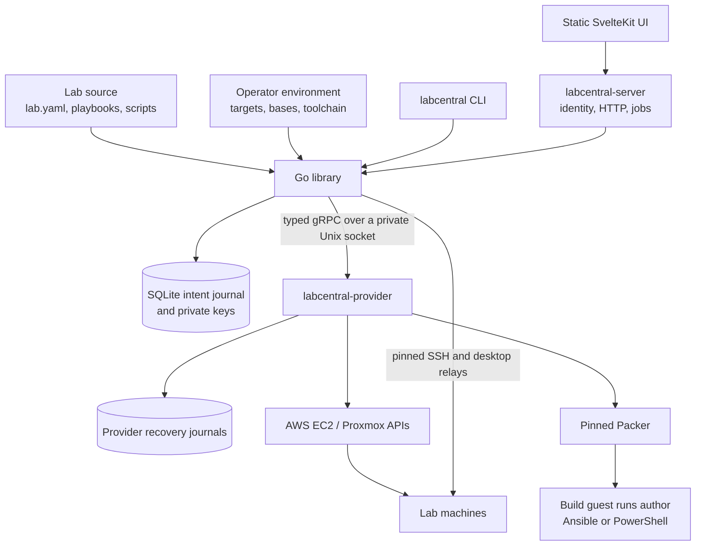
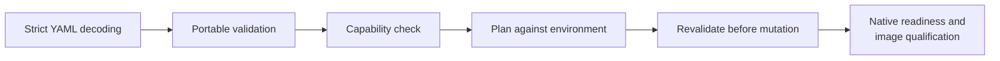
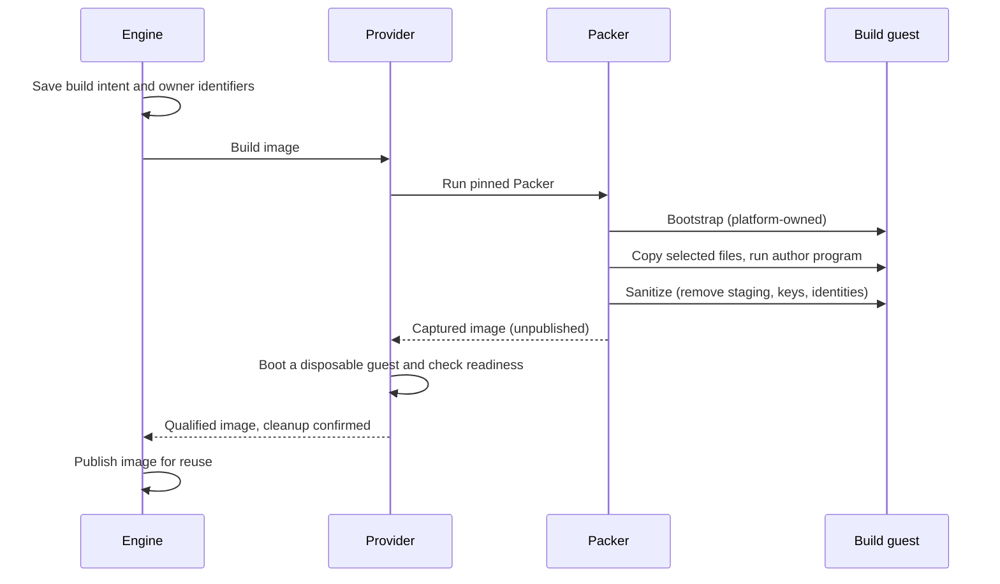
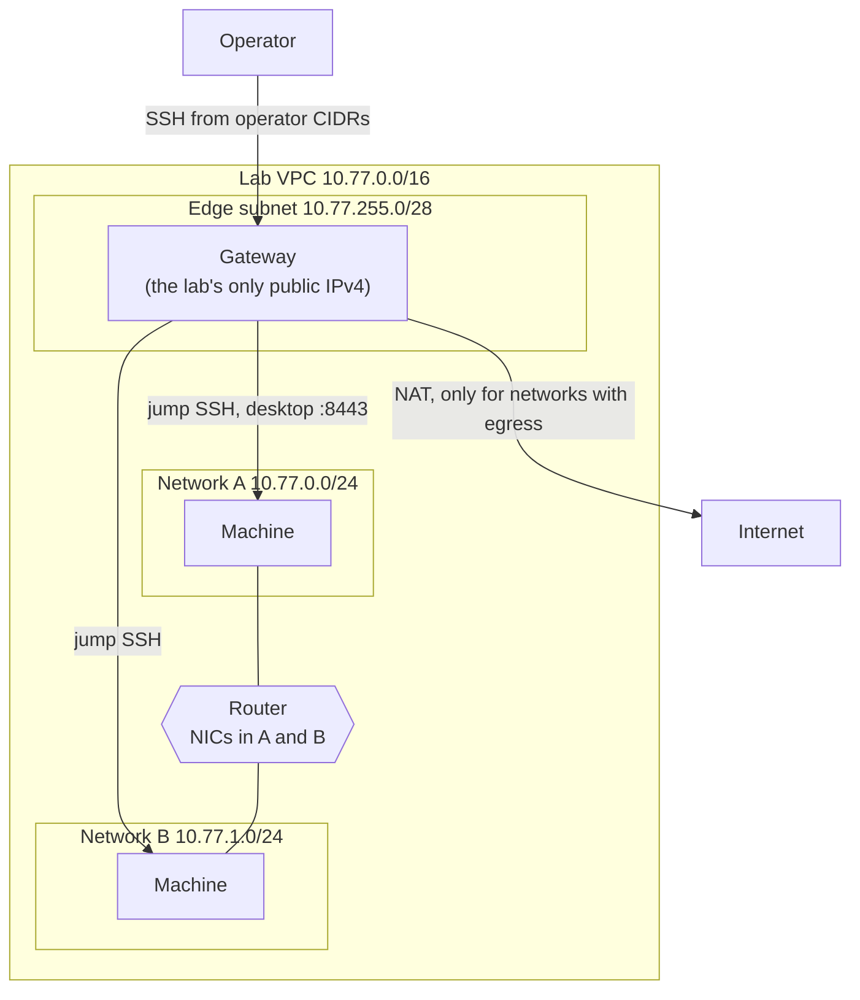
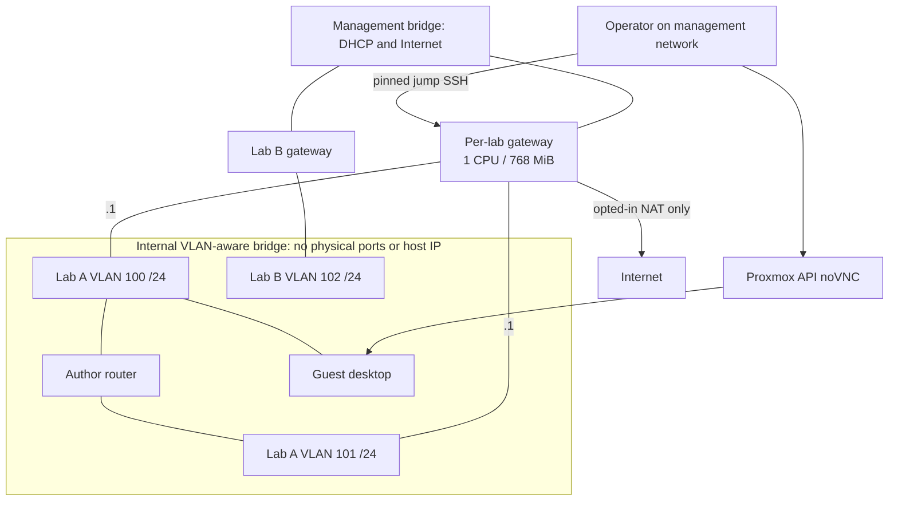
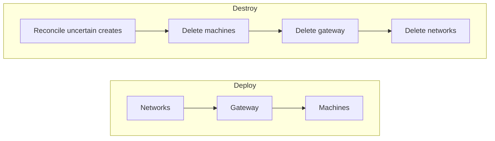
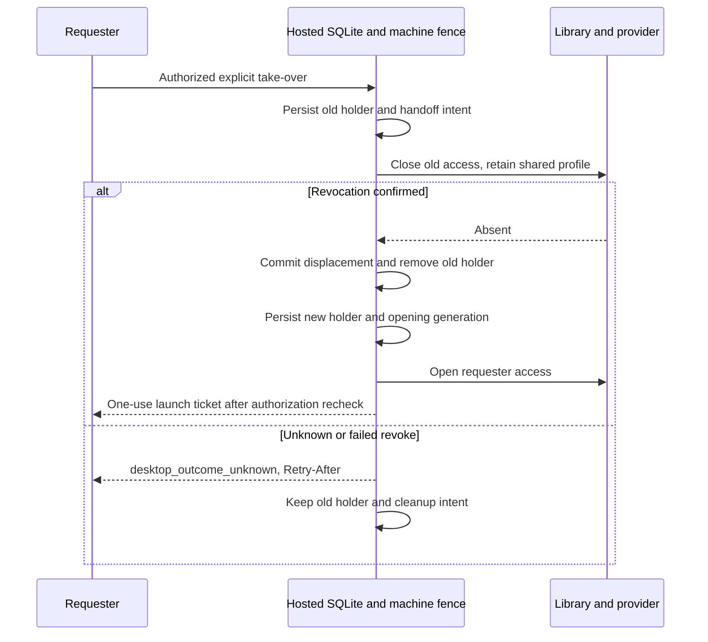
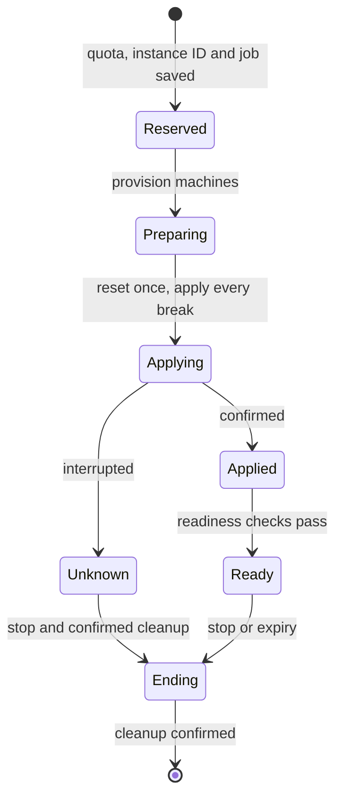

# LabCentral architecture

This document describes how LabCentral is built: its components and boundaries, the
contracts between them, and how it stays safe when operations are interrupted. It is
kept current with the code. Planned work is listed separately under
[Roadmap](#roadmap), and [Qualification status](#qualification-status) records what
has been verified on real platforms.

- [Overview](#overview)
- [Lab source format](#lab-source-format)
- [Environments, plans and images](#environments-plans-and-images)
- [Platforms](#platforms)
- [Access to machines](#access-to-machines)
- [Durability and recovery](#durability-and-recovery)
- [Hosted service](#hosted-service)
- [Qualification status](#qualification-status)
- [Roadmap](#roadmap)

## Overview

| Component | Responsibility |
| --- | --- |
| Library (root package) | Validates source, plans, builds images, deploys, recovers and destroys labs. Accepts contexts, returns typed results and errors, emits structured progress. Never prompts, prints or opens browsers. |
| CLI (`internal/cli`) | Presentation, confirmations and local defaults on top of the library. |
| Provider (`labcentral-provider`, `platform/*`) | Native AWS and Proxmox calls, Packer runs and provider recovery journals. One executable serves both platforms. |
| `instructor` | Private teaching material: strict decoding, validation and guest payloads. No identity, HTTP, storage or provider dependencies. |
| `hosted` | Product policy: users, sessions, meetings, attempts, jobs and desktop authorization. |
| `web` | The static UI served by the hosted service. |

Rules that hold across the codebase:

- **Author code runs only in guests.** Playbooks, PowerShell scripts, checks and breaks
  never execute on the operator's machine or the hosted server.
- **Credentials stay with the operator.** Provider credentials live in the operator's
  environment and the provider process, never in lab source or public APIs.
- **Portable types are provider-neutral.** [model.go](model.go) depends on no provider
  SDK. The AWS SDK is used only in `platform/aws`; Proxmox uses a bounded HTTPS client
  in `platform/proxmox`.
- **The provider never opens the library database.** It receives explicit commands,
  principals and expiry options, and keeps its own journals. Providers are trusted
  operator code, not a sandbox.
- **Unknown outcomes stay recoverable.** A timeout never proves failure; intent is
  saved before every native effect (see [Durability and recovery](#durability-and-recovery)).

The [provider protocol](api/plugin/v2/platform.proto) is generated from typed Go
structures. It uses version 2 envelopes and bounded messages and rejects unsupported
versions. New fields are appended without renumbering. Adapter-specific opaque state
is recovery data, never author input.

## Lab source format

A lab is a directory with `lab.yaml`, image build programs and supporting files,
shared through Git or plain directories. There is no registry, inheritance, loop
expansion or author-supplied Packer configuration. The author guide is
[docs/templates.md](docs/templates.md); this section covers the rules behind it.

### Concepts and defaults

Format version 3 declares images, named machines, networks, NIC host offsets, guest OS
families, access methods, typed inputs and optional platform requests. Omitting a field
means: one network named `lab`, one NIC per machine, Linux guests and no Internet
egress. An optional `platforms` list restricts a lab to AWS, Proxmox or both.

- **Images** name an environment base and optionally a build with exactly one program:
  `build.playbook` (Ansible, Linux) or `build.script` (a `.ps1` file, Windows).
  `build.files` selects the source files the build may use; the selection must include
  the program and may not repeat or invent paths. Without a build, the bound base is
  used directly (enough for SSH-only machines). Desktop images need a build so the
  platform can install its desktop components.
- **Machines** have an image, CPU, memory and disk (`Mi`/`Gi`; disks cannot shrink a
  base) and declare `ssh` and/or `desktop` access.
- **Addresses** are host offsets 4–250, unique per network. Explicit offsets are
  reserved first; the rest are assigned from 11 in machine-name order.
- **Name resolution:** `hostnamePeers` defaults to all peers, accepts a list, or `[]` for
  localhost only. It changes the initial hosts file, not firewall policy.
- **Inputs** are `string`, `integer` or `boolean`, with matching scalar defaults and
  optional descriptions. Required inputs cannot have defaults. CLI values are converted
  to the declared type and undeclared values fail. Inputs are recorded in provenance, so
  they are never secret.

### Networks

Networks are isolated layer-3 segments. A machine with `forwarding: true` and NICs on
several networks joins them:

- The planner computes deterministic static routes along chains of routers. Two routers
  joining the same pair of networks, or a cycle, is rejected.
- A machine's first NIC is its management address (SSH, desktops, checks).
- A peer's hostname resolves to its address on the first network both machines share
  (in the requester's NIC order), otherwise to the peer's first-NIC address.
- Each machine has one default route, through its first NIC on an Internet-enabled
  network. Other NICs carry connected and planned static routes.
- Author CIDRs must be private IPv4 /16–/28 ranges. Only AWS implements them.

Internet egress needs both the author's `egress: internet` on a network and the
operator's `aws.allowEgress` or `proxmox.allowEgress` (both off by default). A rejection
names both the author field and the operator setting, and plans disclose enabled egress and its filtering limits.

### Validation

1. **Strict decoding** rejects unknown or duplicate fields, non-string keys, anchors,
   aliases and multiple documents. Source snapshots reject symlinks, hidden files and
   unsafe paths, and bound file counts and sizes.
2. **Portable validation** checks references, inputs, file selections, names, CIDRs and
   offsets. The source digest binds the parsed lab to the exact file bytes.
3. **Capabilities** are checked before any environment binding or allocation, against
   [capabilities.go](capabilities.go), the implemented capability contract.
4. **Planning** resolves bases, capacity and operator policy.
5. **Before mutation** the engine revalidates the plan and checks the environment;
   adapters repeat capability and option checks before native calls, and source
   validation crosses the process boundary again before image builds.
6. **Builds and deployments** verify native ownership, readiness and access identities,
   and captured images are qualified before they are published.

| Capability | AWS | Proxmox |
| --- | --- | --- |
| Guest OS | Linux; Windows Server 2022 | Linux (Windows is rejected before binding) |
| Networks / NICs per Linux machine | 8 / 8, within the instance type's ENI limit | 4 / 4 |
| Windows NICs and forwarding | 1 NIC; never a router | — |
| Author CIDRs | Yes | No |
| Internet egress | Per network, NAT on the lab gateway | Per network, NAT on the lab gateway |

Format support does not imply adapter support: anything an adapter does not implement
fails before provisioning.

### Windows guests

Windows machines run on AWS only:

- The image declares `os: windows` and builds with `build.script` (PowerShell). Image
  OS must match the base's OS; environment bases default to Linux.
- Machines need at least 4 GiB of memory (also for builds and qualification), exactly
  one NIC and a base disk of at least 30 GiB. Computer names are at most 15 characters.
  Windows machines cannot forward.
- The base binds a pinned AMI and `user: Administrator`. Operators resolve
  `/aws/service/ami-windows-latest/Windows_Server-2022-English-Full-Base` once and keep
  the AMI ID in their environment, never the mutable parameter.

### Platform options and extensions

Author `platform.aws` and `platform.proxmox` blocks refine how a platform realizes an
image or machine. They never change topology, access or security posture. Both blocks
are strictly decoded; each platform ignores the other's.

| Target | Requests | Operator constraint |
| --- | --- | --- |
| AWS image | `buildInstanceType` | Must be in `aws.types`; otherwise the build environment's type is used |
| AWS machine | `instanceType`, gp3 `volume`, `cpuCredits` | Allowlisted type that fits the CPU/memory request; credits only on burstable families |
| Proxmox machine | `cpuType`, `nicModel`, `memoryBalloon` | CPU type must be in `proxmox.cpuTypes`; otherwise the clone's setting is kept |
| Proxmox image | none | Firmware and disk layout belong to the base binding |

gp3 volumes accept 3000–16000 IOPS (at most 500 × disk GiB) and 125–1000 MiB/s
(at most IOPS ÷ 4). Proxmox NIC models are virtio, e1000, e1000e, vmxnet3 or rtl8139.
Disabling ballooning writes zero; enabling it targets the allocated memory. Allowing CPU
type `host` permits nested virtualization.

`extensions` are namespaced keys with arbitrary JSON values, stored as canonical JSON
without interpretation (64 KiB per manifest). Builds receive lab and image extensions as
`labcentral_extensions`. Extensions never carry provider credentials or bypass typed
validation.

### Schemas and versioning

`go run ./tools/schema` generates [schemas/lab-v3.json](schemas/lab-v3.json) and
[schemas/instructor-v3.json](schemas/instructor-v3.json) from the Go types, and tests
reject stale output. A conformance corpus is checked by strict YAML decoding, JSON
Schema 2020-12 and Go validation and planning, keeping structural, reference and
capability failures distinct. YAML checks run before JSON conversion so aliases and
duplicate keys are still caught.

Format 3 replaced format 2 without a reader for older author source. Compatible changes
only add optional fields or values; a change in meaning needs a new format version.
Author format, protocol and record versions are independent (protocol and portable
records are at version 2). Older hosted records have separate read and cleanup paths.

## Environments, plans and images

### Environment files

An environment file holds target identifiers, credential references, base bindings,
network requirements and toolchain pins. It stays outside tracked source.

- **AWS:** account, region, zone and an instance-type allowlist.
- **Proxmox:** node, storage, pool, an exclusive VMID range and an isolated VLAN range.

One state root exclusively owns its allocation namespace.

### Plans

A plan binds the source, effective inputs, environment, base identities and build
policy. On AWS the planner picks the smallest allowlisted instance type that fits,
unless an allowed explicit type is requested. Proxmox reserves disjoint VMIDs and one
VLAN and /24 per network. Deployment copies the plan's machine entries before adding
native images, addresses and keys, so one plan can deploy independent instances.

### Image identity

An image's cache key includes:

- the planned image and its build program;
- the build-relevant part of the environment: target identity, toolchain, the selected
  base binding and build networking;
- effective inputs, the source identity and the desktop build policy.

Runtime networking, operator CIDRs, egress permission, gateway settings, machine
allowlists and the desktop licensing profile do **not** affect keys. With explicit
`build.files`, only the selected files' bytes, the image definition and lab extensions
count. Without a selection, every source file counts, with machine platform options and
the other platform's image options normalized away. Image options change keys; machine
runtime options do not. Saved journals keep their original keys across planner changes,
and a cached image must pass native identity and existence checks before reuse. Package
repositories change over time, so rebuilds are not byte-identical.

### Builds

- **Toolchain:** Packer with the amazon 1.8.1, proxmox 1.2.3 and ansible 1.1.4
  plugins. The environment pins the Packer checksum, toolchain identity, ansible-core
  version and timeout. Packer emits native images directly
  ([amazon-ebs](https://developer.hashicorp.com/packer/integrations/hashicorp/amazon/latest/components/builder/ebs),
  [proxmox-clone](https://developer.hashicorp.com/packer/integrations/hashicorp/proxmox/latest/components/builder/clone)),
  with no disk conversion or nested virtualization.
- **Linux builds** install a pinned guest-local Ansible and run the playbook with
  [ansible-local](https://developer.hashicorp.com/packer/integrations/hashicorp/ansible/latest/components/provisioner/ansible-local).
  Author values never reach host shell commands.
- **Windows builds** use SSH as Administrator (never WinRM) with platform-owned
  EC2Launch v2 user data. The hostname reboot completes before OpenSSH and the build
  key are set up, so provisioning cannot overlap it. Selected files are copied to
  `C:\ProgramData\LabCentral\build\` and `$env:LABCENTRAL_INPUTS` names the typed inputs
  file. For desktop images, the platform installs the DCV MSI pinned by
  `build.windowsDCVURL` and `build.windowsDCVSHA256` (checksum and Authenticode
  signature verified) and reboots before the author script. Packer's restart check
  ignores exit status and counts a session cut by the shutdown as a pass, so a retried
  gate waits for a newer boot and the bootstrap's ready marker before any author code.
  The bootstrap reruns at every boot but leaves OpenSSH running after its first
  complete run for the same payload. Afterwards it removes build files,
  inputs, keys and DCV/SSH identities, then runs EC2Launch sysprep with shutdown. Only
  that final step accepts OpenSSH's shutdown status 2300218.
- **Proxmox builds** clone the base and keep its root disk; the base needs enough disk
  and a working guest agent. Deployment can grow disks. The library never modifies a
  bound base.

**Qualification and publication.** Every build reserves ownership and native
identifiers before mutation (tags, descriptions, explicit VMIDs, image names, key
identities), so an interrupted build can be found again. A captured image stays
unpublished until a disposable guest passes SSH/cloud-init readiness (Windows: the
readiness marker and sshd) and, for desktops, a desktop check, and its cleanup is
confirmed. AWS Linux desktop validation creates a virtual session and observes a running
X display; an empty status response stays unknown and is polled without creating
another session. Validation checkpoints survive cleanup interruption, and a failed
validation can reuse the captured image only after confirmed guest cleanup, with a fresh
validation owner.

`EngineOptions` default to three image builds, four machine creates and four deletions
per operation (1–32 each). Waits check cancellation before native calls.

## Platforms

### AWS

**Layout.** Each lab owns one VPC in one availability zone. By default it is
`10.77.0.0/16`; networks get `10.77.<n>.0/24` in name order and the gateway's edge
subnet is `10.77.255.0/28`. With author CIDRs, the /16 containing them becomes the VPC
and the edge subnet takes its highest free /28. Each network has its own subnet, route
table and security group:

- Routes to remote networks go through the local router's ENI (more specific than VPC
  routing; guests also install explicit routes). Router ENIs disable source/destination
  checks.
- A default route to the gateway exists only for networks whose egress is requested
  and allowed.
- Network security groups allow same-network traffic and routed sources only from
  networks that can reach them. In multi-network labs a management group on first NICs
  admits ports 22 and 8443 from the gateway only.
- Lab machines never get public addresses, and operator CIDRs are never added to their
  management ingress.

**Gateway.** One platform-owned gateway per lab, outside the author's inventory, holds
the lab's only public IPv4 address (default `ubuntu-24.04` on `t3.micro`). It has one
edge NIC, IMDSv2 with hop limit 1, an encrypted root disk and no instance profile; its
host key is generated and pinned before creation. Its cloud-init allows operator SSH and
local port forwarding only (no passwords, agent or X11 forwarding, or tunnels) and
loads nftables before enabling forwarding. Forwarding defaults to drop; only opted-in
networks reach non-private destinations, with masquerade. RFC 1918, link-local, CGNAT
and the gateway itself are blocked. Readiness needs pinned SSH and confirmed cloud-init
completion. The routing follows [AWS NAT instance
requirements](https://docs.aws.amazon.com/vpc/latest/userguide/work-with-nat-instances.html).

**Desktop licensing.** Desktop machines get an instance profile whose only permission
is reading the regional DCV license bucket
([DCV licensing](https://docs.aws.amazon.com/dcv/latest/adminguide/setting-up-license.html)),
and their networks get an S3 gateway endpoint restricted to that bucket. Other machines
have no instance profile.

**Windows guests** share the same ENIs, security groups, routes, gateway and egress
rules. Platform-owned EC2Launch v2 user data:

- installs or verifies the built-in OpenSSH Server, makes PowerShell its default shell
  and installs the per-allocation management key and pinned host key, with
  SYSTEM/Administrators-only ACLs;
- keeps every Windows Firewall profile on, opens lab-network rules and limits added
  management ports 22/8443 to the gateway's private address;
- writes the hosts file and planned routes (active and persistent stores; a
  conflicting existing route fails bootstrap rather than being overwritten);
- renames the computer with one controlled reboot, then writes a readiness marker.

Readiness polls the marker, sshd and (for desktops) dcvserver over pinned jump SSH; a
timeout leaves the create unknown. Build networks need Windows Update access for the
OpenSSH capability; captured images keep it for isolated labs.

**Limits of isolation.** AWS DNS and instance metadata are outside ordinary
security-group filtering, so this is not an air gap ([security-group
behavior](https://docs.aws.amazon.com/vpc/latest/userguide/vpc-security-groups.html)).
Records created before gateways existed keep their original management path; recovery
never adds a gateway to an old record.

### Proxmox

**Layout.** One exclusive VMID range and one VLAN range belong to one state root.
Each lab reserves one VLAN and /24 per network on `proxmox.labBridge`; the adapter
rejects bridges with physical ports, host addresses or no VLAN awareness. Each lab owns
one gateway VM outside author inventory, cloned from a pinned Linux base (default
`ubuntu-24.04`). NIC0 uses `managementBridge`, with DHCP discovered by the guest agent
or an exclusively reserved `managementAddresses` pool. Additional NICs hold `.1` on
each lab VLAN. The operator reaches only management/build addresses.

**Policy.** The gateway uses the shared AWS nftables and SSH policy: pinned host keys,
operator SSH, local forwarding only, no passwords, agent/X11 forwarding or tunnels.
Forwarding starts disabled until nftables loads; its default is DROP. Only opted-in
networks get guest default routes and NAT. Private, link-local and CGNAT destinations,
gateway addresses and the discovered management subnet are blocked. Sources are bound
to their incoming VLAN NICs before established forwarding is accepted. Lab networks
connect only through author routers;
the gateway does not route between them. Structural VLAN separation isolates concurrent
labs from each other and the LAN. VM NIC firewall rules remain optional defense in depth;
setup never changes the cluster firewall. Guest SSH uses the same pinned two-hop dialer
as AWS. Desktops remain API noVNC consoles. Desktop clones use a VirtIO display,
matching the Ubuntu cloud kernel graphics driver; images install a greeter and boot
graphically.

**Setup.** The CLI's reviewed setup plan detects resources, refuses visible allocation
collisions and unowned resources, and creates a scoped privilege-separated token.
A separate read-only `VM.Audit` role on `/vms` keeps
inventory visibility after Proxmox removes VM-specific ACLs during deletion. Mutating
permissions remain scoped to the owned pool and storage; cleanup refuses ambiguous
absence and never removes unreferenced VMID-named disks. The admin secret is resolved
from an environment variable and never persisted. Setup
uses the API to download a checksum-pinned Ubuntu image and import `scsi0`, boots a
platform-owned NoCloud seed to install/verify the guest agent and nftables in the guest,
sanitizes it and converts it to a cloud-init template. Agent startup is checked again
after a restart. The environment, runtime secret
and ownership/recovery receipts remain in private operator files. Network application
refuses unrelated pending changes; storage content changes require plan confirmation.
Teardown verifies remote ownership and retained receipts, refuses remaining lab/build
VMs, and removes exactly the setup inventory. Unknown outcomes retain intent.

**Builds.** `build.bridge` stays a DHCP/Internet bridge whose build VMs the operator can
reach directly. Built images are boot-qualified through a disposable gateway and guest
on an isolated VLAN before publication. Gateway and guest VMIDs are reserved before
creation and released only after confirmed cleanup. Deploy orders networks → gateway
→ machines; destroy reverses those dependencies, with the same engine recovery journal
as AWS.

## Access to machines

`MachineDialer` is the only way to reach a guest. For new labs it verifies the
gateway's SSH host key, opens a `direct-tcpip` channel to the private machine, then
verifies a second SSH handshake against that machine's pinned key. Retained pre-gateway
records dial directly. A failed connection never falls back to a different path, and
agent forwarding is never used. Readiness checks, guest programs, coach terminals and
DCV certificate fetches all share the dialer. Jobs reuse pinned connections; desktops
reuse the gateway connection to reach port 8443. A new channel may reconnect after an
outage with the same pins, but a command is never replayed.

### Desktops

| Platform | Transport | Sessions |
| --- | --- | --- |
| AWS Linux | Amazon DCV, system authentication | One virtual session per access; the temporary guest account owns it |
| AWS Windows | Amazon DCV, system authentication | One console session, `console`, owned by local `lab` |
| Proxmox | Bundled [noVNC 1.6.0](https://github.com/novnc/noVNC/tree/v1.6.0) over an encrypted console connection | VM console |

- **Accounts.** Every desktop access creates temporary guest credentials, disclosed only
  in explicit access output. Linux accounts carry an ownership marker in their comment
  (after a "Student" display name) so cleanup touches only accounts it created. On
  Windows, bootstrap creates a disabled administrative `lab` account; access sets its
  credential and enables it, and an ownership marker plus pinned SID prevent taking over
  a replacement account. Windows has one console, so overlapping desktop owners are
  rejected.
- **Certificates.** DCV certificates are fetched over verified SSH and pinned end to end
  by the relay ([certificate
  handling](https://docs.aws.amazon.com/dcv/latest/adminguide/manage-cert.html)). Image
  capture removes generated certificates so each guest gets its own.
- **Readiness.** Linux waits for a running X display; Windows waits for a running
  console with the expected owner. An unknown status never creates a replacement session.
- **Relays.** CLI relays listen on loopback and require a single-use launch token, an
  authenticated cookie, exact Host and Origin checks and an expiry.
- **Revocation** closes transports and the session, terminates the user's processes and
  removes the account (or locks it, when the caller asked to retain the workspace). On
  Windows it disables the account, logs off the console and cleans or keeps the profile.
  Crash recovery uses durable access intent.

## Durability and recovery

State is a SQLite database (WAL, FULL synchronization) with snapshots, plans,
provenance, allocations, operation records and resource references. SSH private keys
are separate private files. Providers keep their own mutation journals (fsync and atomic
rename). Back up journals and keys together, and fence the original process before a
restored one starts.

### Intent and locks

- Native create intent is saved before every call, with idempotency keys where the
  platform supports them. After a lost response, recovery looks for the exact recorded
  owner. Ambiguous results keep their allocations and recovery intent.
- An authorization rejection and an uncertain transport failure are different outcomes;
  the second is never retried as if it had been rejected.
- Cache-key file locks coordinate build, reuse, abandonment and removal across clients.
  `BuildWithRecovery` holds one key's lock through reconciliation, abandonment after
  confirmed absence and its replacement attempt; active builds finish before recovery
  can inspect them. Unknown outcomes retain intent and allocations across retries/restarts.
  Deployment builds or reuses images first, then takes the image locks in sorted order
  and a short allocation fence to save references. Image removal uses the same fence to
  check for references.
- Deployment, recovery and destruction take an exclusive lifecycle lock per instance.
  Desktop operations and SSH callbacks share it and take an exclusive lock per machine,
  so unrelated machines in one lab can be worked on at once.
- Cleanup intent is saved before fences are released for native I/O, and reservations
  are released only after absence is confirmed.

### Order of operations

- Deployment creates networks, then the gateway, then machines (retained pre-gateway
  records keep their original shape). Successful siblings are saved even if another fails, and recovery
  resumes the original operation and instance ID.
- Destruction first reconciles uncertain creates, then deletes in reverse order:
  machines (concurrently), the gateway once every machine is confirmed absent, then
  networks. Cross-group security rules are removed before either group.
- Deletion checks recorded IDs and ownership, never names alone. Route reconciliation
  verifies table ownership, accepts an existing matching route and rejects a
  conflicting one.
- Guest-session cleanup is tried first, but an unreachable guest cannot block
  termination. Access records survive until machines are confirmed removed.
- Image removal is a separate operation. It refuses images that retained labs still use
  and includes AMI snapshots or Proxmox template disks. Failed or unknown cleanup stays
  recoverable and blocks reuse of the affected cache key.

The CLI has no scheduler: resources keep running until destroyed. The hosted service
persists deadlines and queues overdue cleanup on restart, but an offline control process
can still leave billable resources running. Allocation is not coordinated across
operators. Lost or corrupted state is outside automatic recovery; uncertain mutations
without authoritative discovery need an operator to investigate.

## Hosted service

The `hosted` package uses the public library and adds identity, HTTP policy, jobs and
the product's records. Operator configuration and credentials stay outside source and
public APIs.

### Identity and authorization

- OIDC authorization code flow with PKCE, state and nonce; issuer, audience, signature
  and expiry are verified. An explicit HTTPS backchannel can route server-to-provider
  requests while keeping canonical issuer checks.
- Group membership maps to the configured `memberGroup` and `adminGroup`; admins are
  also members.
- Sessions are opaque IDs in secure, HTTP-only host cookies; tokens stay server-side.
  Writes require an exact Origin and a CSRF token.
- Group authorization is refreshed from userinfo every four minutes (at most four
  refreshes at once). Desktop authorization is rechecked every 20 seconds and fails
  closed. Diagnostics report fixed categories, never tokens or response bodies.
- A rejected refresh ends the session. A provider timeout, network failure or 5xx
  (30-second limit per request, for scale-to-zero providers) keeps it: refreshes back
  off for a minute and the session is served while its last successful check is under
  15 minutes old; after that requests get 503 until the provider answers.

### Persistence

SQLite has one writer using `BEGIN IMMEDIATE` transactions and four read-only readers.
Quota, seat, import and enqueue decisions stay on the writer. Request bodies are read
before a transaction starts, and responses are buffered until commit, so a slow client
cannot hold the writer or see success before persistence.

Older hosted records keep their saved identities, progress, source pins and cleanup
references. They can be read and cleaned up, but new attempts and guest actions require
format 3 revisions. Cleanup always uses saved image keys, never freshly planned ones; an
older revision without saved keys owns no current image and is not counted as sharing
one.

### Jobs and budgets

One process holds the durable scheduler fence. Resource claims coordinate templates,
meetings, teams, allocations and machines, so unrelated work proceeds while blocked jobs
wait. Observational jobs (checks) share team claims but take their target machine
exclusively; resets, breaks and lifecycle work exclude the whole team. Enqueue and
completion wake the dispatcher, with a five-second fallback tick.

| Budget | Default | Scope |
| --- | ---: | --- |
| Bulk jobs | 3 | Builds, preparations, refreshes and image removal |
| Image-build jobs | 2 | Part of the bulk budget |
| Guest jobs | 12 | Checks and breaks, separate from bulk work |
| Cleanup jobs | 1 reserved | Meeting destruction and authorization cleanup |
| Provisioning | 3 | Team and personal preparations |
| Native operations | 8 | Machine and gateway lifecycle and builds, across jobs |
| SSH operations | 24 | Guest steps, terminals, desktops and readiness, across jobs |
| Job timeout | 120 min | Allocation deadlines can stop jobs sooner |
| Preparation | Linux 30 / Windows or mixed 45 min | Per allocation, configurable; job and allocation deadlines still apply |
| Hosted desktop open | Linux 90 / Windows 600 sec | Configurable; provider ceiling Linux 120 / Windows 600 sec |

Worker concurrency and engine limits accept 1–32, aggregate budgets 1–64 and job/prepare timeouts 1–1440
minutes. Ending a meeting cancels overlapping work but leaves unrelated builds running.
Cleanup runs in bounded pools, records each result, and keeps unknown outcomes
retryable.

### Meetings, teams and checks

- A meeting pins one template revision and a deadline. Defaults are five teams, six
  seats and four hours; bounds are 1–100 teams, 1–100 seats and 1–8 hours (extensions
  included). These are policy limits, not tested class sizes.
- Switching teams reserves the destination seat in a transaction, blocks access while
  switching, and commits only after the old desktop is revoked.
- Each team keeps its exact instance ID and readiness. One failed preparation does not
  cancel the others, and retries preserve ready teams.
- A meeting break runs the pinned reset, then the break. Durable intent prevents an
  older job from reapplying effects. An interrupted break stays unknown and needs an
  explicit reset. A reset is an authored targeted repair, not a VM restore.
- Checks run once or on a 60–3600-second schedule that starts paused, stops at the
  meeting's end and never replays missed ticks. Results are pass, fail or unavailable;
  unconfirmed execution is unavailable, never a failure. The scoreboard shows current
  service health, not accumulated scores.

### Templates and images

The template repository is fetched with a read-only deploy key and pinned GitHub host
keys. The importer finds `templates/*/lab.yaml`, pins the commit, validates the portable
and private source, and snapshots it. Each template is imported in its own transaction,
and a failing directory is reported to admins without blocking the others. Planning
requires each image's OS-matched base, Windows-capable build/runtime instance types and
Windows DCV installer pins before build admission. A Linux-only environment remains
valid. A revision's current capability problem is exposed to admins through `problem`
and the existing template problem panel without failing the entire catalog; saved
image identities still fence cleanup if planning becomes impossible. A revision's
identity is the repository commit plus the directory, so any new commit imports new
revisions; meetings and attempts keep their pins.

Image operations save cache keys and operation identity before any effect. Removing a
revision's images blocks new meetings on it, keeps images shared with other built
revisions and images used by retained labs, and cleans unpublished builds. Hosted builds,
including **Retry build**, reconcile pending attempts and replace them only after
confirmed cleanup, keeping already-built sibling images. Uncertain cleanup retains
retryable intent and reports operator guidance in the failed template job.

"Remove unused images" (`POST /api/admin/images/prune`, admin and CSRF) queues a durable
`prune-images` job. It keeps images needed by each template's latest revision, open
meetings, unfinished personal practice (including pending cleanup) and builds in
progress, and removes the rest, including orphaned keys left by rebuilds. Each image
gets an outcome: removed, skipped because a retained lab uses it, or unknown and
retryable. Revision readiness is then reconciled with the remaining images.

### Windows desktop holders and terminals

The library still uses opaque per-principal access identities. Hosted policy adds a
single holder for each meeting Windows allocation/machine; Linux keeps independent
per-user desktops and personal attempts have only one owner. A normal conflicting
open returns authorized HTTP 409 `desktop_held` plus the holder's display name.
Teammates can explicitly take over their own team's desktop; coaches/admins use a
ready team in the current meeting under the existing privileged group policy.
There is no separate coach role or per-meeting coach enrollment.

A per-machine lock spans native revoke/open, while identity and relay locks are never
held across native work. Reserve and confirmed cleanup atomically update the holder
with the existing desktop intent. Recovery closes unconfirmed access before another
grant, including a restart between revoke and grant. It never automatically grants a
request whose caller disappeared. Profile retention uses existing library options:
Windows disables `lab`, logs off the console, terminates its processes and keeps the
profile. Saved files survive; unsaved applications do not.

Displacement is durable, bounded by the old access expiry, and readable only by a
currently authorized session in the same allocation. `/api/me`, dedicated app status
routes and desktop-origin `/status` expose holder/take-over state. Displaced cookie
observations store only a cookie digest and authorization record, never credentials.
Old launch tickets and relay transports become unusable before another grant. The
Windows browser credential response pairs username `lab` with DCV session `console`.
Machine OS is exposed in template, personal attempt, meeting and coach machine views.
The lab page offers a confirmed take over or take back, the desktop page names who
took over, and coaches open or take over team desktops from the coach console.

Coach terminals use pinned OpenSSH and `SSHUser()` (`Administrator` on Windows),
request an initial PTY and launch the platform-configured PowerShell default shell.
They validate and ignore resize frames for Windows while retaining Linux window-change
behavior. Existing current-meeting checks, source/resource pins, group refresh,
transport revocation and shell duration limits apply unchanged.

Windows guest readiness already allows 15 minutes (Linux: 5). Windows console startup
allows 5 minutes, open 10 minutes and logoff cleanup 2 minutes; Linux remains at
25 seconds, 2 minutes in the provider and 20 seconds respectively. Hosted open uses
`desktop.openSeconds` / `desktop.windowsOpenSeconds`; preparation uses
`worker.prepareTimeoutMinutes` / `worker.windowsPrepareTimeoutMinutes`. These budgets
remain bounded by job and allocation deadlines. Unknown DCV state never creates a
replacement session. Qualification budgets remain Linux 10 / Windows 20 minutes.
Browser launches retry for up to five minutes while the server asks them to.

### Instructor material and guest programs

`instructor` decodes `instructor.yaml` strictly (field paths and line numbers),
validates it against the portable source and builds guest payloads. `LoadTemplate`
excludes private material without changing author files.

- **Visibility.** `visibility.audience` is `students` or `coaches`; only coach templates
  may hide machines. Coach revisions are excluded from student catalogs, views, practice
  and downloads. Coaches can create owner-only personal attempts from private revisions;
  request policy uses their verified session role and background preparation reads the
  last verified persisted user role. Role loss blocks disclosure and guest work; cleanup
  remains available. Missing privacy metadata fails closed. Hidden-machine templates
  require visible images to list their build files (excluding `lab.yaml` and private
  programs) and visible machines to use explicit `hostnamePeers`. Validation checks
  structure, not file contents.
- **Steps.** Checks, breaks and resets are ordered guest steps. Each step delivers its
  program (an Ansible playbook for Linux machines, a PowerShell script for Windows),
  plus `files`, `assets` (under `template/`), `labcentral/hosts.json` for `guestHosts`
  and `labcentral/context.json`. Reserved paths and payload collisions fail import.
- **Execution.** A fixed launcher stages the files in a private temporary directory and
  runs the program under a per-machine lock, with a timeout (default 90 seconds,
  10–600). On Linux it runs Ansible as root. On Windows the payload arrives as base64
  JSON on stdin, the script runs inside a kill-on-close job object with
  `$env:LABCENTRAL_STEP_DIR` set, and output is bounded. A failed task or nonzero exit
  is a failure; a timeout, lock, transport or launcher problem is an unknown outcome.
  There is no generic remote-command API.
- **Stages** have instructions, an optional prompt and solution, an optional linked
  `break`, and exactly one completion: an answer (1–10 accepted values, explicit case
  policy, compared as normalized digests in constant time), a check, or an instructor.
- **Disclosure.** Public responses include only permitted instructions, topology (with
  each machine's OS), summaries and the user's own progress. Accepted answers, private
  programs, selected variants and credentials are never sent. A solution is revealed only
  by an explicit request and does not advance progress. Markdown rendering disables raw
  HTML. Guest administrators can inspect programs that run on their machine; guest
  files are not a secrecy boundary.

### Practice attempts and scenarios

Creating an attempt requires authentication, CSRF and a random request ID. A per-user
lock and transaction save the stage snapshot, answer key and private guest definitions
before anything is provisioned. Repeating a request returns the same attempt. Baseline
attempts exclude break-linked stages and instructor checkpoints.

A scenario attempt picks a variant at random (never the student's previous one for the
same scenario) and saves it privately before any effect:

Retries never pick a new variant, confirmed checkpoints resume without replay, and an
interrupted `applying` refuses to apply again: the student stops it and starts a new
attempt. Scenarios run only in hosted cloud workspaces; baseline attempts can also be
downloaded and run with the CLI on the student's own environment.

**Quota.** Personal workspaces need built images and the pinned desktop machine. One
allocation per student may be active, including one pending cleanup, and meetings do
not end it. `weeklyCloudMinutes` (default 180) counts from reservation through
confirmed destruction, split across weeks that reset Monday 00:00 UTC. Expiry removes
desktop access immediately; confirmed cleanup deletes workspace files, while progress
is kept.

Ready action stages are checked automatically on a jittered 20-second cadence, slowing
to 60 seconds after five idle minutes. Only a confirmed pass advances progress.

### Desktops and the coach terminal

- **Launch.** Hosted desktop launches bypass the job queue but keep machine locks and
  aggregate budgets. A one-use ticket (valid one minute) is exchanged on a separate
  desktop origin for a host-only cookie bound to the session, user, team or allocation,
  instance and expiry. Every request is authorized, and open WebSockets close on
  revocation. If another open of the same desktop is still starting, the server asks the
  browser to retry (`Retry-After`) instead of failing.
- **DCV client.** The pinned DCV Web SDK uses the transient credentials, so there is no
  second sign-in. Workspace identities are deterministic, so homes survive reconnects.
  Linux sessions start with `--gl off` after reading CPU graphics libraries
  ([startup guidance](https://docs.aws.amazon.com/dcv/latest/adminguide/investigating-linux-virtual-session-creation-failure.html)).
  "Connected" requires the first rendered frame. The display scales to keep the whole
  workspace visible; clipboard uses SDK channels and is never stored. DCV's 60-minute
  idle timeout disconnects the client; deadlines destroy the machines.
- **Lesson panel.** Practice desktops show the lesson beside the display. Requests carry
  the run rendered into that window and require the desktop Origin, JSON and a custom
  header, so a changed cookie cannot redirect answers to another run.
- **Coach terminal.** Admins open an SSH terminal to any ready team's machine (hidden
  machines included) at `/admin/terminal/`. The WebSocket checks Origin, admin session
  and a CSRF first message, then binds library-owned instance and host identities;
  browsers never supply addresses or credentials. Channels last at most ten minutes,
  hold the machine lock, use a guest PTY with resize, and reconnect with a fresh shell
  that never replays input. Output cannot control navigation, clipboard or titles.
- **Isolation.** Teammates share guest administration, so their workspaces are not
  security boundaries.

### Web UI

The UI is static SvelteKit (daisyUI, Lucide icons, Instrument Sans), prerendered with
no SPA fallback and served under a strict CSP with local scripts, styles and fonts.
Practice, Meeting and Admin become a bottom navigation bar on phones. Practice and
Admin → Templates share one card per template; meetings start from a template card or a
revision's page. Admin data refreshes on a shared two-second poll that clears on
sign-out or identity changes and shows a separate warning when updates fail repeatedly.

## Qualification status

What has been verified on real platforms. Evidence applies to the source, environment
and layout it was recorded with; detailed records stay outside this repository. Mocks,
request capture, browser fixtures and local load models establish local behavior only.

| Area | Verified on a real platform | Not yet verified |
| --- | --- | --- |
| AWS library lifecycle | Image builds, deployment, pinned SSH, desktops, interrupted cleanup | Full interruption, response-loss and stale-ownership matrix |
| AWS gateway and egress | Private guests, jump SSH and DCV, NAT, blocked private forwarding, cleanup | Reboot behavior; broader cold/warm latency |
| AWS platform options | Explicit type, gp3 performance and CPU credits | Wider combinations |
| Multiple networks and routers (AWS) | Two-network labs with a router, default and author CIDRs, routed name resolution, one-sided egress, forwarding off/on, router reboot, cleanup | Interrupted multi-NIC recovery |
| AWS Windows guests (CLI/library) | Mixed IIS lab: both images built and boot-qualified; sysprep and certificate sanitization; private deployment; coach and student SSH; firewall, hosts and routes; DCV console with browser rendering, reconnect and revocation; break/check/repair for every stage and scenario variant; recovery after a killed destroy; image removal with confirmed cleanup | Hosted Windows sign-in and release acceptance; typed desktop input; cohorts; full failure matrix |
| Hosted identity and meetings | Real OIDC, revocation, seat switching, retained workspaces; a meeting of 4 teams × 3 students with 12 concurrent desktops, a break and checks on every team | Meetings larger than 4 × 3 |
| Hosted practice and scenarios | Individual attempts, pinned guest checks, combined breaks, retained progress and cleanup | Larger personal cohorts; full weekly quota exhaustion |
| Hosted Windows | None for this hosted implementation; local conflict, authorization, ordering, restart, race, OS-budget, capability and fake OpenSSH tests only | Real OIDC; typed Windows desktop input; shared holder conflict/take-over/take-back; coach PowerShell; lesson panel; retained reopen; scoreboard; cleanup and image removal; cohorts |
| Hosted desktops and coach terminal | Terminal input, resize, reconnect and revocation; cold and rebooted desktops; desktop browser launch | General launch latency |
| Proxmox setup and lifecycle | PVE 9.2 with directory storage: clean setup, guest-agent cold restart, idempotent rerun, environment check, the single/web-database/workstation examples, image removal and teardown; recovery after a killed deploy and destroy | Full response-loss, stale-ownership and interruption matrix; other storage and firmware combinations |
| Proxmox networking | Single, web/database and two-network router labs; pinned jump SSH, requester-specific names, one-sided Internet egress, blocked LAN/gateway destinations after forced defaults, concurrent-lab L2 isolation; gateway reboot and policy restoration | Static management pools; four-network layouts |
| Proxmox desktops and options | Workstation build and qualification; real noVNC login, keyboard input, desktop/mobile rendering and account revocation; host/kvm64 CPUs, e1000/virtio NICs, ballooning enabled/disabled | Wider CPU/NIC combinations; broader browser/device coverage |
| Durability and scheduling | Local failure, persistence, response-loss, authorization and race tests; a hosted restore rehearsal | Native failure matrix; configured capacity ceilings |

Not supported yet: Windows on Proxmox, Windows routers or multiple Windows NICs, Ansible
targeting Windows, author CIDRs on Proxmox, hosted platforms other than AWS,
multi-operator allocation, laptop hypervisors or Docker runners, a template registry and
background cleanup for the CLI.

## Roadmap

Design intentions, not contracts. Each needs failure tests and live qualification in an
explicitly configured environment.

- **Proxmox:** wider storage/firmware coverage and the native failure matrix.
- **Windows:** Proxmox bootstrap and firmware bindings, more NICs, and an optional
  disposable Linux controller for Ansible targeting Windows (author code still only in
  guests).
- Deferred: registries, additional hosted platforms, broader classroom governance and
  EC2 Image Builder.
