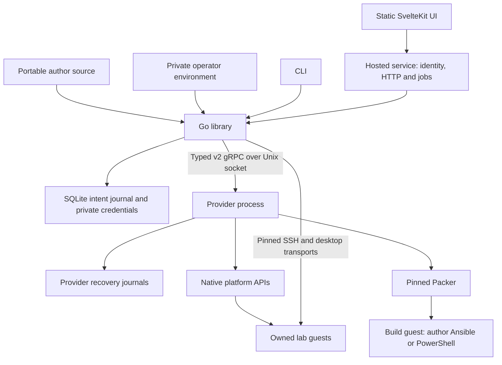

# LabCentral architecture

This living design document describes implemented boundaries and contracts. Proposals
and qualification limits are identified separately. There is no v1 source or protocol
compatibility.

## Overview and boundaries

LabCentral combines a portable Go library, optional CLI, provider processes and a hosted
application. Operators use Linux amd64 with Ubuntu 24.04 amd64 guests and AWS
Windows Server 2022 guests (local qualification only). AWS EC2 and Proxmox are library platforms; hosted provisioning requires AWS.

The library accepts contexts, returns typed results and errors, and emits structured
progress. It does not prompt, print, open browsers or make hosted identity decisions.
The CLI supplies presentation, confirmation and local defaults. Portable types in
[model.go](model.go) depend on no provider SDK. AWS SDK use stays in `platform/aws`;
Proxmox uses a bounded HTTPS API client in `platform/proxmox`.

The provider never opens the library database. It owns native recovery journals and
receives explicit commands, principals and expiry/retention options. One separate
executable currently serves both platforms. Providers are trusted operator code, not a
sandbox; author code runs only inside guests.

The [process protocol](api/plugin/v2/platform.proto) is generated from typed Go
structures, has version 2 envelopes and bounded messages, and rejects unsupported
versions. New fields append without renumbering existing fields. Adapter-specific opaque
state is recovery data, never an author-supplied portable manifest. `instructor` owns
private teaching definitions without identity, HTTP, storage or provider dependencies.
`hosted` owns product policy, and `web` owns its static UI.

## Lab source format v3

A shared directory contains `lab.yaml`, image playbooks/PowerShell scripts and supporting files. The
environment binds logical base names. Sharing uses Git or local directories, without a
registry, inheritance, loop expansion or author Packer extension. Ansible expressions
execute inside build guests.

### Concepts and defaults

Version 3 declares images, named machines, networks, NIC host offsets, OS families,
access methods, typed inputs and optional platform requests. Omission means one network
named `lab`, one NIC per machine, Linux and egress `none`. An optional `platforms`
restriction selects AWS, Proxmox or both.

Images name an environment base and optionally a build with exactly one of
`build.playbook` (Linux) or `build.script` ending in `.ps1` (Windows), plus
`build.files`. Cross-OS programs are rejected with field paths in this phase. An
image without a build can use its bound base directly for SSH access. Desktop images
require a build that installs platform access components. Explicit file selections must
include the build program and reject duplicate or unknown paths; omission includes the
portable source files.

Machines specify an image, CPU, memory, disk and declared `ssh`/`desktop` access. Memory
and disk use positive `Mi` or `Gi` sizes; disks cannot shrink a bound base. Explicit
addresses are usable host offsets, unique within their network. Planning reserves them
first, then assigns remaining offsets from 11 in machine-name order. `hostnamePeers`
defaults to all peers, accepts selected names, or accepts `[]` for localhost only. This
changes initial name resolution, not firewall policy.

Networks are isolated L3 segments. A machine with `forwarding: true` and NICs on several
networks joins them; the planner computes deterministic static routes along router
chains and rejects ambiguous joins (two routers for one network pair) and cycles. A
machine's first NIC is its management address. Peer host names resolve to the address on
the first network both machines share, in the requester's NIC order, or to the peer's
first-NIC address. Each machine's single default route uses its first NIC on an
egress-enabled network; other NICs carry connected and planned static routes.

Inputs have `string`, `integer` or `boolean` types, matching scalar defaults and
optional descriptions. Required inputs cannot have defaults; optional absent values
without defaults are omitted. CLI strings are converted to declared types, and
undeclared values fail. Inputs are retained in provenance, not secret storage.

### Validation phases and capabilities

Validation separates structural correctness, source references, implemented
capabilities, operator permission and native readiness:

1. Strict YAML decoding rejects unknown or duplicate fields, non-string mapping keys,
   aliases, anchors and multiple documents. Snapshots reject symlinks and unsafe paths,
   with bounded file counts and bytes.
2. Portable validation checks references, typed inputs, file selections, names, private
   IPv4 CIDRs and usable unique offsets. The source digest binds the parsed lab to
   retained file bytes.
3. Planning checks static platform capabilities before environment bindings or
   allocation, then resolves bases, capacity and operator policy.
4. Before mutation, the engine revalidates the plan and checks the environment. Adapters
   repeat capability and option checks before native calls. Source validation also
   crosses the process boundary before image builds.
5. Builds and deployment verify native ownership, readiness and access identities;
   captured images are qualified before publication.

Both platforms implement Linux guests, multiple networks and NICs (AWS up to eight each,
Proxmox up to four), forwarding routers and `none`/`internet` egress. Author CIDRs are
AWS-only. AWS also implements Windows with the restrictions below; unsupported
combinations fail before provisioning. Structural
validation accepts private IPv4 /16–/28 CIDRs and usable unique offsets 4–250; format
support does not imply adapter support.

Internet egress also requires `environment.aws.allowEgress` or
`environment.proxmox.allowEgress`, both false by default. Proxmox additionally requires
an operator VLAN gateway providing NAT. Rejection identifies both the author field and
operator setting. Plans disclose enabled egress and its filtering limits.
[capabilities.go](capabilities.go) is the implemented capability contract.

| Capability | AWS | Proxmox |
| --- | --- | --- |
| Guest OS | Linux, Windows Server 2022 | Linux; Windows rejected before binding/provisioning |
| Networks / Linux NICs | 8 / 8 (subject to ENI limits) | 4 / 4 |
| Windows NICs | `MaxWindowsNICs = 1` | 0 |
| Windows forwarding | Rejected; routers remain Linux | Rejected |
| Windows capacity | At least 4 GiB memory for machines, builds and qualification; base disk ≥30 GiB | Unsupported |

Windows computer names are limited to 15 characters. Image OS must match its
base's OS; environment bases default to Linux. Windows bindings require a pinned
AMI ID/identity and `user: Administrator`. Operators resolve the official regional
SSM parameter `/aws/service/ami-windows-latest/Windows_Server-2022-English-Full-Base`
once and retain its AMI ID outside source. Windows build capacity must be declared
in the environment's type allowlist.

### Platform options and extensions

Image and machine `platform.aws`/`platform.proxmox` requests refine the portable core
without changing topology, access or security posture. The environment permits requests.
Strict decoding checks both blocks; realization ignores the other platform.

| Platform | Implemented requests | Operator constraint |
| --- | --- | --- |
| AWS image | `buildInstanceType` | Type must be in `aws.types`; omission uses the build environment |
| AWS machine | `instanceType`, gp3 `volume`, `cpuCredits` | Allowlisted type satisfying requested CPU/memory; credits require a burstable family |
| Proxmox machine | `cpuType`, `nicModel`, `memoryBalloon` | CPU type requires `proxmox.cpuTypes`; omission inherits the clone setting |
| Proxmox image | No additional options | Firmware and disk layout belong to the base binding |

AWS gp3 requests accept 3000–16000 IOPS and 125–1000 MiB/s throughput, enforce IOPS ≤
500 × disk GiB and throughput ≤ IOPS/4, and otherwise retain native defaults. Credits
select `standard` or `unlimited` for supported burstable families. Proxmox NIC models
are virtio, e1000, e1000e, vmxnet3 or rtl8139. Disabling ballooning writes zero;
enabling it targets allocated memory. Allowlisting CPU type `host` permits nested
virtualization. Unimplemented option paths fail capability checks.

Namespaced extensions retain canonical JSON without interpretation, with a combined 64
KiB limit across the portable manifest. Builds receive lab/image extensions in generated
`labcentral_extensions` variables. Extensions do not supply provider credentials or
bypass typed validation.

### Schemas, conformance and versioning

Go YAML tags and annotations generate [schemas/lab-v3.json](schemas/lab-v3.json) through
`go run ./tools/schema`; synchronization tests reject stale output. Conformance checks
strict YAML, JSON Schema 2020-12 and Go validation/planning, separating structural,
reference and capability failures. YAML checks precede JSON conversion to preserve
alias/duplicate-key rejection.

Author format v3 replaces v2 without an author-source reader. Compatible changes add
optional fields or supported values; changed meaning requires a new format version.
Author, protocol and record versions are independent. Protocol and portable records
remain version 2; historical hosted state uses separate read/cleanup paths.

## Environments, planning and image builds

Environment files contain target identifiers, credential references, logical base
bindings, network requirements and toolchain pins. They stay outside tracked source. AWS
binds account/region/zone and an instance-type allowlist; Proxmox binds a node, storage,
pool, exclusive VMID range and isolated VLAN range. One state root exclusively owns its
allocation namespace.

Plans bind source, effective inputs, environment, base identities and build policy. AWS
chooses a smallest fitting allowlisted instance unless an explicit permitted type
replaces that choice; reported capacity reflects the selected type. Proxmox reserves
disjoint VMIDs and per-VLAN /24s. Deployment copies machine entries before adding native
images, addresses and keys, preserving the caller's plan across independent instances.

### Cache identity and toolchain

Image keys include the planned image, the build-relevant part of the environment (target
identity, toolchain, selected base binding and build networking), effective inputs,
source identity and desktop build policy. Runtime networking, operator CIDRs, egress
permission, gateway settings, machine allowlists and the desktop profile do not affect
image keys. Explicit `build.files` binds selected file bytes, the image
definition and lab extensions. Without a selection, the source declaration is normalized
to exclude machine platform options and foreign platform image options; other source
file bytes remain exact. Image options change image keys; machine runtime platform
options do not. Retained journals keep saved keys and identities across planner changes.
Cached images must pass native identity/existence checks before reuse. Mutable package
repositories prevent byte-identical rebuild guarantees.

Builds pin amazon 1.8.1, proxmox 1.2.3 and ansible 1.1.4 plugins. The environment pins
Packer checksums, toolchain identity, ansible-core and timeout. Fixed bootstrap installs
guest-local Ansible; author values stay out of host shell commands. Infrastructure
credentials remain in operator/provider/Packer processes; staging and logs are private.

Windows Packer builds use SSH/Administrator with SFTP and platform-owned
`<powershell>` EC2Launch v2 user data, never WinRM or author code on the operator. The controlled hostname reboot completes before
OpenSSH installation/key setup can expose the build communicator, preventing
Packer provisioning from overlapping that first reboot.
The build key is installed in `administrators_authorized_keys` with SYSTEM and
Administrators-only ACLs. Windows builds do not attach EC2 Ed25519 key pairs;
their interrupted instances are discovered by atomic owner/role tags and verified
before cleanup. Generated and supplied SSH host private keys both receive
SYSTEM/Administrators-only ACLs with the Administrators group as owner before
SYSTEM starts sshd; the individual generator account is not retained as owner. Linux retains its existing key-pair path. Source selection is copied into
`C:\ProgramData\LabCentral\build\`; `$env:LABCENTRAL_INPUTS` names typed JSON.
Platform code installs the Windows DCV MSI pinned by operator environment
`build.windowsDCVURL`/`build.windowsDCVSHA256` before author PowerShell.
Planning and provider requests require valid HTTPS/checksum fields only for
Windows desktop builds, with field-path errors before provisioning. The MSI also needs a valid
Authenticode signature. Platform settings use DCV's SYSTEM user registry hive
(`HKEY_USERS\S-1-5-18`), verified from the pinned MSI metadata. Installation
disables automatic sessions/server startup, configures the service, and performs
a platform driver reboot before author execution. README and the Windows example document Amazon's DCV download
for 2025.0-20103. The operator URL and checksum participate only in Windows desktop policy. Linux plan and image-key golden fixtures retain the preceding
implementation's exact serialized bytes.

After author execution, platform code removes build files, inputs, management
keys and DCV/SSH identities, then invokes EC2Launch v2 sysprep with shutdown.
Packer waits for the stopped guest before capture. Windows AMI qualification uses
an owned disposable gateway and guest and checks the readiness marker, sshd and
DCV service when declared. Qualification receipts and cleanup confirmation use
the existing recovery journal. Windows execution and real AWS acceptance remain
unqualified by local generation, parser and fake-provider tests.

Packer emits native images without disk conversion or mandatory nested virtualization:

- [amazon-ebs](https://developer.hashicorp.com/packer/integrations/hashicorp/amazon/latest/components/builder/ebs)
- [proxmox-clone](https://developer.hashicorp.com/packer/integrations/hashicorp/proxmox/latest/components/builder/clone)
- Guest-local [ansible-local](https://developer.hashicorp.com/packer/integrations/hashicorp/ansible/latest/components/provisioner/ansible-local)

### Build qualification and publication

Every build reserves ownership and native identifiers before mutation. Tags,
descriptions, explicit VMIDs, image names and keypair identities support discovery after
interruption. A captured image remains unpublished until a disposable guest passes
SSH/cloud-init readiness, declared desktop checks and confirmed cleanup. AWS desktop
validation creates a virtual session and observes a running X display. An empty status
response remains unknown and is polled without creating another session. Validation
checkpoints survive cleanup interruption. Retrying failed validation can reuse the
captured image only after confirmed guest cleanup, with the prior receipt archived and a
fresh validation owner/intent. Desktop policy revisions participate in cache identity
without changing unchanged server-image policy. Fixed staging cleanup and final
sanitization remove source staging before capture.

Proxmox clone builds preserve the base root disk. The environment must provide
sufficient base disk space and a working guest agent before Packer IP discovery.
Deployment can grow disks. The library never modifies the bound base.

`EngineOptions` defaults to three image builds, four machine creates and four deletions
per operation; limits accept 1–32, with zero selecting defaults. Waits check
cancellation before native calls. CLI flags/private JSON expose these limits; saved
paths are absolute and mutation approval cannot be saved.

## Platforms and networking

### AWS

Each new lab owns one VPC in one availability zone. Without author CIDRs it is
`10.77.0.0/16`: networks receive `10.77.<n>.0/24` in sorted name order and the gateway's
edge subnet is `10.77.255.0/28`. Author CIDRs must be private, non-overlapping and fit
one /16 together with the default allocations; that /16 becomes the VPC and the edge
subnet takes its highest free /28. Up to eight networks and eight NICs per machine are
allowed, subject to the instance type's ENI limit (`aws.types[].maxNICs` or
`DescribeInstanceTypes`). The edge route table reaches an Internet gateway. Each lab
subnet has its own route table: local routes, routes to remote networks through the
local router ENI (more specific than VPC-local routing; guests also install explicit
routes in case AWS rejects them), and a default route to the gateway ENI only when
Internet egress is requested and permitted. Router ENIs disable source/destination
checks.

One platform-owned gateway, outside author inventory, holds the lab's only public IPv4
address. It defaults to base `ubuntu-24.04` and type `t3.micro`, with validated
base/type compatibility, one edge NIC, source/destination checks disabled, required
IMDSv2 with hop limit 1, an encrypted root disk and no instance profile. The engine
generates and pins its host key before creation.

Gateway cloud-init allows operator SSH and local TCP forwarding, disables password,
agent and X11 forwarding and tunnels, and loads nftables before enabling IPv4
forwarding. Forwarding defaults to DROP. Only opted-in network sources reach non-private
destinations with masquerade. RFC1918, link-local, CGNAT and access to the gateway
itself are blocked; return traffic is allowed. Readiness requires pinned SSH and
confirmed cloud-init completion. The routing model follows [AWS NAT instance
requirements](https://docs.aws.amazon.com/vpc/latest/userguide/work-with-nat-instances.html).

The gateway security group admits operator-CIDR SSH and lab forwarding. Each network has
its own security group that allows same-network traffic and routed sources only from
networks that can reach it. In multi-network labs a separate management group, attached
only to first NICs, admits ports 22/8443 from the gateway group.
General IPv4 egress is allowed only for opted-in networks. Lab machines disable public
IP assignment and use private management addresses. Operator CIDRs are not added to
their management ingress.

Desktop profiles have only the inline regional DCV-license `s3:GetObject` permission and
no managed policies; other machines have no instance profile. Desktop networks attach an
S3 gateway endpoint restricted to the licensing bucket. Build networking is separately
operator-owned and validated. Captured-image qualification uses an owned disposable
gateway. See [DCV
licensing](https://docs.aws.amazon.com/dcv/latest/adminguide/setting-up-license.html).

Windows guests use these same private ENIs, security groups, routes, gateway and
egress rules. Platform-owned EC2Launch user data installs/verifies the built-in
OpenSSH Server capability, sets PowerShell as its default shell and provisions
per-allocation management and pinned SSH host keys. It applies lab-network Windows
firewall rules while limiting added management 22/8443 ingress to the gateway's
private address, keeps all firewall profiles enabled, installs peer inventory in
the Windows hosts file and applies planned guest routes. Rename records one
controlled reboot before a readiness marker is written. Pinned jump SSH polls that
marker, sshd and, for desktops, dcvserver; timeout retains an unknown create.
Build networks need Windows Update access for capability installation; captured
images retain OpenSSH for isolated runtime networks.

Retained pre-gateway records keep their original management path. A durable gateway plan
distinguishes new deployments; recovery never adds a gateway to an old record. Both
resource shapes remain discoverable and removable. AWS DNS and metadata are special
cases outside ordinary security-group filtering; this is not an air gap. Trusted
operators remain responsible for role contents and later network changes. See
[security-group
behavior](https://docs.aws.amazon.com/vpc/latest/userguide/vpc-security-groups.html).

### Proxmox

Proxmox uses a configured node/storage/pool, exclusive VMIDs, existing isolated VLANs
and a VLAN-aware bridge. Each lab network reserves its own VLAN atomically in the
allocation journal and a separate /24 from the operator pool; up to four networks and
four NICs per machine are allowed, and author CIDRs are rejected. Machines configure
`net0..netN` and `ipconfig0..ipconfigN`, with a gateway only on the first egress NIC;
generated netplan routes are installed and verified through the guest agent after boot.
VM rules default to DROP and restrict traffic by NIC to same-network and routed-source
CIDRs, with operator SSH only on the first NIC. The operator's router must drop traffic
between lab VLANs so that segments connect only through declared guest routers. No
gateway VM is provisioned: operator routing already reaches each VLAN. Internet-enabled
VLANs require operator-provided gateway NAT.

Outbound rules preserve intra-lab traffic, then drop private, link-local, CGNAT,
operator ranges and resolved management addresses before permitting other IPv4
destinations. IPv6 Internet forwarding is denied. Management resolution must succeed
before guest mutations, and operators must keep those addresses stable. The adapter
inserts rules in reverse order because POST prepends them; general Internet acceptance
remains disabled until preceding drops are installed. Interrupted reconciliation
therefore remains closed. See the [firewall rule
API](https://github.com/proxmox/pve-firewall/blob/master/src/PVE/API2/Firewall/Rules.pm).

A disabled cluster firewall fails preflight. The adapter checks VLAN awareness; physical
isolation and routes need external verification. It never changes host bridges, routing
or global firewall policy. HTTPS verifies server identity unless the environment
explicitly opts out. See
[Proxmox firewall documentation](https://pve.proxmox.com/wiki/Firewall).

## Access and revocation

`MachineDialer` derives management from the saved gateway resource. On new AWS labs it
verifies gateway SSH, opens `direct-tcpip` to the private machine, then verifies a
second SSH handshake against the machine's pin. Proxmox and retained AWS records use
direct dialing. Connection failure never chooses a direct fallback. No agent forwarding
is used. Readiness, SSH, guest programs, coach access and DCV certificate fetch share
the dialer. Jobs reuse pinned connections; desktops reuse gateway SSH/TLS channels to
private :8443. New channels may reconnect with the same pin after outages; existing
commands never replay. SSH preserves resize and exit status. Names are mapped at first
boot.

### Desktop transports

AWS Linux uses DCV system authentication and named per-access virtual sessions. The session
owner and desktop process user are the temporary guest account. DCV TLS certificates are
fetched through verified SSH and pinned end to end by the relay; image capture removes
generated certificates so each guest gets its own identity. See [certificate
handling](https://docs.aws.amazon.com/dcv/latest/adminguide/manage-cert.html) and
[virtual-session
users](https://docs.aws.amazon.com/dcv/latest/adminguide/managing-sessions-start.html).

Windows uses DCV system authentication and one console session named `console`
owned by local `lab`. Bootstrap creates the disabled administrative account;
authorized access creates its temporary credential and enables it. This follows
the existing credential-on-access flow rather than inventing a deploy-time secret.
A durable access-owner marker and pinned local account SID prevent takeover or
mutation of a replacement account. Windows
cannot provide simultaneous per-user virtual workspaces. Readiness requires an
observed running console with the expected owner/type, without Linux's X-display
requirement. Unknown status never creates a replacement session. The existing
DCV relay and hosted Web SDK use the certificate fetched over pinned SSH.
Revocation verifies ownership, disables the account, closes the observed console,
logs off the local Windows session and terminates remaining processes; profile
retention follows access policy. Repeated cleanup reconciles confirmed absence.

Proxmox uses bundled noVNC 1.6.0 with an encrypted upstream console connection. Provider
management tokens stay in the provider process. Both platforms create temporary guest
login accounts and disclose credentials only in explicit access output. The Proxmox
console and DCV virtual sessions have different behavior. See
[noVNC source and licensing](https://github.com/novnc/noVNC/tree/v1.6.0).

CLI relays listen on loopback and require a single-use launch token, authenticated
cookie, exact Host/Origin checks and expiry. Closing access closes transports and
removes the temporary guest session/account. DCV revocation terminates remaining user
processes and verifies session absence. Process-crash recovery uses durable access
intent. CLI workspaces are disposable by default; hosted callers can request retention
with explicit principal and expiry options.

## Durability, recovery and cleanup

SQLite uses WAL and FULL synchronization. State retains snapshots, plans, provenance,
allocations, operation records and resource references. SSH private keys are separate
private files. Providers own adjacent mutation journals using fsync and atomic rename.
Backups must preserve both journals and credentials, with the original mutator fenced
before any restored worker starts.

### Intent and fences

Native create intent is saved before calls, with idempotency keys where supported. After
response loss, recovery discovers exact recorded ownership. A timeout never proves
failure or absence. Ambiguous or missing results retain allocations and recovery intent.
Authorization rejection and uncertain transport failure are separate outcomes; the
latter cannot be retried as a confirmed rejection. Cache-key file locks coordinate
build, reuse, abandonment and removal across library clients. Native builds do not hold
the allocation lock. Deployment first builds/reuses images, then takes sorted image
locks and a short allocation fence to save image references and reservations. Removal
uses the same image fence to check retained references. Cleanup intent is persisted
before releasing fences for native I/O; reservations are released only after confirmed
absence.

Deployment, recovery and destruction take an exclusive instance lifecycle lock. Desktop
open/close and bounded SSH callbacks share the lifecycle guard and take an exclusive
machine lock, allowing work on unrelated machines in one lab. File locks coordinate
clients/processes; waiting is cancellable. Provider owner/name fences prevent
same-resource create, discovery and cleanup journals from overlapping. Status reads and
unrelated labs remain available during native work.

### Recovery and deletion order

Deployment creates network → gateway → machines; Proxmox and retained direct AWS records
omit the gateway. Successful siblings are saved even if another fails. Recovery resumes
the original operation and instance ID. Destruction reconciles uncertain creates before
deleting in reverse dependency order. Machines can be removed concurrently. Gateway
removal waits for all machines to be confirmed absent; network removal waits for the
gateway. Native results are materialized during destruction if a crash preceded the
instance-record update. AWS networking subresources have independent intents, and
cross-group rules are removed before either security group. Deletion checks recorded IDs
and ownership, never names alone. Route reconciliation verifies table ownership/VPC,
accepts an existing matching route and rejects a conflicting route.

Guest-session cleanup is attempted first, but an unreachable guest cannot block owned VM
termination. Access records survive until VMs and dependencies are confirmed removed.
Image removal is separate, protects retained instance references and includes AMI
snapshots or Proxmox template disks. Failed or unknown cleanup remains recoverable and
blocks affected cache reuse.

The CLI has no scheduler. Hosted deadlines persist and overdue cleanup is queued on
restart, but an offline operator or hosted control process can leave billable resources
active. Cross-operator allocation locking is unsupported. State deletion or corruption
lies outside automatic recovery guarantees; uncertain mutations without authoritative
discovery require operator investigation.

## Hosted service

The `hosted` package owns users, OIDC sessions, meetings, teams, memberships, template
revisions, attempts, jobs and desktop authorization. It uses the public library rather
than putting HTTP policy into portable declarations. Protected operator configuration
and credentials stay outside source and public APIs.

### Identity and authorization

OIDC uses authorization code, PKCE, state and nonce, verifying issuer, audience,
signature and expiry. Membership and administrator policy maps groups to
operator-configured `memberGroup` and `adminGroup` names. Administrator membership also
admits the user. Group names are installation policy, outside portable declarations.

An explicit HTTPS backchannel can route machine requests to the identity provider while
preserving canonical issuer verification and browser URLs. Secure HTTP-only host cookies
contain opaque session IDs; tokens stay server-side. Exact-origin and CSRF-token checks
protect writes.

Userinfo refreshes group authorization every four minutes. Refresh and persistence have
a bounded context independent of browser cancellation, and at most four refreshes
contact the identity provider concurrently. Diagnostics expose fixed categories, phases
and HTTP status, never tokens or identity response bodies. Desktop policy checks run
every 20 seconds and fail closed on revocation or unverifiable identity, cancelling
transports while durable cleanup proceeds.

### Persistence and historical records

Hosted SQLite has one writer using `BEGIN IMMEDIATE` transactions and four read-only,
query-only WAL readers with FULL synchronization. Compound quota, seat, import and
enqueue decisions stay on the writer. Bounded request bodies are read before transaction
admission; mutation responses are buffered until commit, so slow clients cannot retain
the writer or receive success before persistence.

User intent locks are cancellable and reference counted. Desktop maps have a separate
mutex for short memory operations; durable reads and cleanup enqueueing happen outside
it. Desktop opening/closing generations persist intent before native calls, release user
locks during I/O and revalidate before publishing a relay. Stale cleanup snapshots
cannot close a newer generation. Historical hosted records retain their saved
identities, progress, release gates, source pins and cleanup references. Read
projections support older instructor records without rewriting pinned source. New
attempts and guest actions require v3 revisions; historical programs cannot resume
through scheduled or interrupted work. Cleanup uses original instance IDs and saved
image keys, never freshly planned keys. Missing historical image keys block unsafe
removal.

### Jobs, scheduler and budgets

One process holds the durable scheduler fence. Resource claims coordinate
cache-key/template work, meetings, teams, allocations and machines. Ending holds
exclusive meeting claims. Preparation claims only unfinished teams and releases each
after its readiness checkpoint; retries preserve already-ready teams. Unrelated queued
jobs can bypass blocked dependencies.

Observational jobs share team/allocation claims and exclusively claim their target
machines. Resets, breaks and lifecycle work exclude the whole team/allocation. Steps
remain sequential under a guest lock, with pinned SSH reuse per job. Enqueue and
completion wake dispatch; a five-second tick provides fallback.

| Budget | Default | Scope |
| --- | ---: | --- |
| Bulk jobs | 3 | Build, preparation, refresh and image removal |
| Image-build jobs | 2 | Subset of bulk capacity |
| Guest jobs | 12 | Checks and exercises, independent of bulk slots |
| Cleanup jobs | 1 reserved | Meeting destruction or authorization cleanup |
| Provisioning | 3 | Shared team and personal preparation gate |
| Aggregate native operations | 8 | Native effects including gateway/machine lifecycle and builds |
| Aggregate SSH operations | 24 | Guest steps, terminals, desktops and provider readiness |
| Job timeout | 120 minutes | Allocation deadlines can interrupt sooner |

Startup worker/engine concurrency accepts 1–32, aggregate limits 1–64 and job timeout
1–1440 minutes; zero selects defaults. Builds cannot exceed bulk capacity. Cleanup
bypasses provisioning admission. Shared aggregate admission precedes machine guards to
preserve lock ordering. Static policy/config inspection needs no provider, OIDC or
secret output.

Meeting ending cancels overlapping work while unrelated builds continue. Ending and
authorization cleanup use bounded eight-record pools, persist each result and join
errors. Failures cannot hide later cleanup; unknown intent stays retryable. Activity
separates actionable failures from retained ended/superseded history.

### Meetings, teams and checks

Meetings pin a template revision and deadline. Defaults are five teams, six seats per
team and four hours. API/UI bounds are 1–100 teams, 1–100 seats and 1–8 hours;
extensions cannot exceed eight total hours. Larger allowed values are policy bounds, not
a claim of qualified classroom capacity.

Transactions reserve destination seats before a team switch. Access is blocked while
switching; guest revocation must succeed before membership commits. User locks serialize
switching with launch. Each team retains its exact instance ID, readiness or failure.
One failed preparation does not cancel peers; retries reconcile failed teams and
preserve ready instances. Personal practice is independent.

Instructors can view stages, solutions and walkthroughs without mutating guests.
Break/reset/check actions are explicit. A meeting break runs its pinned reset before the
selected break. Durable intent and latest-operation checks prevent superseded jobs from
reapplying effects. Interrupted or failed mutation states remain unknown and require an
explicit reset; observational checks can run again. A reset is an authored targeted
repair, not a complete VM restore.

Checks can run once or on a persisted 60–3600-second schedule. Schedules start paused,
stop at meeting end and resume without replaying missed ticks. Check intent, jobs,
current results and next due time commit together. Active work is deduplicated; busy
teams wait for a later tick. Results are pass, fail or unavailable with weighted points.
Unconfirmed guest execution is unavailable, never a confirmed service failure. The admin
scoreboard is current service health, not accumulated competition scoring.

### Template import and images

The configured template repository is fetched using a read-only deploy key and verified
GitHub host keys. Import discovers `templates/*/lab.yaml`, pins its commit, validates
portable/private source and snapshots it. Directory failures are isolated and reported
to administrators. Each valid revision and bundle commits in one SQLite transaction;
reimport preserves image and cleanup state.

Imports retain commit metadata and repository heads; meetings/attempts keep their pins.
Image counts and jobs use local journals. `imagesBuilt` is informational: admission
revalidates native readiness, while catalog reads never contact providers. Image
operations save cache keys and operation identity before effects. Removal blocks new
meetings on that revision, protects retained labs and images shared with another built
revision, and cleans both published and unpublished attempts through the library.
Uncertain cleanup disables rebuilding until reconciled; superseded jobs cannot remove
later rebuilt images. Source snapshots remain for rebuilds. The standard author library
is under [templates](templates/README.md).

The admin view includes `imageSummary: {images, unusedImages}` when inventory is
available. Admin/CSRF-protected `POST /api/admin/images/prune` queues a durable bulk
`prune-images` job. It keeps saved/current planned keys for template heads, non-ended
meetings and personal allocations (including pending cleanup), plus building images.
Candidates come from engine records, including orphaned rebuild keys. Frozen candidate
keys have write claims; other image keys, revisions and the repository have read claims.
Allocation decisions honor persisted removal reservations. Per-image outcomes report
confirmed removal, referenced-instance skips and retryable unknown outcomes; cleanup
intent remains until engine confirmation. Revision readiness is reconciled with remaining
images before reservations are released; historical revisions remain listed.

### Instructor format v3 and disclosure

The independent `instructor` package owns strict decoding, field-path/line errors,
template validation and payload assembly. `LoadTemplate` excludes private material
without changing author files; CLI `--template` also requires README.md. Go generates
[schemas/instructor-v3.json](schemas/instructor-v3.json) with synchronized schema/Go
conformance. Only v3 author manifests are accepted.

`visibility.audience` explicitly chooses students or coaches; only coach audiences may
hide machines. `practice.desktopMachine` names a visible desktop-enabled guest when
stages or scenarios exist. Coach revisions are excluded from student catalogs, direct
views, practice and downloads; missing/inconsistent privacy metadata fails closed.
Student meeting inventories omit hidden guests; admin inventories retain the complete
topology.

Hidden-machine templates require visible-image file selections excluding
lab.yaml/private programs and `hostnamePeers` excluding hidden guests. Visible payloads
cannot select hidden identities or files used only by hidden images. Validation checks
structure, not contents; disclosure qualification requires native image inspection.

Checks and `breaks` contain ordered guest steps and optional private extensions. Breaks
require a nonempty reset. Every step delivers its OS-matched playbook or PowerShell script; `files` selects private
helpers, `assets` selects portable files under `template/`, and `guestHosts` selects
public addresses/host keys under `labcentral/hosts.json`. Generated
`labcentral/context.json` carries machine and lab/template/owner extensions. Reserved
paths, duplicate destinations and file/directory collisions fail import.

Step timeouts default to 90 seconds and accept 10–600, bounding the guest subprocess,
SSH wrapper and aggregate deadline. Fixed launchers stage pinned files and run Ansible
or PowerShell only in verified guests under a guest lock. The Windows fixed program
receives a base64 JSON payload over SSH stdin (avoiding Windows command-line size
limits), uses an exclusive lock-file handle and a private per-run temporary directory,
and passes `$env:LABCENTRAL_STEP_DIR`. A kill-on-close Windows job object owns the
complete author process tree before its execution gate opens. Timeout or bounded
output overflow kills the job and cleans staging; normal nonzero exits map to check
failure, while launcher/transport/lock/timeout failures remain unknown. Stage checks,
meeting checks, breaks, resets and scenario preparation select by the pinned machine
OS. `guestHosts`/context JSON and file/asset paths retain Linux's contract. Expired steps have unknown outcomes;
uncertain scenario mutation requires cleanup. There is no generic remote-command job API
or author execution on the control host. Guest administrators can inspect transferred
programs and effects; guest files are not a secrecy boundary.

Stages own instructions, optional prompts/solutions and exactly one `completion`: an
answer with 1–10 accepted values and explicit case policy, a pinned `check`, or
`instructor: true`. Answers trim whitespace, optionally fold Unicode case and compare
all normalized digests in constant time. Stages can link a `break`. Optional library
metadata supplies category, difficulty, duration and unique tags.

Public DTOs expose only permitted instructions, topology (including each machine's
explicit `linux`/`windows` OS), summaries and owned progress.
Accepted answers, private programs, selected variant/break IDs and credentials are
excluded. Solution text is revealed only by an explicit authorized request for a
current/completed released stage; reveal does not advance progress. Portable downloads
exclude instructor material and contain source plus student instructions. Markdown
rendering disables raw HTML.

### Practice attempts, scenarios and quota

Attempt creation requires authentication, CSRF and a random request ID. A per-user lock
and transaction save the owned stage snapshot, answer key and private guest definitions
before provisioning. Repeating the same request returns the same attempt; changing its
meaning is rejected. Baseline attempts exclude break-linked stages and instructor
checkpoints. Each attempt has independent progress, and all reads/actions enforce
ownership.

Scenario declarations contain at most twelve scenarios with 2–32 distinct variants. Each
variant certifies `compatible: true`, selects 1–8 existing breaks in execution order and
1–20 self-paced stages, and covers each break with an action recovery stage. Unknown
references, duplicate combinations, missing resets/checks and coach-only scenarios fail
import. Authors qualify compatibility: programs cannot reset or undo another selected
break. The service does not generate guest attacks.

Creation randomly selects a variant, excluding that student's immediately previous
choice for the same template/scenario, and commits it privately before effects. Retries
never rerandomize. After exact-instance/source validation, preparation saves `applying`,
resets once and applies all breaks, then saves `applied` before readiness. Confirmed
checkpoints resume without replay; interrupted `applying` refuses reapplication. Stop,
confirmed cleanup and a new attempt resolve uncertain mutation. Scenario preparation
requires hosted execution; scenario downloads are denied, while baseline portable
downloads remain available.

Personal cloud starts require built images and the pinned practice desktop. One
transaction saves quota reservation, a fresh exact instance ID and prepare job before
effects. Recovery reuses that identity; ending retains cleanup intent and image
references through uncertainty. One personal allocation may remain active per student,
including pending cleanup. Meeting ending does not destroy it.

`weeklyCloudMinutes` defaults to 180 per student per UTC week, resetting Monday. Usage
runs from reservation through confirmed native destruction, including failed preparation
and pending cleanup, apportioned across week boundaries and rounded up to seconds.
Admission reserves remaining quota until the next week boundary. A reset cannot admit
another run while prior cleanup is uncertain. Expiry removes desktop authorization
immediately; confirmed cleanup deletes workspace files, while learning progress
persists.

Ready action stages are checked on a jittered 20-second base cadence, slowing to 60
seconds after five inactive minutes. Explicit checks deduplicate active work. Only a
confirmed pass advances progress; saving a pass rechecks allocation expiry and the
pinned stage. Historical instructor-paced lessons retain release gates. Local downloaded
runs use student-owned AWS/Proxmox environments and cleanup; hosted cloud checks cannot
verify those local guests.

### Hosted desktops and coach terminal

Desktop launches bypass hosted jobs but retain machine/lifecycle exclusion and aggregate
admission. One-use tickets expire after one minute; a separate origin exchanges them for
host-only cookies bound to session, user, team/allocation, instance and expiry. Every
HTTP request is authorized, and established WebSockets close after revocation.
Availability views report authorized relay state, not whether a browser is connected,
and do not delete retained cleanup intent.

The pinned official DCV Web SDK uses transient guest credentials without a second
sign-in. Deterministic workspace identities retain homes across reconnects. Launches
wait for an observed running X display. The shared startup helper reads CPU graphics
libraries before session creation and uses `--gl off`; read failures and cancellation
stop preparation. Retry occurs only after confirmed session absence; unknown outcomes
remain errors. Browser Connected status requires the first rendered frame. See [DCV
startup
guidance](https://docs.aws.amazon.com/dcv/latest/adminguide/investigating-linux-virtual-session-creation-failure.html)
and [SDK connection
callbacks](https://docs.aws.amazon.com/dcv/latest/websdkguide/establish-connection.html).

Display scaling keeps the entire remote workspace visible. Clipboard integration uses
SDK channels and user gestures; Firefox/Safari have a text paste dialog. Clipboard data
is neither persisted nor logged. DCV's default sixty-minute idle client timeout
disconnects transport; allocation/meeting deadlines destroy VMs. Revocation closes
sessions, kills processes and locks retained accounts. Shared guest administration means
teammate workspaces are not security boundaries. See [browser clipboard
behavior](https://docs.aws.amazon.com/dcv/latest/userguide/using-copy-paste.html) and
[idle
timeout](https://docs.aws.amazon.com/dcv/latest/adminguide/manage-disconnect.html).

Personal desktop lesson requests bind the authenticated owner and the run rendered into
that window. Writes require the exact desktop Origin, JSON content type and a custom
header, preventing a changed cookie from redirecting answers to another run. The lesson
panel uses local UI assets and contains no infrastructure secrets.

Admin coach access selects a ready team's declared SSH machine, including hidden guests,
and opens `/admin/terminal/` in a separate tab. A WebSocket checks app Origin, admin
session, first-message CSRF, dimensions and pinned context, then binds library-owned
instance/source/machine/host identities. Browsers cannot supply guest addresses or
credentials. Authorization is rechecked while connected; revocation, meeting expiry and
bounded keepalives close the channel.

Channels last at most ten minutes and hold the selected machine/lifecycle guard. The
bundled xterm.js terminal uses a guest PTY with resize and binary keyboard frames.
Scrollback and renderer queues are bounded and not persisted. Transport recovery
reauthorizes, opens a fresh shell, retains visible history and never replays input.
Normal exit, explicit disconnect and lost authorization stop retries. Context changes
discard queued output before it can repaint another session; terminal output cannot
control navigation, clipboard or page titles.

### UI structure

The static SvelteKit UI uses daisyUI, Lucide, Instrument Sans and a local SVG mark. Nine
prerendered routes cover home, template library, learning player, team choice, team lab
and administration, including a legacy admin redirect and coach terminal. SSR runs
during generation with no SPA fallback. Internal navigation preserves the authenticated
layout; server login/logout uses full document navigation. Strict CSP serves scripts,
styles and fonts locally. See
[SvelteKit static generation](https://svelte.dev/docs/kit/adapter-static).

Practice, Meeting and Admin adapt to phone bottom navigation. Admin tools cover teams,
exercises, scoreboard and templates. Players combine stages/workspace controls, with
lesson panels beside desktops. Layout includes safe areas, touch targets and keyboard
focus clearance.

Practice and Admin → Templates share one card per template's newest revision. Cards
read public catalog content and use audience-specific availability or admin image
status. An empty admin revision list still loads the catalog and reaches its empty
state. Per-revision image actions and instructor notes live on the template detail
page; its revision selector reaches older pins. Meeting creation opens a dialog from
a built card or revision panel, retains that exact pin, and refuses submission if the
admin view no longer considers it built or marks it for removal. The Meeting page
links to template selection when no meeting is open.

Admin views are scoped to user/CSRF session and clear on sign-out, identity/role changes
or unauthorized reads. A two-second poll shares refreshes. Transient failures retain the
last view; repeated failures show a separate stale warning. Late responses cannot
populate another session. Active jobs remain visible beyond recent history. UI fixtures
establish layout/flow only.

## Qualification status

The table summarizes recorded prior evidence, not new live checks performed by editing
this document. Evidence applies to its original source, environment and resource layout;
unchanged inputs retain their passing evidence. Detailed records and installation
identifiers belong outside tracked source.

| Area | Real-platform evidence recorded | Remaining qualification |
| --- | --- | --- |
| AWS library lifecycle | Native builds, deployment, pinned SSH, desktops and interrupted cleanup | Full interruption, response-loss and stale-ownership matrix |
| AWS private gateway/egress | Private guests, jump SSH/DCV, NAT, blocked private forwarding and confirmed cleanup | Cohort load, reboot behavior and broader cold/warm latency |
| AWS platform options | Explicit type, gp3 performance and CPU credit requests checked natively | Wider option combinations; Proxmox options have local coverage only |
| Hosted identity and meetings | Real OIDC, revocation, seat switching and retained desktop workspaces; twenty desktops across five teams on an earlier layout | Current-layout cohort qualification and configurable group policy |
| Hosted practice/scenarios | Individual AWS attempts, pinned guest checks, combined breaks, retained progress and cleanup | Larger personal cohorts and full weekly quota exhaustion/reset |
| Hosted coach/desktops | Native terminal input/resize/reconnect/revocation and cold/reboot desktop samples | Generalized launch latency and classroom concurrency |
| Multiple networks and routers | AWS: two-network labs with a router, default and author CIDRs, routed name resolution, one-sided egress, forwarding off/on, router reboot and complete cleanup | Interrupted multi-NIC recovery on AWS; all of it on Proxmox |
| AWS Windows guests | Local schema/planning, golden Linux compatibility, Packer generation/offline validation, PowerShell parsing, SSH payload/OS-selection and fake-EC2 recovery tests only | All Windows Server 2022 boot, sysprep, OpenSSH, firewall, DCV console/licensing, real OIDC/desktop sessions, interrupted lifecycle and image removal acceptance for `examples/windows-iis`; native launcher harness not run on this Linux host |
| Proxmox | No complete live lifecycle qualification recorded | All examples, isolation, noVNC input/auth/revocation, options and egress |
| Durability and scheduler | Local failure, persistence, response-loss, authorization and race coverage; prior hosted restore rehearsal | Full native failure matrix and configured aggregate capacity ceilings |

Mocks, request capture, browser fixtures and fake-engine load measurements establish
local behavior, not platform acceptance. Hosted AWS evidence does not establish Proxmox
portability. Cross-platform release qualification needs native lifecycles and image
removal/inventory reconciliation on both platforms.

Not yet supported: Windows on Proxmox, Windows forwarding/multiple NICs, Linux
PowerShell builds or a Linux-controller Ansible path for Windows, author CIDRs on
Proxmox, additional hosted
platforms, multi-operator allocation, laptop hypervisors or Docker runners, a template
registry and automatic CLI background cleanup. Larger admitted meeting sizes are not
load-qualified.

## Proposals and roadmap

These are design intentions, not implemented contracts. Further Windows work includes
Proxmox bootstrap/firmware bindings, additional NICs and an optional disposable Linux
controller for Ansible targeting Windows. Author code must still stay in guests.
Firmware, machine type and disk controller remain base-binding responsibilities.
Each expansion needs meaningful failure tests and live qualification in an explicitly
configured environment. AWS Windows implementation and its qualification limits are
described above, not proposed here.

Registries, additional hosted platforms, broader classroom governance and EC2 Image
Builder are deferred. Hosted policy must stay outside portable declarations.
