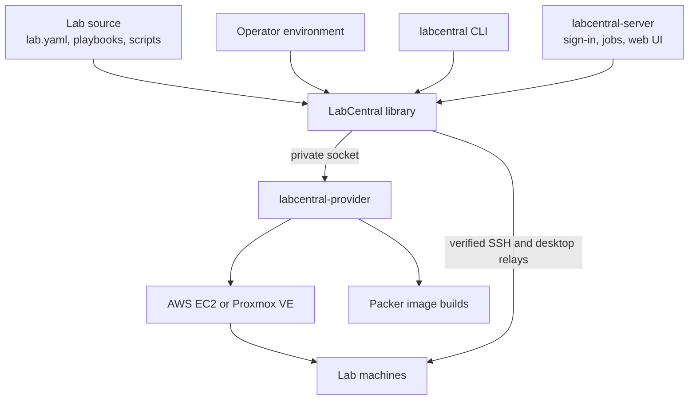

# LabCentral

LabCentral builds and runs hands-on virtual labs from small YAML files and ordinary
Ansible playbooks or PowerShell scripts. A lab describes its images, machines and
networks once, and the same source deploys on AWS EC2 or Proxmox VE, with images kept
native to each platform.

It has three parts:

- **A Go library** that validates lab source, plans deployments, builds images with
  pinned Packer, deploys and destroys labs, and recovers from interrupted operations
  without guessing.
- **A CLI** (`labcentral`) for operators who run labs on their own AWS account or
  Proxmox cluster.
- **A hosted web service** (`labcentral-server`) for teams and classes: a template
  library with guided practice, randomized troubleshooting scenarios, and team meetings
  with in-browser desktops, scoreboards and an instructor terminal.

## Documentation

| Guide | For |
| --- | --- |
| [Writing lab templates](docs/templates.md) | Authors: `lab.yaml`, image builds, stages, checks, breaks and scenarios |
| [Running labs with the CLI](docs/operators.md) | Operators: AWS and Proxmox environments, deploying, state and recovery |
| [Running the hosted service](docs/hosted.md) | Running the web application for a team or class |
| [Developing LabCentral](docs/development.md) | Contributors: building, testing and generated files |
| [Architecture](ARCHITECTURE.md) | The design, its guarantees and what has been verified |

## Features

- **Portable lab source.** One strictly validated `lab.yaml` per lab, with generated
  JSON Schemas for editors. No template language, inheritance or hidden provider
  configuration.
- **Native images.** Packer runs Ansible (Linux) or PowerShell (Windows) inside a
  temporary build machine to produce AMIs or Proxmox templates. Images are cached by
  content, checked on a disposable machine before use, and rebuilt only when their
  inputs change.
- **Private by default.** Lab networks have no Internet access unless an author asks for
  it and the operator allows it. Each lab has a small gateway for SSH and opt-in NAT; Proxmox
  VLANs live on an internal bridge with no physical uplink.
- **Desktops in the browser.** Amazon DCV on AWS and the VM console (noVNC) on Proxmox,
  through authenticated relays with one-use launch links.
- **Recoverable operations.** Every change to a cloud resource is recorded before it is
  made. An interrupted or timed-out operation is treated as an unknown outcome and
  reconciled, never assumed to have failed, and resources are deleted only after their
  ownership is verified.
- **Platform options and extensions.** Typed per-platform settings (instance type,
  volume performance, CPU and NIC models and more) and namespaced `extensions` for your
  own data.
- **Teaching tools (hosted).** Stages completed by an answer, an automatic check or an
  instructor; author solutions; randomized scenarios built from compatible "breaks";
  guest checks that verify real repairs; team meetings, scoreboards and weekly cloud
  allowances.

## How it fits together



Author code (playbooks, scripts, checks and breaks) only ever runs inside lab machines.
Cloud credentials stay in the operator's environment and the provider process.

## Platform support

| Capability | AWS EC2 | Proxmox VE |
| --- | --- | --- |
| Linux guests (Ubuntu 24.04) | Yes | Yes |
| Windows guests (Server 2022) | Yes: desktop, SSH, PowerShell builds and checks | No |
| SSH access | Through the lab gateway | Through the lab gateway |
| Desktop access | Amazon DCV | VM console (noVNC) |
| Internet egress (opt-in, per network) | NAT on the lab gateway | NAT on the lab gateway |
| Multiple networks, NICs and routers | Up to 8 networks and 8 NICs per machine; author CIDRs | Up to 4 networks and 4 NICs per machine |
| Platform options | Instance type, gp3 volume, CPU credits, build instance type | CPU model, NIC model, memory ballooning |
| Environment setup | Build stack and operator configuration | Guided setup and ownership-verified teardown |
| Hosted service | Yes | Library and CLI only |

The operator machine is Linux amd64. Real AWS and Proxmox runs cover the CLI lifecycle,
gateways, egress, SSH and desktops. See
[Qualification status](ARCHITECTURE.md#qualification-status) for specific coverage and
remaining acceptance work.

## Quick start

You need Go 1.27 and an AWS account or Proxmox cluster you control.

```sh
git clone https://github.com/OutboundSpade/LabCentral.git
cd LabCentral
make build
export PATH="$PWD/bin:$PATH"

labcentral init my-lab          # writes a minimal lab
labcentral validate my-lab
```

Then [configure an environment](docs/operators.md#configure-an-environment) and run it:

```sh
labcentral plan    my-lab --environment ~/.config/labcentral/aws.yaml
labcentral deploy  my-lab --environment ~/.config/labcentral/aws.yaml
labcentral access  INSTANCE_ID server ssh
labcentral destroy INSTANCE_ID
```

A lab looks like this; [Writing lab templates](docs/templates.md) covers every field,
and [examples/](examples/README.md) has more:

```yaml
version: 3
name: web-investigation
description: Investigate a web server from an analyst workstation.
images:
  workstation:
    base: ubuntu-24.04
    build: {playbook: images/workstation.yml, files: [images/workstation.yml]}
  server:
    base: ubuntu-24.04
    build: {playbook: images/server.yml, files: [images/server.yml, images/site.conf]}
machines:
  workstation:
    image: workstation
    cpu: 2
    memory: 4Gi
    disk: 20Gi
    access: [ssh, desktop]
  server:
    image: server
    cpu: 1
    memory: 2Gi
    disk: 20Gi
    access: [ssh]
```

## License

LabCentral is licensed under the [Apache License 2.0](LICENSE).
