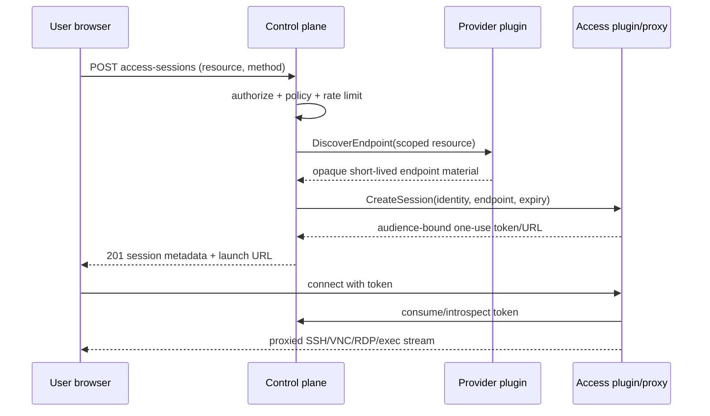

# Access sessions

## Separation of concerns

Provider plugins discover safe endpoint material (for example a Proxmox console ticket request handle, VM address, or Kubernetes pod identity). Core authorizes user/resource/method and creates a short-lived session. An access plugin establishes proxy/tunnel/browser protocol and returns only an audience-bound connection URL/token. Every transition is audited.

## Object and states

`AccessSession` contains ID, subject ID, instance/logical resource, requested method, access plugin, created/expires/lastActivity timestamps, token hash/JTI/audience, status, revocation, source/request metadata, and encrypted/opaque plugin state. Status is `pending → ready → active → expired|revoked|failed`; disconnect may return active to ready until expiry if policy allows reconnection.

Initial tokens are random 256-bit opaque values, stored only as keyed hashes, default five-minute launch TTL and one-time exchange into a bounded session cookie/token. Long-lived provider credentials, control secrets, provider state, and unredacted endpoint data never reach the browser. URL query tokens are avoided; when a browser protocol requires one, it is single-use, redacted, `Referrer-Policy: no-referrer`, and immediately exchanged.

Methods advertise capability and policy: SSH/browser terminal, VNC/noVNC, SPICE, serial, RDP, container/Kubernetes exec, bastion, or provider-native URL. “Endpoint exists” does not grant access. Provider-native links are accepted only if short-lived, scoped, and revocable enough for policy.

Revocation closes active proxy sessions where supported and always blocks new exchanges. Audit records actor, target, method, start/end/revocation/result, not keystrokes or secret content by default. Optional recording requires explicit policy, consent/notice, encryption, retention, and a later ADR.

Future guest credential brokers generate per-instance/per-session SSH keys, passwords, users, RDP credentials, or API tokens; values use secret delivery and are never copied on clone unless explicitly regenerated.

