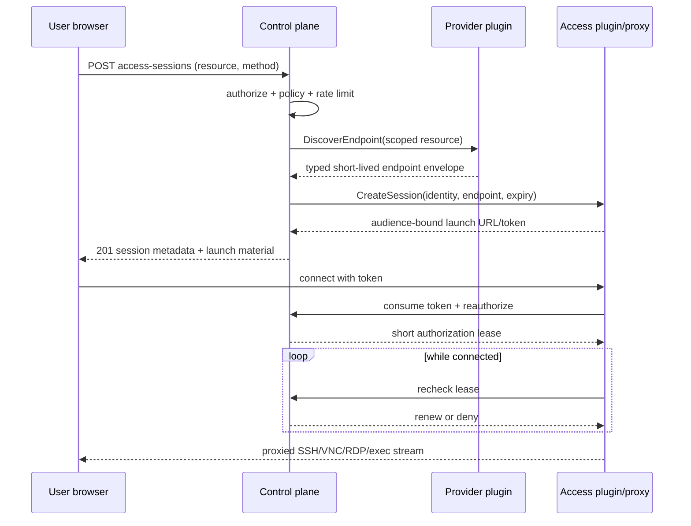

# Access sessions

## Separation of concerns

Provider plugins discover safe endpoint material (for example a Proxmox console ticket request handle, VM address, or Kubernetes pod identity). Core authorizes user/resource/method and creates a short-lived session. An access plugin establishes proxy/tunnel/browser protocol and returns only an audience-bound connection URL/token. Every transition is audited.

The selected v1 path is a separately supervised access-only process, not a WebSocket handler embedded in the control plane and not a provider-native URL handed to the browser. Provider and access plugins may share the launch and health transport contract, but they run as different configured processes, advertise different categories and kinds, and receive only the data needed for one bounded call. The plugin host verifies the access executable identity and digest, binds registration to its configured access kind and instance ID, exposes an `AccessService` client, and does not require an access-only process to implement `ProviderService`. An access plugin has no database connection, provider credential, authorization rule, or unrelated tenant context.

## Versioned handoff and callback contract

The existing `DiscoverAccessEndpoint`, `CreateAccess`, and `RevokeAccess` RPCs evolve additively. A provider endpoint response carries a typed schema name/version, validity, digest, and bounded opaque connection bytes. Access state is likewise a typed schema envelope bound to the access plugin identity/version. Core accepts a handoff only when the selected access kind explicitly supports the endpoint schema and method; an unknown major version, unsupported method, stale provider-state digest, or mismatched instance/resource/target binding fails before the endpoint is opened. Endpoint bytes pass in memory from the provider call to the selected access plugin and are never persisted as ordinary provider state, emitted, logged, or returned to the client. An SSH user-CA value, when enabled, uses a separate invocation-scoped access-credential envelope resolved from its authorized `SecretRef`; it is not mixed into provider endpoint or durable access-state bytes and is cleared after the call.

Access protocol ranges are negotiated independently from provider protocol and provider-state versions, as required by ADR-0012. The first implementation minor requires the `access-authorization-recheck-v1` feature. Older provider plugins continue to negotiate their existing provider minor; they are not required to implement access. A missing feature or incompatible endpoint/access-state schema makes the method unavailable rather than silently weakening reauthorization.

The core hosts an access-authorization callback service on the same host-created private IPC channel used for registration. Registration returns a random per-launch callback credential bound to plugin ID, plugin instance ID, selected access protocol, and configured audience. It is held only by that access process and is never a browser token. Local IPC permissions and the callback credential are both checked; remote transport later uses the same identity binding over TLS 1.3 mTLS.

The callback service has three semantic operations:

1. `ExchangeAccessToken` atomically consumes the one-time launch token and reauthorizes the current subject, ownership/share, membership, role, target grant, instance/resource state, method, audience, and access-plugin identity. Success returns an opaque short authorization lease; it returns no provider endpoint or authorization data.
2. `RecheckAccessLease` repeats those current checks for an active connection. The default authorization lease is 15 seconds and renewal is requested after 7.5 seconds, before that lease expires. A successful renewal moves the connection authorization deadline; it never extends the fixed access-session expiry. A denial closes the stream. If core cannot be reached, an access plugin admits no new connection and closes an active stream no later than 30 seconds after its last successful authorization.
3. `EndAccessLease` reports a bounded safe terminal reason and releases the active connection record. It cannot turn a denied, expired, or revoked session back into `ready`.

The callback caller is identified by the authenticated transport and registration session, not by a request-supplied plugin ID. Tokens and leases are compared by keyed hashes with constant-time equality and consume/renew against database time so concurrent control-plane replicas have one decision. Callback requests and responses are size/deadline bounded and excluded from generic request-body logging.

## Object and states

`AccessSession` contains ID, subject ID, organization/project, instance/logical resource, requested method, target, access plugin/audience, created/expires/last-activity timestamps, token hash/JTI, status, revocation, source/request metadata, endpoint/access-state schema versions, resource desired generation/provider-state digest, resource version, and encrypted/opaque plugin state. Status is `pending → ready → active → expired|revoked|failed`; disconnect may return `active` to `ready` only when policy explicitly allows reconnection before expiry.

Initial tokens are random 256-bit opaque values stored only as keyed hashes. The default launch TTL is five minutes, and session expiry is the earliest of policy expiry, instance expiry, discovered endpoint validity, and the requested bounded duration. A launch token is one use even under concurrent PostgreSQL replicas. Long-lived provider credentials, control secrets, reusable guest credentials, provider state, and unredacted endpoint data never reach the browser.

The launch URL is a configured relative or allowlisted HTTPS route and never contains the token in its query or fragment. The browser transfers the one-time token in the first protected protocol message, under `Referrer-Policy: no-referrer`, and the plugin immediately exchanges it through the core callback. The short authorization lease is confined to the plugin process. Neither token may appear in access URLs, page content after exchange, logs, errors, traces, metrics, events, or audit payloads.

Creation first commits a `pending` session, idempotency binding, audit intent, event, and any required durable retry record. Provider discovery and `CreateAccess` occur outside the transaction under the stable Access Session ID and idempotency key. A lost response is retried with the same identity; the plugin replaces any undelivered launch material so at most one token remains usable. Core finalizes `ready` only after validating the response and storing the token hash plus bounded opaque state. Recovery never treats an ambiguous external response as an authorized launch.

Methods advertise capability and policy: SSH/browser terminal, VNC/noVNC, SPICE, serial, RDP, container/Kubernetes exec, bastion, or provider-native URL. The initial portable method IDs are `ssh` and `vnc`, backed by capability IDs `access.ssh` and `access.vnc`; noVNC is the browser adapter for the VNC method rather than a provider-specific portable method. “Endpoint exists” does not grant access. Provider-native links are accepted only if short-lived, scoped, and revocable enough for policy.

Authorization is checked before endpoint discovery or secret resolution, again after discovery before a session becomes ready, atomically during launch exchange, and throughout the active lease. Current user enabled state, membership and role validity, target grant, instance ownership/share, instance expiry/lifecycle, logical-resource generation/provider-state binding, and method policy all participate. Starting destroy or losing any required relationship makes the next exchange or recheck fail. The plugin never interprets these inputs as an authorization decision.

Revocation is core-first. A version-pinned transaction records `revoked`, revocation actor/time/reason, audit, and outbox intent before contacting the plugin. New exchanges and rechecks then fail immediately even when the plugin is unreachable. `RevokeAccess` is idempotent, closes every active connection for the exact session, and is retried until closure is confirmed or the session has expired. Plugin failure closes its live streams; restart does not revive consumed, expired, or revoked launch material. Audit records actor, target, method, start/end/revocation/result, not keystrokes, screen content, provider tickets, addresses, or secrets. Optional recording requires explicit policy, consent/notice, encryption, retention, and a later ADR.

## First production adapters

The first browser console adapter is implemented as Proxmox VNC through the
separate `lab-access-novnc` proxy. The provider uses only the reviewed
`POST /nodes/{node}/qemu/{vmid}/vncproxy` API after fresh signed-qualification,
effective `VM.Console`, exact provider-state, generation, ownership-marker,
and current VM-config checks. It returns a typed short-lived endpoint envelope
directly to the access plugin through core. The plugin connects immediately,
verifies the proxy against system roots plus the target-configured and
Proxmox-returned CA material by default, consumes the Proxmox VNC challenge
itself, and presents a no-auth RFB stream only after core accepts the one-time
launch exchange. The browser receives neither the Proxmox management origin,
VNC password, nor API credential. Existing mutation qualification does not
imply console support: target config v1.2 must explicitly enable console access
and the changed config/permission profile must be qualified on that exact
installation.

Browser SSH is supported only when the selected image explicitly trusts an operator-configured SSH user CA and policy binds an allowed guest principal. Core resolves the target-scoped CA `SecretRef` only for the authorized invocation; the access plugin generates an ephemeral key, signs a certificate no longer than the Access Session, keeps key material in memory, proxies the terminal, and never returns that credential to the browser. Without that declared trust path, `access.ssh` is `unsupported`; LabCentral does not fall back to a cloned password, shared key, arbitrary control-plane SSH script, or participant-supplied plaintext secret.

Future guest credential brokers may add per-instance/per-session passwords, users, RDP credentials, or API tokens; values use secret delivery and are never copied on clone unless explicitly regenerated.

The executable cases for these rules are [`design/contracts/access-conformance.yaml`](../../design/contracts/access-conformance.yaml). All eighteen normal/guarded Go bindings now exist; `TEST-ACCESS-018` is an opt-in black-box run against an operator's disposable authenticated installation and skips before file or network access when inactive. `TEST-SEC-ACCESS-001` and `TEST-SEC-ACCESS-002` remain the threat-model anchors for single-use launch and telemetry secrecy.

## Explicit encrypted tailnet transport

[ADR-0019](../adr/0019-pinned-tailnet-console-transport.md) adds an operator-selected
Linux transport for VNC sockets that are already inside Tailscale. A closed
`labcentral.tailscale-vnc/v1` profile pins target, MagicDNS name, numeric tailnet
address and node public key. The local tailscaled identity lookup must confirm
the complete online peer binding. `SO_BINDTODEVICE=tailscale0` fixes the route
to the encrypted tunnel, and the plugin permits only ports 5900–5999. There is
no automatic TLS downgrade or management credential delivery to access.
Default TLS transport and existing endpoint schemas remain unchanged.

Launch finalization uses the database clock as the maximum launch-token TTL.
If the application clock is slightly ahead (including SQLite millisecond
rounding), finalization shortens the requested launch deadline to that bound.
It never extends the caller deadline or fixed session lifetime; expired launch
requests still fail. This avoids intermittent rejection at the TTL boundary.

## Independent extension foundations

ADR-0024 adds namespaced descriptors, workload/network targets and one-time credential delivery without introducing plugin-defined authorization classes. See the [extension contract](extensions.md) for adapter resolution, enforcement/recovery features and remaining conformance gates. Legacy ssh/vnc records keep their existing meaning.
