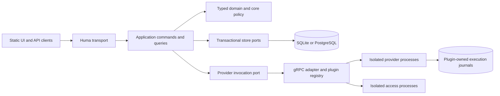

# Architecture audit — 2026-09-04

> Historical audit at the pre-refactor checkpoint. The owner approved implementation; ADR-0015, ADR-0016 and ADR-0017 and the [current architecture](architecture.md) supersede the proposals and implementation observations below.

LabCentral has a sound foundation, but its extension boundary is less complete than its production machinery. The highest-value simplification is to make one provider-neutral application path and one configurable plugin runtime real, then prove them with a provider developed outside the core. Rewriting the platform or introducing more independently deployed core services would discard useful work without addressing these constraints.

This is the assessment for **TASK-ARCH-001**. The owner selected a broadly extensible, multi-provider platform with third-party plugins as the next 6–12 month priority, specifically new infrastructure providers implementing the existing lab resource types, and is open to substantial simplification. Recommendations below are proposals, not accepted replacements for existing ADRs. `TASK-PROD-004` remains in progress with its existing evidence gaps; this audit does not certify production readiness or authorize provider operations.

The review covered the fourteen accepted ADRs, state/checklist, relevant architecture and operational contracts, and representative runtime, persistence, renderer, HTTP, UI, provider, SDK, and test code. Findings distinguish directly observed implementation constraints from architectural judgments. This was not an exhaustive security scan or live deployment assessment.

**Keep the foundations that are doing useful work.** Preserve the Go modular monolith, canonical Huma API, static frontend, typed portable resources, bounded declarative rendering, independent provider/access processes, core authorization, immutable ownership identities, absence-gated allocation release, and database-backed durable execution. SQLite and PostgreSQL serve explicit supported deployment needs and already share conformance tests; deleting one is not an obvious saving. Likewise, core invocation records and provider journals solve different failure windows: do not collapse them into one record or give plugins access to the control-plane database.

**1. High priority: make provider installation independent of core compilation.**

Observed: [cmd/labd/main.go](../../cmd/labd/main.go), lines 228–323 and 657–676, constructs Docker, Proxmox, and noVNC individually with separate flags, identifiers, configuration paths, and examples. The target registry accepts arbitrary provider-kind strings, but the executable does not expose that flexibility. [service.go](../../internal/controlplane/service.go), lines 167–184 and 359 onward, and [batches.go](../../internal/controlplane/batches.go), line 67 onward, contain Docker/Proxmox-specific orchestration branches. The [plugin design](plugin-system.md) explicitly acknowledges that general manifest installation remains unimplemented. The [release matrix](../compatibility.md), line 13, requires core/plugins from the same release even though ADR-0012 anticipates independent compatibility.

Implication: another provider currently needs core composition work and may require additions to admission logic, packaging, health reporting, and example wiring. Protocol compatibility alone does not yet deliver the promised ecosystem.

Proposal: use one closed, versioned installation configuration containing plugin identity, pinned executable/manifest identity, launch or attach mode, and a list of target bindings. Keep plugin-owned configuration in validated, versioned envelopes; keep the portable resource model typed. Move provider-specific prerequisite interpretation behind an adapter while core admission enforces generic required capabilities, freshness, isolation policy, grants, and quotas. A provider assertion must never grant its own authorization or establish hostile-workload safety by itself.

Start with explicit administrator installation and restart-based configuration reload. Dynamic hot installation, a marketplace, a plugin UI framework, and remote sites are unnecessary prerequisites. Give the SDK/protocol a tested release compatibility matrix, distinguishing supported official deployment combinations from external protocol compatibility. Acceptance: install an externally built provider with two targets on an unchanged `labd` binary, run conformance and restart recovery, and reject incompatible state/features before dispatch. Preserve ADR-0002/0003; any public configuration contract and change to the release matrix needs a decision under TASK-ARCH-002.

**2. High priority: contain plugin failure to its targets.**

Observed: [cmd/labd/main.go](../../cmd/labd/main.go), lines 330–345, includes every configured plugin in overall readiness. Lines 431–455 monitor plugin failure; lines 489 onward cancel workers and shut down the server when any one plugin fails. The [plugin design](plugin-system.md) describes this as the implemented registration-recovery strategy. The Kubernetes design supports only bundled official plugins because a Pod shares its network namespace.

Implication: a failed optional console or third-party provider interrupts unrelated targets, API administration, and existing access flows. Adding plugins increases the control plane's failure exposure. Separate processes currently provide less availability isolation than the architectural shape suggests.

Proposal: introduce explicit plugin/target health and reconnect states. Stop admission and dispatch only for affected targets; retain unknown invocations for reconciliation before replay. Keep core administration and healthy targets available. Rebuild launch credentials and registration safely on restart with bounded backoff and an operator-visible circuit breaker. Separate core readiness from target availability. Continue to close access leases when authorization cannot be rechecked.

Choose one lifecycle owner for each deployment: systemd/Kubernetes owns external processes; the local supervisor owns laptop children. Do not build a second general-purpose orchestrator. External third-party plugins need an enforced filesystem/network identity boundary, not merely a manifest declaring permissions. Preserve ADR-0008 and add tests where one provider or the access process exits while another target continues working. Standard gRPC service health supports service-specific availability; adopting it would still require LabCentral's registration, fencing, and recovery state machine. [gRPC health documentation](https://grpc.io/docs/guides/health-checking/), retrieved 2026-09-04.

**3. High priority: converge on one application/storage boundary.**

Observed: [application/ports.go](../../internal/application/ports.go), lines 12–25 and 298 onward, declares `UnitOfWork`, `Repositories`, and `PluginInvoker`, but repository-wide Go searches find no runtime consumers of those interfaces. Runtime orchestration instead uses the large [controlplane.Store](../../internal/controlplane/model.go) interface at line 551 and generated gRPC clients in [targets.go](../../internal/controlplane/targets.go). The [architecture tests](../../internal/architecture/imports_test.go) protect domain/application and provider imports, but do not constrain actual orchestration's transport dependencies. The production store is still named `localdb`; [store.go](../../internal/adapter/localdb/store.go), lines 1730–1754, updates instance state and prototype job-aggregate state and emits legacy job records in the same finalization path.

Implication: developers must understand the aspirational ports and the real runtime contracts. Pure package tests can pass while transport coupling grows in the package that actually implements use cases. Duplicate state/event representations add transaction maintenance costs even though the existing atomic updates avoid a demonstrated consistency failure.

Proposal: retain the working transactional command semantics and move cohesive consumer-owned ports into the actual application layer: template operations, instance admission, execution checkpoints, access authorization, and queries. Use one provider adapter to translate typed application requests/results to gRPC. Remove unused abstractions after consumer inventory rather than implementing them solely because the design sketched them. Rename `localdb` to reflect its dual-backend role when moving boundaries; do not rewrite SQL just to adopt a repository framework.

Keep permission/quota rechecks inside write transactions. Splitting a large interface must not split atomic classroom admission into separately committed repository calls. Inventory consumers of legacy events/aggregate columns before an expand/migrate/contract retirement; preserve replay and audit history. Acceptance: runtime orchestration has an enforced transport boundary, existing SQLite/PostgreSQL crash/fencing/admission conformance passes, and each persisted lifecycle field has an explicit authoritative owner. ADR-0001/0011 already support this direction.

**4. High priority: separate reusable templates from resolved instances.**

Observed: [LabRequest and InstanceBatchRequest](../../api/http/server.go), lines 96–124, contain no typed input values. [PublishTemplateRevision](../../internal/controlplane/templates.go), line 117, renders with `nil` inputs; [OpenTemplateRevision](../../internal/controlplane/templates.go), line 215, re-renders with the current renderer and requires exact renderer/canonical-version equality. Revision records preserve a source artifact, versions, and a canonical digest, but not the canonical bytes promised by ADR-0012. Instances do persist canonical bytes. The renderer correctly rejects missing required inputs in [inputs.go](../../internal/render/inputs.go).

Implication: the current reusable-template flow works for declarations whose inputs can be resolved from defaults. Required participant inputs cannot flow through the product API. A renderer-version change can prevent an old revision from opening; the current check fails closed rather than silently changing its meaning.

Proposal: make the lifecycle explicit: immutable source revision with parameter schema and pinned renderer semantics → typed instance inputs → persisted resolved canonical instance and plan. Validate a parameterized revision without requiring participant values; render only when instantiating or explicitly previewing with inputs. Decide how stored renderers/compiled representations remain usable across upgrades, and what canonical publication artifact exists for a parameterized revision. Do not merely remove the provenance check or use the latest renderer automatically. Explicit migration should produce a new representation/revision with provenance.

Acceptance: publish a required-input template, instantiate it twice with different values, retain stable instance digests/replay, and exercise a renderer upgrade with an old revision. This requires an ADR clarifying/superseding the affected part of ADR-0012 and any public schema changes before implementation.

**5. High priority design review: reduce qualification's operational coupling.**

Observed: [ADR-0014](../adr/0014-qualified-proxmox-production-mutation.md), lines 30–52, binds writes to exact executable/source, target/PVE/profile, reviewer trust, and expiring evidence. It explicitly applies to destroy and notes that expiry/revocation can defer cleanup. [execution.go](../../providers/proxmox/execution.go), lines 607–638, rechecks inventory and authorization under the mutation lease. [Makefile](../../Makefile) derives the provider source identity from the repository archive, coupling qualification to the release source tree as well as provider behavior.

Judgment: this is defensible for a tightly controlled reference installation, but costly as a universal operating model for an extensible platform. It combines software provenance, deployment qualification, current safety, and permission to clean up into one frequently invalidated gate. Routine deployment changes can require destructive requalification, while TTL cleanup can remain blocked.

Proposal: design separate software release verification, deployment/profile qualification, and fresh operational eligibility checks. Scope each identity to the facts it actually protects while retaining complete release provenance. Evaluate a distinct, explicitly authorized and audited cleanup path for already-owned resources; expired evidence must not become an unconditional delete permission. Ownership ambiguity, revoked authority, and changed target identity must remain blocking conditions. This needs a replacement ADR-0014 decision, not a configuration switch or an implementation shortcut. Test renewal, revocation, binary upgrade, target drift, expiry during an operation, and cleanup policy independently.

**6. Medium priority: make execution topology honest before expanding HA.**

Observed: [journal.go](../../providers/proxmox/journal.go), lines 33–37, deliberately serializes all writes using one target journal lock, including independent provider processes. [execution.go](../../providers/proxmox/execution.go) retains that lease in `preparedExecution` across discovery and provider work, including task waits. The [deployment design](deployment.md) requires shared RWX state for multiple replicas. The documented 100-Instance resilience result uses an in-process deterministic provider; live target load and cross-node storage/failover evidence remain open.

Implication: additional core replicas improve control-plane redundancy but do not establish concurrent Proxmox mutation throughput. Durable queue state, artifact storage, and provider execution journals have different ownership/recovery requirements. Cross-node lock safety cannot be established by the journal's same-host two-file-descriptor self-test alone.

Proposal: document core/API scaling separately from per-target execution concurrency. Keep the conservative lock until measured workload evidence justifies finer concurrency. Evaluate one active execution owner per target with a plugin-owned durable journal, independent of core replica count; failover still needs explicit ownership fencing, recovery storage, and tests. This is a design candidate, not a claim that a singleton automatically solves HA. Avoid giving every new provider an implicit shared-filesystem requirement. Defer remote agents and a new execution service until this local contract is demonstrated. Never shorten lock scope without testing response-loss, conflicting lifecycle actions, and stale-owner recovery.

**7. Medium priority: generate client contracts and reduce documentation duplication.**

Observed: [web/src/lib/api.ts](../../web/src/lib/api.ts) manually defines HTTP types and uses generic response casts; [web/package.json](../../web/package.json) has no OpenAPI client generation step. The main UI and HTTP registration files are 606 and 2,614 lines respectively. [architecture.md](architecture.md) presents route shells and other features more broadly than the implemented frontend. At audit start, `AGENTS.md` said runtime services and persistence had not started, contradicting `PROJECT_STATE.md`. Reconciliation prose also contains historical producer-work statements after that work was completed.

Proposal: derive client DTOs from checked OpenAPI and keep a small handwritten authentication/error wrapper. Split handlers and UI by feature only where they have independent responsibilities; avoid a generic screen/schema framework. Keep ADRs for reasons, machine contracts for guarantees, design docs for current structure, and one short state summary with links to execution evidence. Generate repeated indexes where practical, and label future architecture explicitly. A green link/ID verifier does not establish that prose matches implementation. The stale agent-guide phase statement is corrected as audit housekeeping; broader documentation convergence belongs in the follow-up.

**Proposed target shape**

This remains a modular monolith. Fewer competing contracts and provider-specific branches are the simplification; process, credential, and ownership boundaries remain intentional.

**Recommended sequence and completion criteria**

1. **TASK-ARCH-002: decision package.** Resolve template/version semantics, qualification/cleanup authority, plugin failure containment, supported external-plugin isolation, and release compatibility. Propose dependent implementation tasks and any replacement ADRs; do not silently reorder TASK-PROD-004 or reverse accepted decisions.
2. Consolidate the actual application ports and transport adapter, preserving transactional behavior and compatibility. Add boundary checks around the runtime package.
3. Add explicit manifest/configuration loading and per-plugin recovery, then prove an external provider can be installed without rebuilding core. Use two targets and an independent failure test as the architecture acceptance gate.
4. Complete typed template input and upgrade behavior. Migrate persisted contracts explicitly.
5. Reassess multi-replica execution and qualification operations with measurements. Retain unfinished production gates as unfinished rather than treating fake-provider scale results as infrastructure evidence.

An external provider implementing existing resource kinds is the owner-confirmed first extension priority and the proposed architecture exercise. Arbitrary new resource kinds, policy-granting plugins, and a marketplace are separate product decisions. Keep independent format versions where data or external plugins outlive releases; reduce manual bookkeeping with compatibility manifests rather than collapsing all versions into product SemVer. Additive Protobuf evolution and reserving removed tags remain appropriate. [Protobuf best practices](https://protobuf.dev/best-practices/dos-donts/), retrieved 2026-09-04.

**Verification**

The focused architecture/domain/application/control-plane/localdb/HTTP/plugin-host Go suite passed, with most package results served from the existing Go test cache. Renderer, jobsdb, Docker, and public SDK package checks also passed. The complete design verifier passed YAML/JSON, examples, canonical vectors, protocol format/lint/breaking, contract catalogs, topology/release checks, and links/state consistency. The initial Proxmox attempts encountered read-only cache and sandbox socket restrictions. A fresh Proxmox run then passed using a writable temporary cache and permission to open local fake HTTPS servers; the three credentialed T3 runners and live T4 upgrade-readability runner were explicitly excluded by test name. No credentialed provider qualification, PostgreSQL service provisioning, live load/soak, or production changes were performed for this audit.
