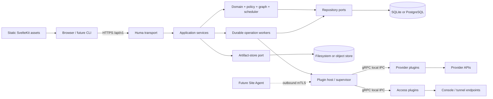
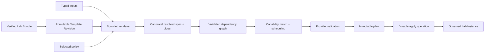
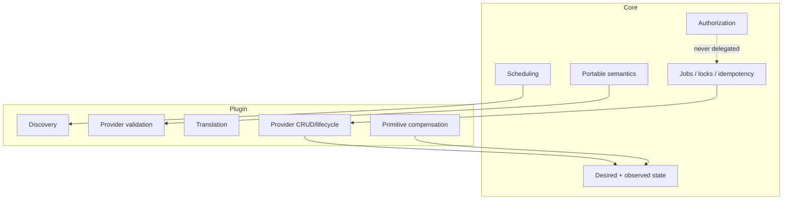
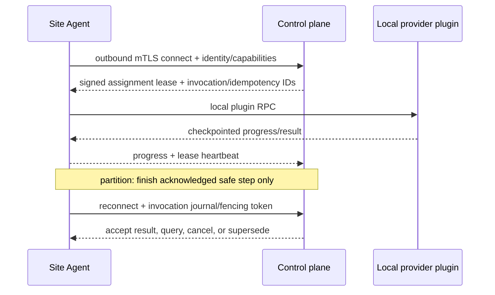

# Architecture

## Top-level shape

LabCentral is a microkernel-shaped modular monolith: the core defines identity, portable meaning, authorization, desired/observed state, orchestration, and scheduling; plugins realize those meanings. Provider differences are exposed as capabilities and plan warnings, not hidden behind false equivalence.



### Dependency rules

- `internal/domain` imports no Huma, SQL, provider SDK, or generated transport types.
- `internal/controlplane` coordinates domain ports; `api/http` maps HTTP DTOs and errors.
- Persistence/artifact adapters implement application-owned interfaces.
- Official providers use only generated plugin contracts, `pkg/plugin-sdk-go`, and provider-local code.
- UI uses OpenAPI-derived client types and no provider API.
- Generated gRPC code is owned by `api/plugin/v1`; generated OpenAPI is owned by `api/http` build tooling.

## Template-to-instance pipeline



Validation never mutates provider infrastructure. A plan records target capability snapshot/digest, plugin version, expected logical actions, quotas, warnings, destructive actions, and expiry. Apply rejects a stale plan when relevant target capability, policy, revision, or input digest changed.

## Control/plugin boundary



Plugin outputs are assertions to be validated, bounded, and stored—not trusted authorization decisions. The core never interprets opaque provider state but validates its envelope and size.

## Scheduling

Core scheduling filters before scoring:

1. Explicit target or targets granted to the tenant.
2. Healthy, connected, compatible plugin and readable provider-state versions.
3. Required capability expressions, isolation class, labels, placement, policy.
4. Reservable quota and non-stale capacity where required.
5. Score operator priority, capacity headroom, locality, and non-binding cost hints; use stable target ID as deterministic tie-breaker.

Unknown capacity may be accepted only when policy labels the target `capacityMode: optimistic`; realization then may fail with `capacity_failure` and reservations are recovered. There is no mid-instance failover because an instance binds to one target. Explicit incompatible selection returns structured missing-capability details.

## Future Site Agent

The Site Agent is a transport and supervision boundary, not a second provider API. Direct control-plane-to-locally-supervised-plugin connectivity is implemented first. The agent later enrolls with a one-time token, receives an installation/site identity certificate, initiates an outbound mTLS stream, supervises the same executables, and persists assignment/invocation/idempotency metadata. Control plane owns authorization, scheduling, desired state, and durable operation truth; agent owns local connectivity, site-local provider credential resolution, and temporary offline execution checkpoints. The central database may store the credential reference but need not receive its value.

During partition, an agent may finish an already acknowledged idempotent step but starts no new assignment after its signed lease expires. It buffers bounded progress and reconciles by invocation ID/fencing token. Duplicate deliveries return the recorded result. Certificate rotation overlaps old/new validity; revocation blocks new leases immediately. This remains a later milestone.



## Static web UI

SvelteKit route shells are prerendered for `/login`, `/labs`, `/team-labs`, `/templates`, `/templates/[id]`, `/instances/[id]`, `/operations/[id]`, `/providers`, `/admin/{users,teams,quotas}`, and `/audit`; parameterized routes use static entry/fallback rules explicitly tested by the export. Screens cover typed-input instance creation, validation/plan/capability/portability errors, topology/resource state, progress, access, snapshots/reset/restore, TTL, and role-gated administration.

At startup the client fetches public `/api/v1/server-info` for API base, auth mode/methods, server version, public feature flags, enabled provider kinds, and unsafe-mode banner; it then fetches `/session`. No provider target credentials, secret refs, internal URLs, or authorization decisions live in frontend configuration. UI gating improves usability but server authorization is always authoritative.

## Repository shape

```text
cmd/labd                    control-plane composition root
cmd/lab-agent               future remote site agent
cmd/lab-provider-*          official plugin entry points
internal/{domain,controlplane,jobs,auth,persistence,pluginhost,artifacts}
pkg/{plugin-sdk-go,api-client-go}
api/{http,plugin/v1}
providers/{fake,docker,proxmox,kubernetes,fly,aws}
schemas/                    author/editor and event schemas
examples/                   complete Lab Bundles and golden outputs
web/                        SvelteKit/DaisyUI static frontend
docs/{design,adr}
design/{state.yaml,checklist.yaml}
```

Packages are added only at a durable dependency boundary; provider-specific code never enters core packages.
