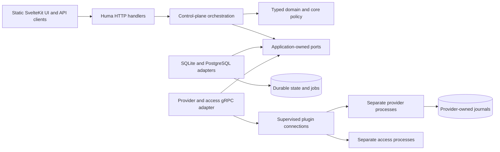

# Architecture

LabCentral is a modular monolith. The first third-party extension is an infrastructure provider implementing existing resource types. Arbitrary resource schemas, authorization plugins, remote agents, hot upgrades and a marketplace are future decisions. Current decisions are ADR-0015, ADR-0016 and ADR-0017; the [audit](architecture-audit-2026-09-04.md) records the earlier rationale.

## Boundaries

`internal/domain` contains portable resource types and pure policy/graph behavior. `internal/application` owns actual command/query, worker, authorization, artifact and provider interfaces. `internal/controlplane` coordinates them without importing generated plugin types or gRPC. Compatibility aliases preserve internal callers while declarations have one owner. `internal/adapter/localdb` is the historical package name of the shared SQLite/PostgreSQL implementation; it retains existing SQL migrations and persisted protobuf state decoding. `internal/adapter/providergrpc` owns RPC translation and terminal-stream handling. Import tests guard domain/application and orchestration boundaries.

Store operations describe complete atomic application changes. Adapters repeat mutable authorization, quota, version and fence checks inside transactions. Enqueueing a classroom batch never decomposes into independently committed reservations, instances and events. Plugins never receive a database handle or make authorization decisions.

## Template and instance identity

Publication validates source syntax, schema, parameter declarations/defaults and provider override envelopes, then stores immutable source plus canonical authoring representation. It does not need participant values. Preview and creation resolve typed inputs and evaluate expressions, resource graphs, capabilities and policy. Each revision pins renderer semantics independently of product version. Each instance persists resolved canonical bytes, digest and provider plans. See [template rendering](template-rendering.md).

## Provider composition and failure

An operator-authored installation binds digest-pinned manifests to target IDs, configuration files, secret references and core policy. No provider-kind switch is needed for external registrations. Capabilities remain discovered per-target facts. Protocol/features and optional required native capabilities are policy inputs, never authority granted by a plugin. Docker's explicit trusted-laptop acknowledgement and the official Proxmox profile remain compatibility defaults.

Production external providers attach under separately provisioned identities and filesystem/network policy. Trusted development may launch local children. A stable connection adapter replaces failed plugin registrations after three failed health checks, with five bounded restart attempts per deployment. Unavailable target jobs remain pending; available targets continue. An interrupted mutation remains unknown until its original invocation is recovered. Core readiness does not aggregate plugin health. Target availability is visible through the product API.

Core replica count is separate from provider execution concurrency. The Proxmox journal retains one mutation owner at a time; multi-node shared-journal correctness remains a live qualification gate. Other providers define their own durable execution storage and failover contract.

## API and UI

Huma route registration is the API authority. `tools/openapi` exports `api/http/openapi.json`; pinned `openapi-typescript` generates `web/src/lib/api.generated.ts`. CI checks generation drift. The handwritten wrapper only handles fetch, authentication and errors. HTTP handlers are grouped by lab, template, access, quota, records, authentication and administration.

The static SvelteKit UI currently implements authentication/project selection, target selection, source and typed parameter editing, plan/create/destroy, instance status, and browser console launch. Broader template/governance administration exists in the API; dedicated UI screens are future work. The UI calls only the product API and uses relative URLs under `/api/v1`.

See [plugin installation](../operations/plugin-installation.md), [application ports](domain-ports.md), [compatibility](../compatibility.md), and [project state](../../PROJECT_STATE.md) for the operational and implementation contract.
