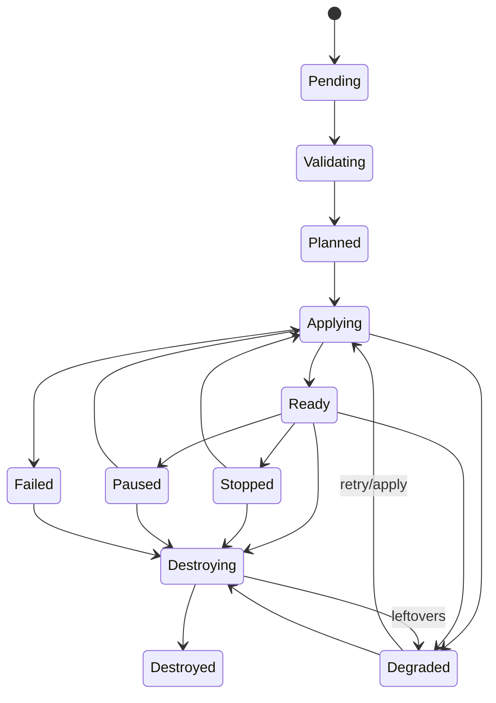
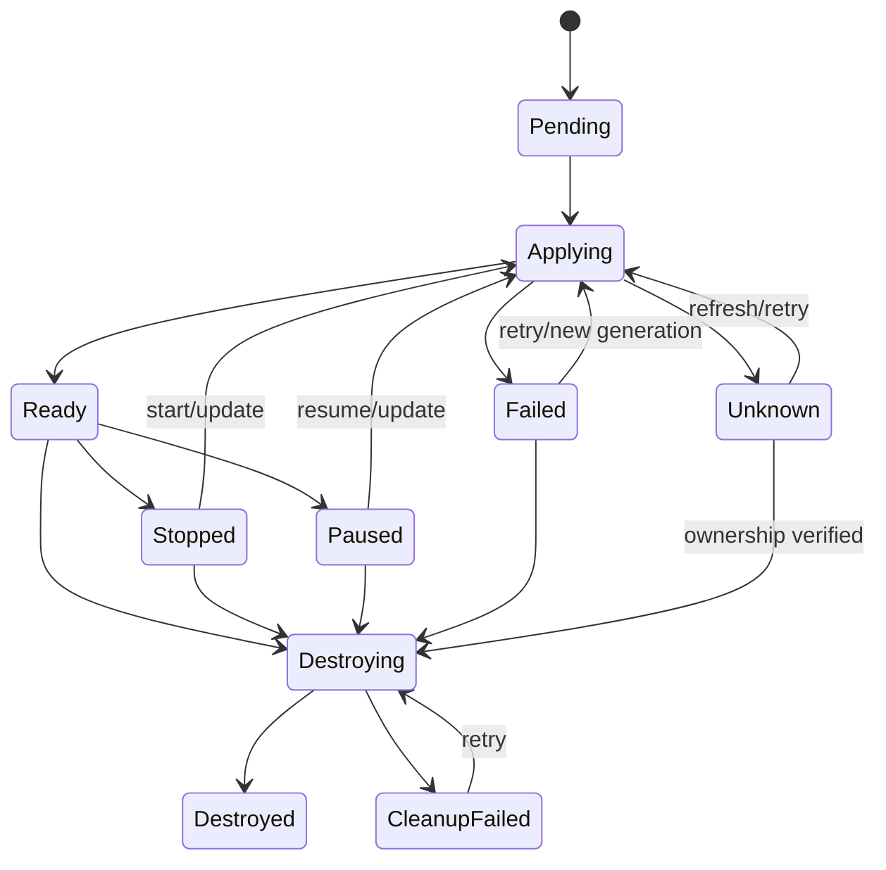

# Domain model

## Aggregates and identity

All IDs are opaque, stable UUIDv7/ULID-style values generated by core; names are scoped display identifiers, never ownership proof.

| Aggregate | Invariant |
|---|---|
| Installation | Stable ID used in every provider ownership tag. |
| Organization / Project / Team | Scope tree; memberships and role assignments are explicit. |
| ProviderTarget | One configured environment, provider plugin binding, credential refs, labels, grants, capability snapshot, health. |
| LabTemplate | Mutable metadata pointing to immutable Template Revisions. |
| TemplateRevision | Bundle digest + source provenance + author schema + immutable canonical authoring representation and renderer semantics (ADR-0016). |
| LabInstance | Exactly one revision, target, owner/share scope, resolved inputs, canonical spec digest, desired lifecycle, TTL, generation. |
| LogicalResource | Exactly one instance; portable kind/spec, generation, observed status, provider-state envelope. |
| Operation | Durable user intent, actor, target aggregate, state, progress, structured result/errors. |
| Snapshot | Instance/resource scope, provider identities, consistency/mode, compatibility and retention metadata. |
| AccessSession | Authorized subject/resource/method, expiry, revocation, token hash, access-plugin state. |
| Quota/Reservation | Scoped limit and expiring operation reservation; committed usage reconciles observed resources. |

## Portable resources

- **Network:** independent provider topology object and dependency target; owns CIDRs, IPAM, isolation/external intent, egress, and MTU hint.
- **Volume:** independent persistent/ephemeral storage lifecycle and snapshot target. Ephemeral root filesystems remain workload fields.
- **VM:** portable virtual-machine isolation semantics; owns NIC and mount subresources, image ref, requirements, placement, provisioning, lifecycle.
- **Container:** OCI-process semantics plus requested isolation; owns NIC/mount/port/config subresources. `realizationPreference` may allow native, sandboxed, or via-VM, but policy can require exactly one.
- **AccessEndpoint:** declared access intent/policy attached to a workload. It has user-visible lifecycle and authorization separate from a published application port.
- **Output:** typed projection of static or observed fields with sensitivity marker and readiness dependency.

`ImageRef`, `ArtifactRef`, and `SecretRef` refer to external inventory/stores and are not resources. Interfaces and mounts cannot exist without workloads, so they are ordered typed subresources. Published ports are network exposure policy, not independently managed resources.

## Desired, observed, and provider-owned state

```text
LabInstance.desired = {generation, lifecycle, canonicalDigest, policyDigest}
LogicalResource.desired = {generation, kind, canonicalSpec}
LogicalResource.observed = {observedGeneration, phase, health, addresses, timestamps, drift, conditions[]}
ProviderStateEnvelope = {pluginID, pluginVersion, schemaVersion, instanceID,
                         logicalResourceID, ownershipIDs[], migrationRequired,
                         opaqueBytes, digest}
```

Core treats `observedGeneration == generation` plus provider-reported readiness as converged. `Unknown` means observations are too stale or provider/plugin unavailable; it never implies deletion. Provider state is bounded (initial recommendation: 256 KiB/resource), access-controlled, never sent to clients, and prohibited from holding reusable plaintext credentials.

## State machines

Instance phase is an aggregation, not the operation state:



Resource phases: `pending → applying → ready|failed|unknown`; ready may transition to `stopped|paused|applying`; any non-destroyed state may transition to `destroying → destroyed|cleanup_failed`. Instance `Failed` is reserved for failure before usable resources or a permanent aggregate error; partial success is `Degraded`.



Operation states are `queued, running, cancel_requested, compensating, succeeded, failed, canceled, timed_out, partial`. Terminal success requires all promised postconditions.

TTL policy stores requested expiry, maximum lifetime, renewal policy, warning schedule, destruction grace, and whether persistence is allowed. The implemented Instance snapshot pins the resolved policy digest and maximum expiry at admission. Renewal uses database time, optimistic concurrency, exact idempotent replay, a fresh composition of every applicable lifetime policy, quota-scope expansion checks, and an in-transaction authorization recheck. A durable sweeper emits a one-shot `lab-instance.expiring` event, expires invocation-free admission work after its reservation or exact Instance TTL elapses, then requests the same audited/idempotent destroy operation used by a user after grace. Idle shutdown is enabled only when a provider/access capability supplies a defined, timestamped activity signal; absence of such a signal means “unknown,” never “idle.” Persistent instances opt out of TTL only where policy permits.

Quota limits are versioned resources over a closed scope and dimension vocabulary. One Instance reservation contains normalized positive amounts plus a line for every applicable scoped limit. Usage is separated into `reserved`, `committed`, and `retained`; total usage is their checked sum. Hard quota quantities come from the immutable canonical request/accepted plan and cannot be increased by a provider at realization. Provider cost hints remain advisory while `OQ-QUOTA-001` is open and are not exposed as enforced quota dimensions.

## Error contract

`DomainError` includes stable `code`, class, safe message, resource/ref/field paths, retryability, retry-after, provider-safe details, correlation ID, and nested causes. Classes are `invalid_declaration`, `missing_capability`, `provider_validation`, `authentication`, `authorization`, `quota`, `capacity`, `provider_unavailable`, `plugin_unavailable`, `transient_provider`, `permanent_provider`, `timeout`, `cancellation`, `partial_cleanup`, and `state_version_incompatible`.
