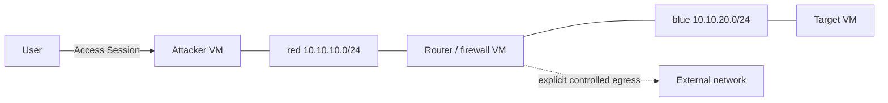

# Networking

## Portable model

`Network` declares `kind: isolated|external`, optional IPv4/IPv6 CIDRs, `ipam.mode: none|static|providerManaged`, MTU hint, and `egress.mode: deny|restricted|allow`. A workload NIC declares ordered `networkRef`, optional static addresses/MAC, and capability requirements. `publishedPorts` declare protocol, workload port, exposure `host|public|proxied`, optional requested external port, and allowed sources. A proxied service produces an access/application URL without promising a public IP.

Defaults are isolated and denied egress (ADR-0004). `external` requires an administrator-resolved target network reference or provider override. CIDRs define author intent; providers that cannot allocate that exact CIDR fail rather than substitute. Interface order is stable and part of canonical identity.

The core does not model DHCP, DNS, routes, NAT, firewalls, VPNs, or routing protocols inside a router guest. Guest provisioning configures those. Advanced features—broadcast fidelity, trunks, BGP, spoofing, promiscuous mode, taps, shaping/latency/loss, overlays, and public-IP details—are required capability predicates or versioned overrides.

## Provider mappings

| Logical construct | Mapping and limitation |
|---|---|
| Proxmox isolated network | Existing/admin-approved VLAN-aware bridge plus allocated VLAN, or SDN zone/VNet if discovered; NIC maps to QEMU `netN`. Plugin never creates host bridges casually. L2/static MAC/VLAN depend on target policy. |
| KubeVirt network | Pod network for simple L3; Multus `NetworkAttachmentDefinition` plus KubeVirt network/interface for multiple segments/L2. IPAM/MAC/NetworkPolicy depend on installed CNI and binding. |
| Kubernetes container | Namespace + CNI pod network; Multus only when discovered. NetworkPolicy realizes L3/L4 isolation only when the CNI actually enforces it. |
| Docker network | User-defined Engine network with labels, optional requested IPAM if supported. Published ports use Engine API. Desktop baseline makes no raw L2/host firewall claim. |
| Fly network | Custom 6PN per lab or isolation scope, private IPv6/DNS and Fly services. Reject arbitrary L2, custom MAC/CIDR, multi-NIC, and router topology. |
| AWS network | VPC/subnet (shared or dedicated policy), route table, ENIs, security groups and optional NACL/NAT/IGW/public address. Subnet is one AZ and L3 semantics; router appliances require explicit source/destination-check and route validation. |

The first Proxmox mutation contract narrows its mapping to an existing administrator-approved VLAN-aware Linux bridge plus one core-claimed VLAN per isolated logical Network. The Network provider state records that binding; dependent VM plans consume it. It does not create or reconfigure bridges, SDN, routes, firewall, DHCP, or NAT. IPv4 static addressing is rendered into typed PVE `ipconfigN`; IPv6, external networks, trunks, and provider-managed IPAM fail validation. Capability remains unsupported until management-path and cross-instance negative connectivity tests pass on the exact target profile.

## Qualified preconfigured Proxmox egress

ADR-0030 extends the initial subset with target-config v1.5. A network profile may
bind an exact allowed-egress IPv4 CIDR and gateway to reviewed policy/probe
digests and measured Internet/management/cross-lab results. Matching is explicit:
denied requests cannot consume an allowed-egress VLAN, and allowed requests
cannot consume a denied-egress profile. VLAN pools are disjoint even when they
share a bridge. Typed VM addressing carries only the configured gateway; workload
addresses cannot equal the gateway or subnet network/broadcast addresses.

The provider still creates no routing, NAT or firewall infrastructure. An
operator-owned boundary outside student guests supplies stateful outbound IPv4
with management/private/metadata/cross-lab denies, source-spoofing protection and
IPv6 denial. Qualification must measure Internet access and negative reachability
with overlapping-CIDR labs, including altered guest networking, before signing the
exact target/build/profile. Operator details and policy transcripts are private.
Unconfigured or unqualified targets fail explicit egress requests.

## Docker laptop degradation

The `TASK-DOCKER-001` baseline uses only version-negotiated Docker Engine image/container/volume/network APIs. Every published port is bound explicitly to `127.0.0.1`; a provider-selected host port is read back from Engine state before the instance becomes ready, and published TCP ports must accept a bounded loopback connection. Containers drop all Linux capabilities, set `no-new-privileges`, and receive declared CPU/memory limits. These controls reduce exposure but do not turn containers into a hostile-workload boundary.

Example A requests both denied egress and a host-published web port. The thin provider cannot prove denied egress for that portable published-port path, so it refuses validation until `trustedLaptopIsolationAccepted` is true, creates a normal user-defined bridge, and reports `docker_trusted_laptop_only`. Thus `egress.mode: deny` is explicitly degraded—not silently treated as satisfied. Strong egress enforcement remains capability-gated future work.

## Routed cybersecurity example

Target has no external attachment; router egress is optional and policy constrained. Providers lacking at least two isolated segments, VM isolation, and a three-interface router (when egress enabled) fail capability validation.

## Plan and drift

Plans show logical segments, attachment order/addresses, provider mapping class, policy enforcement evidence, exposure, warnings, and management-network deny assumptions. Refresh can report drift (changed SG/policy/bridge/VLAN) but does not silently repair it. Any explicit re-apply shows destructive connectivity changes.
