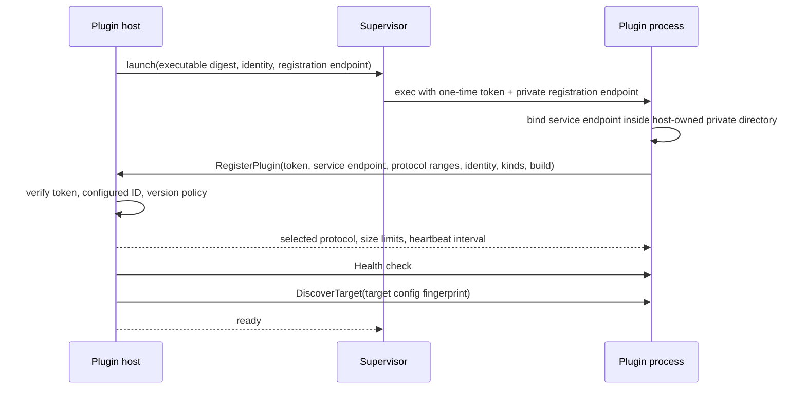

# Plugin system

## Categories and scope

v1 activates provider and access plugins. Future guest provisioners, image resolvers/importers, policy modules, audit sinks, and event sinks are deliberate extension points but not v1 plugin APIs. Plugins do not add portable top-level kinds.

## Startup and handshake

Registration is the handshake and must complete within 10 seconds by default. The control plane hosts `PluginRegistrationService`; the plugin hosts `PluginRuntimeService` and exactly the category services configured for that process. Provider-only and access-only processes are both valid; an access-only process is never required to expose a dummy provider service. The plugin advertises semantic plugin version, build digest, supported categories, provider/access kinds, capability/state/override schema versions, feature bits, and independently supported provider and access protocol ranges. Core selects each applicable protocol using the highest common major and then highest common minor after applying its configured downgrade floor. The launch token is one-time and bound to configured plugin/instance identity; registration reports a service endpoint under the host-created private IPC directory (or the documented Windows equivalent).

## RPC semantics

Discovery/validation are read-only and bounded. Mutations (`ApplyResource`, lifecycle, snapshot, restore, clone, destroy) include operation/invocation IDs, target-scoped credential delivery, logical resource desired generation, prior provider-state envelope, ownership metadata, idempotency key, deadline, and trace context. Progress is structured (`phase`, percent optional, safe message, provider task ref, timestamp). Final response includes observed state, owned primitive identities, provider state, warnings, and structured errors.

Access endpoint discovery and proxy creation are distinct calls. Provider output uses a typed, versioned, expiring endpoint envelope; the core validates its exact target/instance/resource/method/provider-state binding and passes the bounded opaque bytes directly to a compatible access plugin. Access plugin state has its own typed envelope and cannot be interpreted as provider state. Neither envelope grants access. The core hosts additive one-time exchange, active-lease recheck, and lease-end callbacks on the private registration channel. A per-launch callback credential plus transport identity binds each callback to the configured access-plugin instance and audience. Details and conformance cases are in [`access-sessions.md`](access-sessions.md) and [`design/contracts/access-conformance.yaml`](../../design/contracts/access-conformance.yaml).

Cancellation is cooperative: gRPC cancellation requests prompt the plugin to stop before the next unsafe boundary and report `canceled`, `too_late`, or `continuing`. Core never assumes cancel succeeded. Timeouts yield `unknown` until `GetInvocation`/refresh resolves the provider outcome.

## Supervision and upgrade

- Heartbeat/health failures mark plugin `unhealthy`; after grace, in-flight invocations become `unknown`, not failed.
- Restart uses bounded exponential backoff plus jitter and a circuit breaker. Repeated crashes require administrator retry.
- Logs are JSON lines or captured streams decorated by host; output is size/rate bounded and secret filtered.
- Graceful shutdown stops new work, waits to deadline, checkpoints, then exits; forced kill is recorded.
- Upgrade: stage and verify executable → handshake/readability probe → drain old → start new → health/capabilities → switch. Mixed versions are allowed per target. State migration is explicit and durable.

Plugin installation is manifest-driven, not an unsafe scan of `$PATH`. A versioned manifest declares plugin ID/version, executable relative path, SHA-256, categories/provider kinds, protocol range, supported OS/architecture, requested local permissions, and optional signature/provenance. Administrators install it into an allowlisted root and explicitly enable it. Official release archives/images use the same manifests. Third-party repositories can publish protocol-compatible executables/manifests and use the public SDK without rebuilding `labd`; production policy may require a configured signer. Duplicate IDs or digest changes fail closed.

## Remote transport readiness

The same gRPC service is tunnelable through a future Site Agent. Remote identity is installation/site/agent/plugin/target, authenticated by mTLS; it never relies on network location. Messages do not assume shared filesystem paths: bundle material is digest-addressed and streamed through bounded artifact APIs or pre-staged tokens.

Provider and access services share the transport handshake, but advertise and negotiate their service/schema versions independently. Updating access messages or requiring `access-authorization-recheck-v1` does not force a provider plugin, provider-state envelope, or provider capability schema to change. Missing access recheck support fails access negotiation closed while an otherwise compatible provider service may continue.

The accepted v1 wire baseline is [`api/plugin/v1/plugin.proto`](../../api/plugin/v1/plugin.proto). [`api/plugin/v1/compat/compatibility.yaml`](../../api/plugin/v1/compat/compatibility.yaml) defines negotiation/deadline/cancellation/state cases and pins a compact descriptor used by Buf `FILE` breaking checks. Field numbers/names are reserved rather than reused after deletion. See ADR-0002 and ADR-0012.

`TASK-PROXMOX-003` evolved the provider descriptor additively to protocol v1.1 while retaining the original v1.0 descriptor as the Buf breaking baseline. `AllocationClaim` carries bounded opaque namespace/value pairs; `ResourceDependency` carries a dependency's plan digest/bytes, provider state, observation, and committed claims. Planning receives excluded claims and returns proposed claims; mutation input receives committed claims and dependencies. The provider host selects the highest supported minor through 1.1 and requires the `opaque-allocation-claims-v1` and `dependency-resource-input-v1` feature bits before a capability depends on these fields. Docker remains a v1.0 plugin.

`TASK-PROD-003` evolves the same descriptor additively to v1.2 for the independently negotiated access category. Registration now separates provider and access protocol ranges and selections. Access-only processes must advertise methods, accepted provider-endpoint schemas, and `access-authorization-recheck-v1`; the host refuses access protocol minors below 1.2. A launch-scoped callback credential and immutable host-supplied plugin identity bind exchange, recheck, and end callbacks. Provider negotiation remains capped at v1.1, so adding access does not force Docker or the qualified Proxmox mutation path to negotiate a new provider minor.

The `TASK-PROXMOX-005` integration removes the Docker-specific registration assumption: each launched provider is checked against its configured provider kind, and negotiated protocol/features are copied into an immutable target registry. Target sessions carry copied non-secret configuration and resolve credentials only for a bounded invocation scope; closing a session zeroes the credential bytes. Target discovery snapshots persist protocol, features, configuration fingerprint, capability document, and validity interval, never the credential or configuration envelope. A Proxmox create requires a fresh snapshot bound to the currently registered target and native `workload.vm` evidence; configuration alone cannot enqueue writes.

Exact-target T3 qualification is a separate compatibility and authorization input, not another plugin handshake feature. ADR-0014 requires the production provider constructor to receive an immutable authorizer that loads a signed document plus explicit trust policy and rebinds it to the current target, provider executable/source build, live inventory, reviewed profile, and reviewer validity before advertising capability or mutating. Missing or stale authorization preserves discovery but closes writes.

## Implemented local launch subset

`TASK-DOCKER-001` generates Go bindings from the accepted descriptor and implements the shared launch/runtime helpers plus the `labd` plugin host. Before execution, the host rejects symlink or group/world-writable executables, copies the opened bytes into its private mode-0700 runtime directory while calculating the configured SHA-256, syncs the mode-0500 snapshot, and executes that immutable snapshot. It exposes a private registration Unix socket, issues a one-time token, checks configured plugin and instance identities, negotiates protocol v1, performs health checks, consumes heartbeats, and bounds captured child logs.

The launcher now supports independently configured Docker and Proxmox children plus bounded provider arguments for qualification inputs. `TASK-PROD-003` generalizes the same verified launch path for access-only children, validates configured access category/kind, exposes the negotiated `AccessService`, and keeps browser-facing proxy configuration separate from the private plugin RPC socket. The Kubernetes `TASK-PROD-004` checkpoint adds an explicit attach mode for official orchestrator-managed sidecars: the host and plugin may start in either order, authenticate with one protected rollout-token file, use exact mode-`0660` sockets inside a mode-`0770` group-only directory, and retain the same identity/category/protocol/callback handshake. Each sidecar runs under a distinct non-root UID; three consecutive health failures terminate `labd` so its single-use registration state and the sidecar are rebuilt together. Automatic bounded child restart/backoff, circuit breaking, upgrade draining, remote mTLS transport, Windows IPC, manifest installation, and sandboxing for unreviewed third-party plugins remain follow-on work; the single-operator systemd deployment restarts the whole control plane on terminal child failure.

The native release packages both official provider children beside `labd`, adjacent SHA-256 files, and versioned Docker/Proxmox inventory manifests containing identity, protocol range, target OS/architecture, digest, and requested permissions. The launcher consumes configured adjacent checksums directly; general allowlisted manifest discovery/installation and signature policy remain unimplemented rather than being implied by the packaged inventory.
