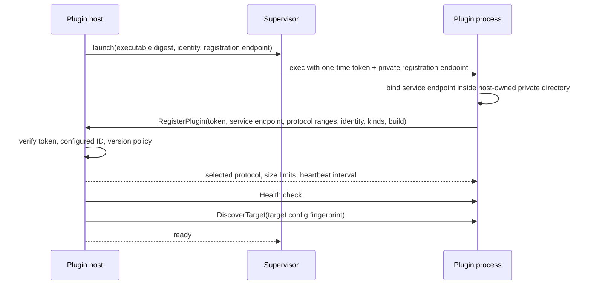

# Plugin system

## Categories and scope

v1 activates provider and access plugins. Future guest provisioners, image resolvers/importers, policy modules, audit sinks, and event sinks are deliberate extension points but not v1 plugin APIs. Plugins do not add portable top-level kinds.

## Startup and handshake

Registration is the handshake and must complete within 10 seconds by default. The control plane hosts `PluginRegistrationService`; the plugin hosts `PluginRuntimeService` and its provider/access services. The plugin advertises semantic plugin version, build digest, per-major protocol minor ranges, supported categories, provider/access kinds, capability/state/override schema versions, and feature bits. Core selects the highest common major and then highest common minor after applying its configured downgrade floor. The launch token is one-time and bound to configured plugin/instance identity; registration reports a service endpoint under the host-created private IPC directory (or the documented Windows equivalent).

## RPC semantics

Discovery/validation are read-only and bounded. Mutations (`ApplyResource`, lifecycle, snapshot, restore, clone, destroy) include operation/invocation IDs, target-scoped credential delivery, logical resource desired generation, prior provider-state envelope, ownership metadata, idempotency key, deadline, and trace context. Progress is structured (`phase`, percent optional, safe message, provider task ref, timestamp). Final response includes observed state, owned primitive identities, provider state, warnings, and structured errors.

Cancellation is cooperative: gRPC cancellation requests prompt the plugin to stop before the next unsafe boundary and report `canceled`, `too_late`, or `continuing`. Core never assumes cancel succeeded. Timeouts yield `unknown` until `GetInvocation`/refresh resolves the provider outcome.

## Supervision and upgrade

- Heartbeat/health failures mark plugin `unhealthy`; after grace, in-flight invocations become `unknown`, not failed.
- Restart uses bounded exponential backoff plus jitter and a circuit breaker. Repeated crashes require administrator retry.
- Logs are JSON lines or captured streams decorated by host; output is size/rate bounded and secret filtered.
- Graceful shutdown stops new work, waits to deadline, checkpoints, then exits; forced kill is recorded.
- Upgrade: stage and verify executable → handshake/readability probe → drain old → start new → health/capabilities → switch. Mixed versions are allowed per target. State migration is explicit and durable.

Plugin installation is manifest-driven, not an unsafe scan of `$PATH`. A versioned manifest declares plugin ID/version, executable relative path, SHA-256, categories/provider kinds, protocol range, supported OS/architecture, requested local permissions, and optional signature/provenance. Administrators install it into an allowlisted root and explicitly enable it. Official release archives/images use the same manifests. Third-party repositories can publish protocol-compatible executables/manifests and use the public SDK without rebuilding `labd`; production policy may require a configured signer. Duplicate IDs or digest changes fail closed.

## Remote transport readiness

The same gRPC service is tunnelable through a future Site Agent. Remote identity is installation/site/agent/plugin/target, authenticated by mTLS; it never relies on network location. Messages do not assume shared filesystem paths: bundle material is digest-addressed and streamed through bounded artifact APIs or pre-staged tokens.

Provider and access services share the transport handshake and envelope, but advertise and negotiate their service/schema versions independently. Updating access messages does not force a provider-state or capability version change.

The accepted v1 wire baseline is [`api/plugin/v1/plugin.proto`](../../api/plugin/v1/plugin.proto). [`api/plugin/v1/compat/compatibility.yaml`](../../api/plugin/v1/compat/compatibility.yaml) defines negotiation/deadline/cancellation/state cases and pins a compact descriptor used by Buf `FILE` breaking checks. Field numbers/names are reserved rather than reused after deletion. See ADR-0002 and ADR-0012.

`TASK-PROXMOX-003` evolves the current descriptor additively to protocol v1.1 while retaining the original v1.0 descriptor as the Buf breaking baseline. `AllocationClaim` carries bounded opaque namespace/value pairs; `ResourceDependency` carries a dependency's plan digest/bytes, provider state, observation, and committed claims. Planning receives excluded claims and returns proposed claims; mutation input receives committed claims and dependencies. The host selects the highest supported minor through 1.1 and requires the `opaque-allocation-claims-v1` and `dependency-resource-input-v1` feature bits before a capability depends on these fields. Docker remains a v1.0 plugin.

## Implemented local launch subset

`TASK-DOCKER-001` generates Go bindings from the accepted descriptor and implements the shared launch/runtime helpers plus the `labd` plugin host. Before execution, the host resolves and SHA-256 verifies the configured executable. It creates a mode-0700 runtime directory, exposes a private registration Unix socket, issues a one-time token, checks configured plugin and instance identities, negotiates protocol v1, performs health checks, consumes heartbeats, and bounds captured child logs.

This thin supervisor deliberately has one configured Docker child. If that child exits, `labd` stops instead of silently running without its only target. Automatic bounded restart/backoff, circuit breaking, upgrade draining, remote mTLS transport, Windows IPC, manifest installation, and third-party sandbox identities remain required follow-on work before the supervisor is production-complete.

`TASK-RELEASE-001` packages the Docker child beside `labd`, its SHA-256 beside the executable, and a versioned `plugins/docker.json` inventory manifest containing identity, protocol range, target OS/architecture, digest, and requested Docker endpoint permission. The current single-plugin laptop launcher consumes the adjacent checksum directly; general allowlisted manifest discovery/installation and signature policy remain unimplemented rather than being implied by the packaged inventory.
