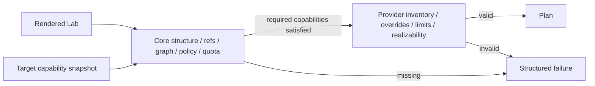

# Provider contract

## Required provider behavior

A provider plugin implements:

- `GetPluginInfo`, target configuration schema, `DiscoverTarget`, `GetCapabilities`, and `GetHealth`.
- `ValidateLab` for target inventory/topology/provider overrides without mutation.
- `PlanResource` and lifecycle support reporting with warnings/destructive markers.
- idempotent logical-resource apply/read/destroy; start/stop/pause/resume; snapshots/restore/clone/reset where advertised.
- capacity/placement reporting with timestamp, confidence, and `unknown` support.
- image inventory/import only when advertised.
- safe endpoint discovery, never reusable credentials.
- invocation query, progress, structured errors, ownership evidence, and opaque-state migration.

## Two-stage validation



Required capabilities are typed predicates such as `workload.vm == native`, `network.interface.max >= 3`, `network.semantics includes l2`, `isolation includes virtualMachine`, or `snapshot.modes includes crashConsistent`. Capability evidence includes discovery time, TTL, optional component dependency, constraints, and target configuration fingerprint. Plans pin its digest; stale capability facts trigger revalidation.

## Apply invariant

For each logical resource, plugin behavior is effectively:

```text
lookup recorded provider state and ownership tags
if desired generation already realized: read and return it
if a prior invocation with idempotency key exists: resume/query it
create/update primitives while recording their IDs locally
on failure: compensate primitives created by this attempt
return success OR error + every known primitive + compensation result
```

The core persists the response before unlocking. Plugin-local temporary journals are recommended for crash windows but core invocation/provider state is authoritative. A plugin must never adopt a name collision. Adoption, if later supported, is an explicit privileged operation with a resource identity proof.

## Ownership metadata

Where tags exist: `labcentral.installation`, `target`, `organization/project`, `instance`, `logicalResource`, `generation`, and `managed=true`. Where tags are limited, store a collision-resistant composite token plus full IDs in provider state. Destroy requires both the recorded immutable provider ID and matching ownership token; mismatch stops with `partial_cleanup` and emits an audit alert.

## Container-via-VM contract

Official Proxmox, AWS, and KubeVirt providers share a `container-vm-runtime` library plus a small versioned in-guest bootstrap protocol. Base image contract: verified image provenance/digest, supported CPU architecture, cloud-init or Ignition, read-only bootstrap component, OCI runtime version range, dedicated unprivileged workload user, log/readiness channel, and no inbound control-plane dependency. The provider attaches networks/volumes, injects a one-time bootstrap document, and observes readiness via provider-safe serial/guest-agent or outbound mutually authenticated status where policy permits.

The shared library creates runtime config, state schemas, lifecycle/reset semantics, and conformance tests; each provider owns VM/network/storage API calls. Snapshot includes VM disks/runtime state according to advertised consistency; OCI image upgrades are recreate by default. Shell access goes through normal Access Sessions. This avoids three divergent contracts without hiding provider VM differences.

## Contract tests

Every provider must pass idempotent replay, stale generation, wrong ownership, crash-after-create, timeout-with-unknown-outcome, partial-create compensation, compensation failure, reverse destroy, provider-state old/new/unknown schema, capability downgrade, cancellation, redaction, and deterministic plan tests. The fake provider offers programmable faults and a virtual clock. The authoritative machine-readable cases are in [`design/contracts/provider-conformance.yaml`](../../design/contracts/provider-conformance.yaml); official-provider suites may add cases but cannot waive these IDs.

`TASK-PROVIDER-001` implements the public harness contract under [`pkg/plugin-sdk-go/contract`](../../pkg/plugin-sdk-go/contract), the reusable 18-case runner under [`pkg/plugin-sdk-go/contracttest`](../../pkg/plugin-sdk-go/contracttest), and a mutex-safe programmable fake under [`internal/adapter/fakeprovider`](../../internal/adapter/fakeprovider). The fake has no credentials or external provider access; it uses a virtual clock and durable restart snapshot to exercise failure windows deterministically. Official provider test adapters implement the same public `Harness` without importing core internals.

## Thin Docker v1 implementation

`TASK-DOCKER-001` implements `PluginRuntime`, `ProviderService`, and the advertised lifecycle subset in `providers/docker`. Discovery negotiates Engine API v1.44 or newer and returns target-specific version/OS/architecture facts. Validation rejects VM resources, unpinned images, unsupported networking, and missing trusted-laptop acknowledgement. Planning produces typed, persisted provider plans; apply/read/destroy use stable invocation/idempotency identities and opaque provider state.

Physical object names and labels are deterministic. Deletion first inspects the immutable Engine ID/name and requires every expected ownership label to match; it never deletes by a name collision alone. Image pulls require a `@sha256:` reference. Published ports are loopback-only, published TCP services must accept a bounded connection before readiness, and container creation applies capability drop, `no-new-privileges`, CPU, and memory settings. Unit tests cover negotiation, pinning, loopback publication/readiness, replay, and ownership refusal; the local control-plane test covers complete Example A apply and reverse destroy through gRPC.
