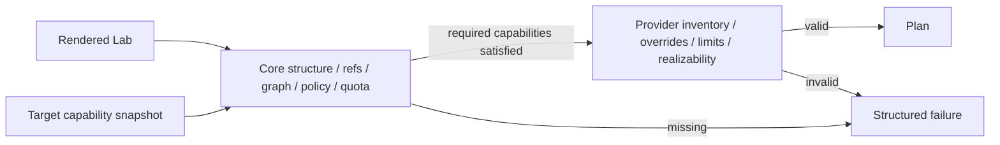

# Provider contract

## Required provider behavior

A provider plugin implements:

- `GetPluginInfo`, target configuration schema, `DiscoverTarget`, `GetCapabilities`, and `GetHealth`.
- `ValidateLab` for target inventory/topology/provider overrides without mutation.
- `PlanResource` and lifecycle support reporting with warnings/destructive markers.
- idempotent logical-resource apply/read/destroy; start/stop/pause/resume; snapshots/restore/clone/reset where advertised.
- capacity/placement reporting with timestamp, confidence, and `unknown` support.
- image inventory/import only when advertised.
- safe endpoint discovery, never reusable credentials.
- invocation query, progress, structured errors, ownership evidence, and opaque-state migration.

## Two-stage validation



Required capabilities are typed predicates such as `workload.vm == native`, `network.interface.max >= 3`, `network.semantics includes l2`, `isolation includes virtualMachine`, or `snapshot.modes includes crashConsistent`. Capability evidence includes discovery time, TTL, optional component dependency, constraints, and target configuration fingerprint. Plans pin its digest; stale capability facts trigger revalidation.

## Apply invariant

For each logical resource, plugin behavior is effectively:

```text
lookup recorded provider state and ownership tags
if desired generation already realized: read and return it
if a prior invocation with idempotency key exists: resume/query it
create/update primitives while recording their IDs locally
on failure: compensate primitives created by this attempt
return success OR error + every known primitive + compensation result
```

The core persists the response before unlocking. Plugin-local journals are mandatory when an upstream async task can outlive the RPC or process; they bridge the pre-response crash window and make `GetInvocation` durable, while committed core invocation/provider state remains authoritative. Journals are versioned, checksummed, bounded, and secret-free. A plugin must never adopt a name collision. Adoption, if later supported, is an explicit privileged operation with a resource identity proof.

## Provider allocation claims

Target-global scarce values cannot be assigned safely by hashing and provider plugins do not access the control-plane database. Under ADR-0013, a provider proposes bounded opaque `(namespace, value)` claims and the core enforces uniqueness by target. The core creates the Instance ID before planning, atomically commits the accepted plan and claims, and supplies committed dependency plans/states to later resources. Conflicts cause bounded replan with exclusions. A claim is not provider ownership; externally occupied values still fail closed. Claims remain held for unknown outcomes, leftovers, and orphaned resources and are released only after provider absence is confirmed.

The v1.1 protocol and repository prerequisites are implemented by `TASK-PROXMOX-003`: v1.0 remains negotiable, the accepted v1.0 descriptor remains the breaking baseline, and the new current descriptor is independently pinned. The `TASK-PROXMOX-005` local integration now generates the stable Instance ID before planning, validates provider plan digests and opaque claims, atomically commits plans and claims with the instance/job transaction, and performs at most eight deterministic replans with exact conflicts excluded. Workers deliver committed dependency plans, provider state, observations, and claims. Unknown outcomes and ambiguous cleanup retain claims; successful destroy or completed compensation releases them only after the provider reports absence.

## Ownership metadata

Where tags exist: `labcentral.installation`, `target`, `organization/project`, `instance`, `logicalResource`, `generation`, and `managed=true`. Where tags are limited, store a collision-resistant composite token plus full IDs in provider state. Destroy requires both the recorded immutable provider ID and matching ownership token; mismatch stops with `partial_cleanup` and emits an audit alert.

## Container-via-VM contract

Official Proxmox, AWS, and KubeVirt providers share a `container-vm-runtime` library plus a small versioned in-guest bootstrap protocol. Base image contract: verified image provenance/digest, supported CPU architecture, cloud-init or Ignition, read-only bootstrap component, OCI runtime version range, dedicated unprivileged workload user, log/readiness channel, and no inbound control-plane dependency. The provider attaches networks/volumes, injects a one-time bootstrap document, and observes readiness via provider-safe serial/guest-agent or outbound mutually authenticated status where policy permits.

The shared library creates runtime config, state schemas, lifecycle/reset semantics, and conformance tests; each provider owns VM/network/storage API calls. Snapshot includes VM disks/runtime state according to advertised consistency; OCI image upgrades are recreate by default. Shell access goes through normal Access Sessions. This avoids three divergent contracts without hiding provider VM differences.

## Contract tests

Every provider must pass idempotent replay, stale generation, wrong ownership, crash-after-create, timeout-with-unknown-outcome, partial-create compensation, compensation failure, reverse destroy, provider-state old/new/unknown schema, capability downgrade, cancellation, redaction, and deterministic plan tests. The fake provider offers programmable faults and a virtual clock. The authoritative machine-readable cases are in [`design/contracts/provider-conformance.yaml`](../../design/contracts/provider-conformance.yaml); official-provider suites may add cases but cannot waive these IDs.

`TASK-PROVIDER-001` implements the public harness contract under [`pkg/plugin-sdk-go/contract`](../../pkg/plugin-sdk-go/contract), the reusable 18-case runner under [`pkg/plugin-sdk-go/contracttest`](../../pkg/plugin-sdk-go/contracttest), and a mutex-safe programmable fake under [`internal/adapter/fakeprovider`](../../internal/adapter/fakeprovider). The fake has no credentials or external provider access; it uses a virtual clock and durable restart snapshot to exercise failure windows deterministically. Official provider test adapters implement the same public `Harness` without importing core internals.

## Thin Docker v1 implementation

`TASK-DOCKER-001` implements `PluginRuntime`, `ProviderService`, and the advertised lifecycle subset in `providers/docker`. Discovery negotiates Engine API v1.44 or newer and returns target-specific version/OS/architecture facts. Validation rejects VM resources, unpinned images, unsupported networking, and missing trusted-laptop acknowledgement. Planning produces typed, persisted provider plans; apply/read/destroy use stable invocation/idempotency identities and opaque provider state.

Physical object names and labels are deterministic. Deletion first inspects the immutable Engine ID/name and requires every expected ownership label to match; it never deletes by a name collision alone. Image pulls require a `@sha256:` reference. Published ports are loopback-only, published TCP services must accept a bounded connection before readiness, and container creation applies capability drop, `no-new-privileges`, CPU, and memory settings. Unit tests cover negotiation, pinning, loopback publication/readiness, replay, and ownership refusal; the local control-plane test covers complete Example A apply and reverse destroy through gRPC.

## Proxmox discovery and gated QEMU implementation

`TASK-PROXMOX-001` adds the separately runnable discovery process. `TASK-PROXMOX-004` adds closed target-config/validation-plan/QEMU-plan/provider-state/journal types and the fixed-node full-clone Validate, Plan, Apply, Read, Destroy, `GetInvocation`, and start/stop/pause/resume paths. Strict JSON envelopes, verified HTTPS, refused proxy/redirect behavior, bounded responses, path validation, and credential/upstream-body redaction apply to both slices.

The production constructor still hard-closes mutation execution and advertises all portable mutation capabilities as unsupported. A package-private T0 constructor opens the gate only after exact inventory, permission, template, isolation, journal, config, and protocol evidence match. This permits deterministic fake-API verification without creating an operator-controlled bypass. Snapshot, firewall, access, reservation, and placement remain unsupported. The complete behavior and release boundary are in [`proxmox-provider.md`](proxmox-provider.md).

The in-progress `TASK-PROXMOX-005` control-plane path can register a separately supervised Proxmox process, persist its expiring discovery evidence, and route validation/planning/worker invocations by the instance's immutable target ID. The runtime refuses Proxmox create when persisted native mutation evidence is missing, stale, or no longer matches the registered configuration/protocol/features. This integration is exercised only against a deterministic in-process target so far; it does not change the provider's production write gate.

## Proxmox QEMU mutation design gate

`TASK-PROXMOX-002` defines the first write slice and `TASK-PROXMOX-004` implements its T0 gate: fixed-node PVE 9.x Linux QEMU full clones, approved storage, core-claimed VMIDs/VLANs, approved VLAN-aware bridges, PVE-native typed IPv4 Cloud-Init networking, and bounded start/stop/pause/resume. Durable replay, optimistic config digests, ownership refusal, response-loss reconciliation, compensation, least-privilege scopes, and all 22 fake cases are executable. Production mutation stays unsupported until the exact-target T3 task passes.

`TEST-PROXMOX-024` defines the T3-to-review handoff as a closed RFC 8785/Ed25519 document. The verifier requires the complete target-applicable case matrix, exact PVE/profile/permission/protocol/build facts, three guest-origin isolation probes, provider-confirmed cleanup, no leftovers, released claims, a current validity window, a trusted signing key, and exact deployment expectations. An authentic failure artifact remains non-qualifying. This verifier is intentionally not wired into the provider constructor; production enablement requires a separate accepted decision and cannot be selected by target configuration.

`TEST-PROXMOX-025` keeps the first credentialed smoke behind the package-private test constructor. Exact destructive and target-ID confirmation, closed profile parsing, pre-write disposable-claim equality, lifecycle exercise, ownership-checked cleanup, and an independent absence read are mandatory. It is a runner-readiness check rather than qualification: it neither covers the full T3 matrix nor creates capability evidence, and the production binary cannot invoke it.

`TEST-PROXMOX-026` provides the missing probe transport mechanism without adding guest execution to the provider contract. A preinstalled qualification-only agent accepts one bounded, closed three-destination TCP-connect request over dedicated TLS 1.3 mTLS and returns bound aggregate observations plus digests rather than addresses. The runner client independently pins server trust, refuses proxies and redirects, validates the complete response binding, and produces the canonical transcript digest consumed by signed evidence. Neither the provider plugin nor the control plane installs, invokes, or receives credentials for this agent; exact-template installation and real guest-origin execution remain T3 deployment/runner responsibilities.
