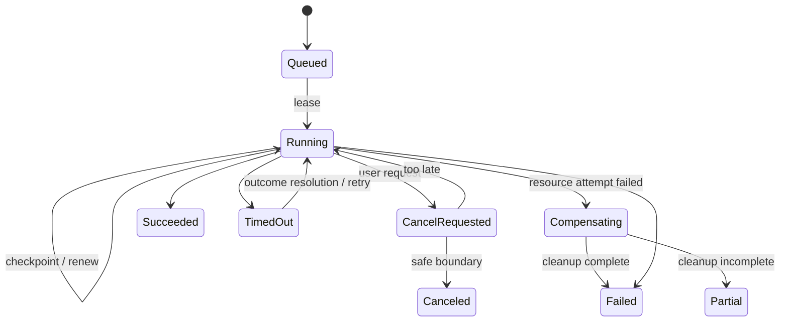
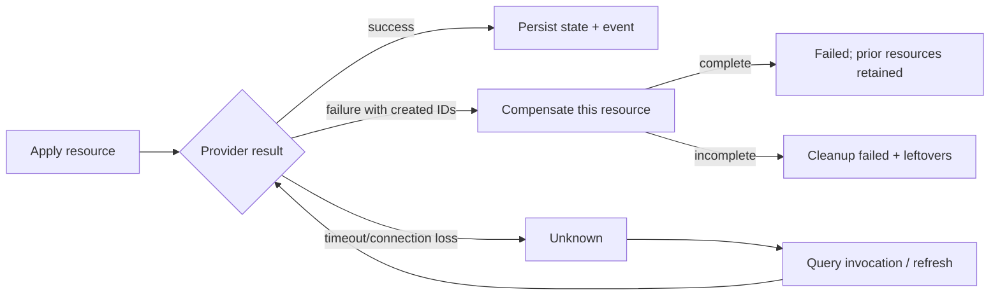

# Reconciliation and durable jobs

## Reconciliation model

LabCentral reconciles only after explicit validate/plan/apply/refresh/lifecycle requests or policy timers (TTL, scheduled destruction, configured idle shutdown). It does not continuously repair drift in v1. `refresh` reads provider state and records drift; `apply` is the explicit authority to converge a reviewed plan.

An instance and every logical resource carry desired `generation`; observations carry `observedGeneration`. A spec/lifecycle change increments generation transactionally with its Operation. A stale worker may observe but cannot commit against a newer generation/fencing token.

## Operation and job execution

Operation is user-visible intent; jobs are schedulable attempts; steps are checkpointed graph/resource actions; plugin invocations record the external side-effect boundary. Claim transactions set `leaseOwner`, `leaseUntil`, increment `fencingToken`, and honor operation/resource/instance locks. Workers renew before half-life. Expired work is reclaimed only after its invocation is queried; unknown external outcome blocks duplicate non-idempotent action.

Recommended initial defaults: 30-second job lease, heartbeat every 10 seconds, operation-specific deadlines, exponential retry with full jitter and maximum attempts/elapsed time by error class. Permanent validation/auth/quota/state-version errors are not retried automatically.

The single-node worker gives one provider resource invocation a ten-minute
deadline while continuing to renew its 30-second database lease. This covers
the Proxmox provider's bounded five-minute task polling plus configuration,
start, and guest-readiness confirmation without weakening fencing. Credential
resolution is scoped to the same invocation with one minute of expiry margin.

## Graph execution

References and `dependsOn` form a DAG. Stable Kahn topological sorting produces deterministic layers. Resources within a layer run in parallel up to global, target, instance, and provider-advertised limits. Per-resource exclusive locks prevent conflicting lifecycle operations; instance-level locks serialize apply/reset/restore/clone/destroy while start/stop may use graph-safe concurrency.

On dependency failure, descendants become `blocked` with causal IDs; unrelated branches may continue when policy permits. Failure of resource 7 cleans only primitives newly created for 7, persists its diagnostic state, retains 1–6, and makes the instance `Degraded`. Retry resumes satisfied dependencies and uses original idempotency keys for the same attempt or a derived key for a new desired generation.

Destroy takes the reverse DAG, attempts all owned resources despite independent failures, and records leftovers. A destroy with leftovers is `partial`/instance `Degraded`, never `Destroyed`. Unknown ownership mismatch stops deletion and requires operator resolution.

## Quotas and reservations

Provider allocation claims are separate from capacity quota reservations. Under ADR-0013 the core persists a bounded opaque `(targetID, namespace, value)` unique claim together with its plan. Planning conflicts trigger bounded replan with exclusions. `held` becomes `committed` at plan acceptance; an unknown invocation, compensation failure, leftover, or destroy failure retains the claim as unavailable rather than recycling it. Only positive provider absence permits `released`. Claim writes use the same operation/instance locks and fencing checks as plan and provider-state checkpoints.

The `TASK-PROXMOX-003` repository prototype enforces batch atomicity, plan-binding checks, target scoping, state transitions, conflict reporting, and absence-gated release on both SQL dialects. The `TASK-PROXMOX-005` local create unit of work now writes accepted plans, committed claims, instance, resources, operation/job, audit intent, event, outbox, and idempotency record in one SQLite transaction; exact conflicts roll the entire transaction back and feed the bounded replan loop. Docker continues to propose no claims. Worker unknown outcomes and cleanup failures retain or orphan claims, while successful destroy or completed compensation releases them only after the provider reports absence.

Limits compose from platform, organization, project, team, user, and target; every applicable limit must admit the request. Before scheduling/apply, the same serializable transaction that creates the Instance/job creates an expiring reservation for instances, VM/container count, CPU, memory, storage, public IPs, published ports, and snapshots. Hard quantities are the fixed canonical/accepted-plan quantities; a provider must not realize a different hard quantity. Provider-specific cost units remain advisory under `OQ-QUOTA-001` and are not advertised as enforced. Successful realization commits planned usage. Failures release only after the provider outcome and cleanup are known; destroy releases only after absence is confirmed, while unknown or orphaned resources retain usage.

The `TASK-PROD-003` quota/lifetime slice implements these transitions on both SQL adapters. Shared advisory identity locks prevent policy installation or tightening from racing admission, including scopes with no pre-existing row. An invocation-free reservation is terminalized when either its hold or exact Instance TTL expires; eligible queued and expired-lease running jobs race worker reclamation through row locks, repeated predicates, and bounded serialization retry. The sweeper also emits exact-expiry-gated warnings and idempotent destroy requests. Worker apply checks DB-time expiry before validation, before every provider resource, and before ready finalization. Planned allocation claims are released when no invocation could have run; unknown outcomes retain quota/claims and set recovery-required.

On takeover, a recovery-required claim carries the exact unknown invocation record. The worker calls provider `GetInvocation` with the original invocation ID and never redispatches the mutation. Incomplete, missing, unavailable, or corrupt journal lookup remains unknown and retained. A durable terminal result is persisted under the new fence, transitions claims once, and resumes apply/compensation/destroy from stored resource state. Lost-response integration proves one provider mutation and one recovery lookup.

## Events and audit

State transaction writes outbox rows with envelope: `eventID`, schema/version, type, occurredAt, aggregateType/ID, aggregateSequence, organization/project, actor, correlation/causation/operation IDs, safe payload. Delivery is at least once; consumers deduplicate event ID. Ordering is guaranteed only per aggregate sequence. Operational event retention is configurable (default proposal 90 days); immutable audit retention is policy-controlled and longer. Audit records authorization-relevant intent/result and redacted changes; events support progress/integration.

The first `TASK-PROD-003` implementation generalizes audit/event storage beyond the earlier job prototype. Audit and event streams have independent database-allocated monotonic positions; events also allocate a sequence per aggregate. Their versioned actor, scope, links, outcome/type, and deliberately redacted/safe payloads are immutable, while deletion exists only through bounded cutoff-based retention. Event cleanup skips every record with an undelivered outbox sink. Export enforces row and byte ceilings without loading an unbounded result set. Template mutations are the first fully integrated producer and atomically append audit, event, local outbox delivery, and their idempotency binding with the aggregate change; authentication, authorization, target, operation, access, and administrator producers remain required before `TASK-PROD-003` can complete.

The cross-adapter acceptance catalog is [`design/contracts/job-invariants.yaml`](../../design/contracts/job-invariants.yaml). It fixes the expected semantics for atomic outbox, fencing, unknown invocation recovery, idempotency conflicts, quota retention, leftover handling, SQLite/PostgreSQL claim equivalence, and at-least-once delivery before implementation selects SQL details.

The executable `TASK-JOBS-001` prototype binds every `TEST-JOB-*` ID to a Go test. Normal tests run the suite against a bounded single-writer SQLite adapter; `TestPostgreSQLJobConformance` runs the identical cases against PostgreSQL when `LABCENTRAL_TEST_POSTGRES_DSN` is set. Unknown payload versions remain unclaimable, expired unknown invocations yield `get_invocation`, and outbox retries retain event ID and aggregate sequence.

`TASK-DOCKER-001` composes those primitives into the first durable application path. A create transaction writes the instance, ordered resources, persisted provider plans, job, Operation, audit intent, event, outbox delivery, and idempotency binding atomically. The local worker revalidates the canonical Lab, uses the pinned plans, prepares one stable provider invocation per resource/action, and fence-checks every phase/result/finalization write. Apply compensation and explicit destroy traverse the reverse resource order and preserve cleanup failures as `partial`/`Degraded`. The laptop runtime uses one worker; graph-layer parallelism and the wider lifecycle/cancellation surface remain future scope.

`TASK-PROD-001` runs the same Store through independent PostgreSQL pools and worker identities. Concurrent claims have one winner, a replacement claim advances both attempt and fencing token, a partitioned old worker cannot publish, a prepared invocation is rebound to its original identity after takeover, and row-locked terminal finalization has exactly one winner. Concurrent equivalent create requests serialize by subject/action/key and return one original plus one replay instead of leaking a database serialization failure.
