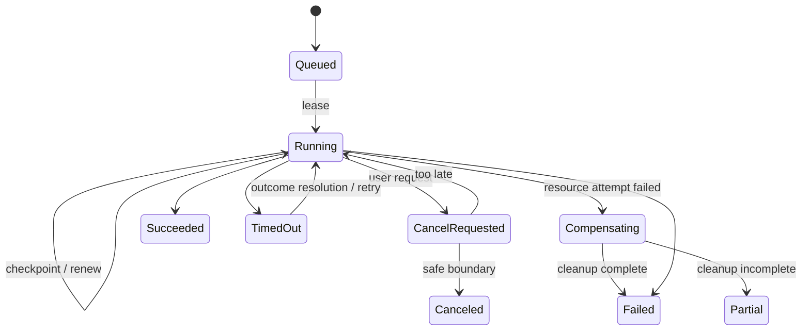
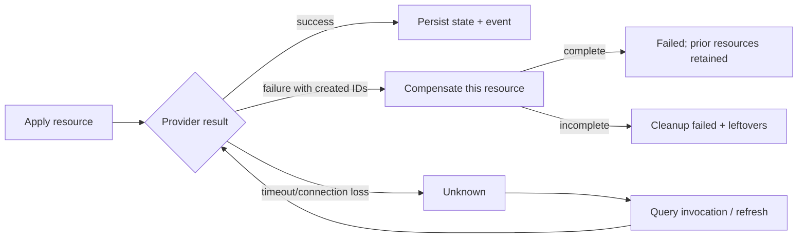

# Reconciliation and durable jobs

## Reconciliation model

LabCentral reconciles only after explicit validate/plan/apply/refresh/lifecycle requests or policy timers (TTL, scheduled destruction, configured idle shutdown). It does not continuously repair drift in v1. `refresh` reads provider state and records drift; `apply` is the explicit authority to converge a reviewed plan.

An instance and every logical resource carry desired `generation`; observations carry `observedGeneration`. A spec/lifecycle change increments generation transactionally with its Operation. A stale worker may observe but cannot commit against a newer generation/fencing token.

## Operation and job execution

Operation is user-visible intent; jobs are schedulable attempts; steps are checkpointed graph/resource actions; plugin invocations record the external side-effect boundary. Claim transactions set `leaseOwner`, `leaseUntil`, increment `fencingToken`, and honor operation/resource/instance locks. Workers renew before half-life. Expired work is reclaimed only after its invocation is queried; unknown external outcome blocks duplicate non-idempotent action.

Recommended initial defaults: 30-second job lease, heartbeat every 10 seconds, operation-specific deadlines, exponential retry with full jitter and maximum attempts/elapsed time by error class. Permanent validation/auth/quota/state-version errors are not retried automatically.

## Graph execution

References and `dependsOn` form a DAG. Stable Kahn topological sorting produces deterministic layers. Resources within a layer run in parallel up to global, target, instance, and provider-advertised limits. Per-resource exclusive locks prevent conflicting lifecycle operations; instance-level locks serialize apply/reset/restore/clone/destroy while start/stop may use graph-safe concurrency.

On dependency failure, descendants become `blocked` with causal IDs; unrelated branches may continue when policy permits. Failure of resource 7 cleans only primitives newly created for 7, persists its diagnostic state, retains 1–6, and makes the instance `Degraded`. Retry resumes satisfied dependencies and uses original idempotency keys for the same attempt or a derived key for a new desired generation.

Destroy takes the reverse DAG, attempts all owned resources despite independent failures, and records leftovers. A destroy with leftovers is `partial`/instance `Degraded`, never `Destroyed`. Unknown ownership mismatch stops deletion and requires operator resolution.

## Quotas and reservations

Limits compose from platform, organization, project, team, user, target; the tightest applicable remaining limit wins. Before scheduling/apply, a serializable transaction creates an expiring reservation for instances, VM/container count, CPU, memory, storage, public IPs, published ports, lifetime, snapshots, and provider-specific cost units. Successful realization commits planned to observed usage; variance over reservation pauses additional work and raises quota review. Failures release uncommitted portions after outcome/cleanup is known. Destroy releases only after absence is confirmed; orphaned resources retain usage.

## Events and audit

State transaction writes outbox rows with envelope: `eventID`, schema/version, type, occurredAt, aggregateType/ID, aggregateSequence, organization/project, actor, correlation/causation/operation IDs, safe payload. Delivery is at least once; consumers deduplicate event ID. Ordering is guaranteed only per aggregate sequence. Operational event retention is configurable (default proposal 90 days); immutable audit retention is policy-controlled and longer. Audit records authorization-relevant intent/result and redacted changes; events support progress/integration.

The cross-adapter acceptance catalog is [`design/contracts/job-invariants.yaml`](../../design/contracts/job-invariants.yaml). It fixes the expected semantics for atomic outbox, fencing, unknown invocation recovery, idempotency conflicts, quota retention, leftover handling, SQLite/PostgreSQL claim equivalence, and at-least-once delivery before implementation selects SQL details.

The executable `TASK-JOBS-001` prototype binds every `TEST-JOB-*` ID to a Go test. Normal tests run the suite against a bounded single-writer SQLite adapter; `TestPostgreSQLJobConformance` runs the identical cases against PostgreSQL when `LABCENTRAL_TEST_POSTGRES_DSN` is set. Unknown payload versions remain unclaimable, expired unknown invocations yield `get_invocation`, and outbox retries retain event ID and aggregate sequence.
