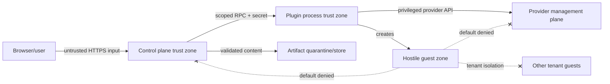

# Security threat model

## Assets, actors, and boundaries

High-value assets are provider credentials/APIs, control-plane identity/session keys, tenancy and audit data, provider management networks, host/container runtime sockets, artifact integrity, plugin binaries, and access-session tokens. Adversaries include malicious participants/guests/images/bundles, compromised authors/admin accounts, malicious plugins, supply-chain attackers, and network attackers.

Out-of-process plugins are not trusted merely because official. The host validates every response and isolates processes. A future Site Agent is trusted to use only enrolled site targets but not to authorize users or edit canonical state.

## Threats and required controls

| Threat ID | Threat | Core guarantee | Provider/deployment obligation |
|---|---|---|---|
| THREAT-NET-001 | Guest reaches control/provider API | Explicit isolated topology, management-prefix denies, no guest callbacks required | Physically/logically separate management networks; firewall/VLAN/VPC/CNI rules; no host socket mounts |
| THREAT-TENANT-001 | Cross-tenant access | Scoped IDs/RBAC/list filtering/access checks; unique ownership tokens | Target network/namespace/VPC isolation and provider IAM |
| THREAT-ISOLATION-001 | Container escape | Isolation class is explicit; no silent VM→Pod/container downgrade; warnings/policy rejection | Use KubeVirt/QEMU/EC2 or verified sandbox; patch hypervisor/runtime |
| THREAT-IMPORT-001 | SSRF/image import | Disabled by default; allowlist, exact digest, redirects/DNS/IP recheck, private/metadata IP deny | Isolated fetch/build workers and restricted egress |
| THREAT-BUNDLE-001 | Malicious bundle/archive | streaming byte/file/depth/ratio limits, manifest hashes, normalized paths, reject symlink/hardlink/device | quarantine filesystem with no execution and least privilege |
| THREAT-RENDER-001 | Malicious YAML/CEL | safe parser, duplicate-key rejection, schema/AST/cost/expansion limits, pure environment | keep libraries patched; fuzz parsers/renderers |
| THREAT-BUILD-001 | Build-context code execution | `labd` never builds; separate durable build job | disposable sandbox, no provider credentials, capped resources/network |
| THREAT-PLUGIN-001 | Plugin credential theft | target-scoped just-in-time secrets, no DB access, process identity, response validation | OS/container sandbox, egress allowlist, separate credentials, executable verification |
| THREAT-OWNERSHIP-001 | Resource tag spoofing/deletion | recorded immutable provider ID + ownership-token match; names insufficient | IAM prevents guests/users tagging or deleting management resources |
| THREAT-ACCESS-001 | Console-token leakage or stale authorization | short TTL, one use/audience/resource binding, hashed storage, core exchange and active-lease recheck, core-first revocation, no URL logs | TLS, origin/CSP/referrer protections, access proxy redaction and fail-closed stream closure |
| THREAT-SESSION-001 | CSRF/session theft | SameSite/Secure/HttpOnly cookie, CSRF tokens, origin checks, session rotation | TLS, trusted reverse-proxy config, OIDC redirect allowlist |
| THREAT-SECRET-001 | Secret/log leakage | typed SecretRefs; central structured redaction; schema-marked sensitive fields | provider SDK redaction and operator log access controls |
| THREAT-DELETE-001 | Destructive race/replay | ETag/generation, leases/fencing, idempotency, strong ownership, audit | provider APIs with least privilege and task polling |
| THREAT-SUPPLY-001 | Supply-chain compromise | pinned modules/actions/scanners, reproducible artifacts, SBOM/provenance, plugin checksums/allowlist, exact-identity Sigstore and GitHub attestation verification | protected branch/tag/environment controls, independent publisher approval, and operator verification before installation |

The authoritative owner/control/test mapping is machine-readable in [`design/contracts/security-controls.yaml`](../../design/contracts/security-controls.yaml). A mapped test may be a Phase 0 contract case or a required later implementation/integration test; provider release gates require every applicable test to pass, not merely exist in the matrix.

## Guarantees by owner

- **Core-enforced:** schema/expression limits, identity/RBAC, target grants, explicit isolation, capability mismatch failure, state/operation locking, secret redaction contract, ownership checks, bundle validation, audit/outbox.
- **Provider-enforced:** faithful primitive mapping, network/storage isolation, endpoint safety, cleanup, accurate capabilities, provider API least privilege.
- **Deployment-enforced:** management-plane separation, host/Kubernetes/Docker socket protection, TLS/key custody, database/artifact encryption/backups, plugin sandboxing, patching, reverse-proxy correctness.
- **Operator-owned:** select suitable isolation, maintain safe base images, configure provider targets and allowlists, investigate leftovers/drift, rotate credentials, accept Docker laptop risks.

Operational telemetry is a separate private deployment surface. Its listener is
not routed through the public product origin; Kubernetes or host policy admits
only the monitoring identity. Metrics contain fixed low-cardinality labels and
never tenant/object IDs, raw paths/queries, or error strings. Exported server
spans use only endpoint families plus HTTP method/status, and remote OTLP/HTTP
requires TLS 1.3 with optional mTLS. Collector storage and access remain
operator-controlled sensitive data. Tests seed tenant/token canaries through
metrics and spans and require them to be absent.

Access is a split trust path. Core alone decides whether a subject may use an exact instance/resource/method, stores only keyed launch/lease hashes, and re-evaluates current authorization at exchange and throughout a short active lease. The provider plugin receives the provider credential only while discovering one exact endpoint. The access plugin receives that bounded opaque endpoint but no provider credential, database connection, role policy, or unrelated tenant data. A malicious access plugin remains capable of abusing the endpoint it was given, so production deployment must verify its executable, isolate its OS/network identity, restrict its egress to the intended endpoint classes, and close all streams when authorization recheck is denied or unavailable. The Kubernetes base gives core/provider/access distinct UIDs, individual token/secret mounts, group-restricted IPC, read-only roots, and no Kubernetes API token. Because all containers in one Pod share its network namespace, NetworkPolicy is a Pod-wide outer boundary rather than per-plugin egress isolation; that packaged topology therefore admits only the digest-pinned official sidecars. Unreviewed third-party plugins require a separately proven process/Pod/VM transport boundary. The browser never receives the provider management origin, console ticket, SSH CA, or callback credential.

## Docker laptop limitations

Normal Docker isolation is not a security boundary for arbitrary hostile code. Docker API/socket possession is host-equivalent privilege; LabCentral never mounts it into guests. Desktop networking and host firewall enforcement vary. Laptop mode is for trusted learning/dev images unless the operator explicitly acknowledges the risk; it cannot claim protection equivalent to QEMU/KubeVirt/EC2.

The packaged Compose deployment mounts only the operator-selected Docker socket and uses a read-only bind, read-only root filesystem, dropped capabilities, `no-new-privileges`, and a PID limit. Those container controls reduce incidental mutation but do not constrain commands sent through the Docker API; the LabCentral image runs as root for the normal root-owned socket. Host networking is required to preserve loopback binding/probing, so the deployment must remain single-user and trusted-laptop-only.

Native releases require a clean source tree, normalize archive metadata, and include executable/archive checksums, plugin manifests, CycloneDX SBOM, and source/build provenance. Local child mode rejects indirect or group/world-writable provider paths and executes a private snapshot made from the same opened bytes whose configured digest it verifies. The production native form instead uses three non-root systemd users, per-plugin IPC groups, private credential projections, mutually inaccessible state roots, a syscall allowlist, and non-loopback network deny until the operator installs the exact qualified Proxmox address. Archive checksums and signed exact-provider-build qualification bind its root-owned executables. The protected publisher byte-compares native builds, signs and same-run verifies the archive and digest-qualified image with the exact workflow/tag Fulcio identity, and attaches GitHub attestations before creating a release. Those authenticity controls are effective only after an owner configures and independently reads back the required branch, tag, and environment protections and completes the first publisher ceremony. Native installation still requires the operator to verify the external signature and attestation; automatic loader-side publisher-signature enforcement remains future `THREAT-SUPPLY-001` hardening.

## Proxmox discovery boundary

The `TASK-PROXMOX-001` provider receives a target API token only in the invocation envelope and keeps it in process memory. It accepts an HTTPS origin only, verifies system/private-CA trust with TLS 1.2 or newer, disables environment proxies and redirects, performs `GET` only, bounds every response and aggregate inventory, and never reports upstream response bodies. Provider-returned node names are validated before URL construction, while externally visible gRPC errors omit configuration and credential details. Tests seed token canaries through envelopes, headers, upstream failures, and factory errors and reject any output leak.

Operators must use a dedicated privilege-separated, expiring token whose backing user and token have only audit access required for the target inventory. The provider must reach the Proxmox management origin, but lab guests must not; management-plane routing/firewall separation remains the deployment control for `THREAT-NET-001`. The normal provider constructor still refuses mutation, so production deployments should not receive write privileges before the exact-target T3 gate.

## Proxmox mutation boundary

`TASK-PROXMOX-002` supplies that review and `TASK-PROXMOX-004` implements it under a T0-only gate. The first mutation capability is gated on exact non-root effective-permission scopes, a fixed-node/template/storage/bridge allowlist, core-unique VMID/VLAN claims, positive intended-segment and negative management/cross-instance evidence, and a durable secret-free invocation journal. The journal now holds a filesystem-enforced exclusive lease across each complete mutation, preventing separate replicas from executing overlapping provider writes; multi-replica startup binds it to the already lock-tested shared artifact filesystem and refuses node-local placement. A clone receives its full ownership marker at creation; every read, lifecycle action, compensation, and destroy uses the recorded node/VMID and requires the marker token to match. Unknown outcomes and cleanup failures retain claims and report leftovers.

The typed plan cannot carry raw QEMU arguments, hooks, host devices/paths, arbitrary Cloud-Init, secrets, access endpoints, or force/purge flags. UPIDs, task status, provider JSON, and error sizes are bounded; task logs and upstream bodies are excluded. The executable machine catalog covers management reachability evidence, token/journal redaction, foreign VMID collision, marker mismatch, compensation failure, deletion ambiguity, and claim retention. T0 and disposable-target T3 pass; production capability additionally requires a deployment-specific artifact accepted by ADR-0014's live authorizer.

The `TASK-PROXMOX-005` integration stores only a SHA-256 configuration fingerprint and redacted expiring discovery response. The strict target configuration remains process memory, while its API-token envelope is read from one explicitly allowlisted non-symlink file with no group/world permissions, resolved only for a bounded discovery or resource invocation scope, copied into the gRPC request, then zeroed. Target configuration is also rejected when group/world writable so an unprivileged local actor cannot redirect credentialed discovery to another CA/origin. Instance target IDs and effective provider overrides are immutable durable inputs. A create requires fresh capability evidence bound to the registered configuration, protocol, and features; a missing, stale, mismatched, or `unsupported` snapshot fails before enqueue.

The T3 qualification artifact is a separate closed, canonical, Ed25519-signed document. ADR-0014's production authorizer trusts only an active non-revoked key from a separate closed policy and rebinds target/installation IDs, target-configuration/capability/inventory/policy digests, exact PVE release/build, provider binary/source-tree digests, and the normalized live node/storage/network/template/permission profile. Missing/failed matrix cases, excessive age, expiry, any successful management/cross-instance probe, any failed intended-segment probe, unconfirmed cleanup, a leftover, or a retained/orphaned claim closes writes. The provider repeats live discovery and authorization before capability advertisement and every apply/destroy/lifecycle write. The artifact uses bounded IDs and transcript/address digests rather than credentials, raw task logs, upstream bodies, guest data, or management addresses.

The credentialed smoke runner exists only in provider test sources and can reach the package-private mutation constructor. It requires an exact destructive sentinel plus a separately matching target ID, rejects partial activation and non-absolute/reused paths, reads the credential only from a mode-protected non-symlink file, verifies the selected disposable claims before apply, generates random ownership tokens, and uses only ownership-fenced provider cleanup followed by a fresh absence read. Cleanup receives its own timeout so cancellation of the test body does not silently skip it. The runner must be used only on an isolated target; an unknown outcome or failed absence check requires operator investigation and continued VMID/VLAN exclusion. It cannot be linked into `lab-provider-proxmox` and does not alter capability advertisement.

The qualification probe agent is a deliberately narrow network-capable fixture inside the designated source guest. A dedicated short-lived mTLS runner CA gates its single endpoint; TLS 1.3, an exact guest listen address, closed duplicate-rejecting JSON, one global in-flight request, exactly three distinct IPv4 TCP destinations, at most ten attempts each, and five seconds per attempt bound misuse. It has no DNS, shell, command execution, arbitrary file, callback, credential, Proxmox API, or production control-plane integration. Responses omit raw destinations and bind a fresh nonce plus endpoint and transcript digests. Because an authorized request still causes outbound connects and address hashes are not a secrecy primitive, the CA must be unique to the protected run, destination selection must remain reviewer-controlled, and the fixture must be absent or inactive in participant images. Local T0 mTLS/protocol tests do not prove the traffic originated in a real guest; only the exact-target T3 topology and external network observations can do that.

The isolation runner binds that mechanism to two independently claimed VLANs and three owned VMs: source/peer share one instance, while the negative cross target has a distinct instance identity and VLAN. All allocations must exactly equal the disposable profile before mutation. The runner supplies no guest command or secret, calls the preinstalled source agent once, and cleans known applied resources in reverse order under independent contexts, reopening the Proxmox client to confirm every VM is absent. An apply result that is unknown, any cleanup error, or any unexpected VM/VLAN observation is not a pass; operators must retain the reservations and investigate. This single happy-path topology run still cannot establish the full loss/restart/permission/drift matrix or open capability advertisement.

## Future hardening

Automatic bundle and per-plugin publisher-signature enforcement, external policy modules that only constrain, isolated image importers, hardware-backed key management, and anomaly/flow monitoring are roadmap items. They do not weaken current fail-closed defaults.

## Offline container VM extension

ADR-0022 confines author argv and literal environment values to a rootless workload
inside a dedicated owned VM. The fixed QGA bootstrap receives no credentials,
mounts or provider addresses, rejects replacement bindings and never executes an
author-selected host program. Guest-exec permission is restricted to the exact
configured pool and remains forbidden for VM-only profiles. A compromised guest
may falsify workload readiness; authorization, ownership, claims and network
isolation remain outside that guest.
