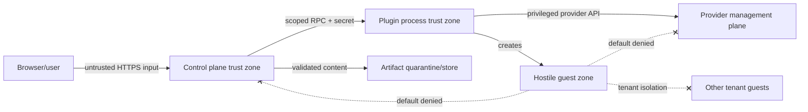

# Security threat model

## Assets, actors, and boundaries

High-value assets are provider credentials/APIs, control-plane identity/session keys, tenancy and audit data, provider management networks, host/container runtime sockets, artifact integrity, plugin binaries, and access-session tokens. Adversaries include malicious participants/guests/images/bundles, compromised authors/admin accounts, malicious plugins, supply-chain attackers, and network attackers.

Out-of-process plugins are not trusted merely because official. The host validates every response and isolates processes. A future Site Agent is trusted to use only enrolled site targets but not to authorize users or edit canonical state.

## Threats and required controls

| Threat ID | Threat | Core guarantee | Provider/deployment obligation |
|---|---|---|---|
| THREAT-NET-001 | Guest reaches control/provider API | Explicit isolated topology, management-prefix denies, no guest callbacks required | Physically/logically separate management networks; firewall/VLAN/VPC/CNI rules; no host socket mounts |
| THREAT-TENANT-001 | Cross-tenant access | Scoped IDs/RBAC/list filtering/access checks; unique ownership tokens | Target network/namespace/VPC isolation and provider IAM |
| THREAT-ISOLATION-001 | Container escape | Isolation class is explicit; no silent VM→Pod/container downgrade; warnings/policy rejection | Use KubeVirt/QEMU/EC2 or verified sandbox; patch hypervisor/runtime |
| THREAT-IMPORT-001 | SSRF/image import | Disabled by default; allowlist, exact digest, redirects/DNS/IP recheck, private/metadata IP deny | Isolated fetch/build workers and restricted egress |
| THREAT-BUNDLE-001 | Malicious bundle/archive | streaming byte/file/depth/ratio limits, manifest hashes, normalized paths, reject symlink/hardlink/device | quarantine filesystem with no execution and least privilege |
| THREAT-RENDER-001 | Malicious YAML/CEL | safe parser, duplicate-key rejection, schema/AST/cost/expansion limits, pure environment | keep libraries patched; fuzz parsers/renderers |
| THREAT-BUILD-001 | Build-context code execution | `labd` never builds; separate durable build job | disposable sandbox, no provider credentials, capped resources/network |
| THREAT-PLUGIN-001 | Plugin credential theft | target-scoped just-in-time secrets, no DB access, process identity, response validation | OS/container sandbox, egress allowlist, separate credentials, executable verification |
| THREAT-OWNERSHIP-001 | Resource tag spoofing/deletion | recorded immutable provider ID + ownership-token match; names insufficient | IAM prevents guests/users tagging or deleting management resources |
| THREAT-ACCESS-001 | Console-token leakage | short TTL, one use/audience/resource binding, hashed storage, no URL logs | TLS, origin/CSP/referrer protections, access proxy redaction |
| THREAT-SESSION-001 | CSRF/session theft | SameSite/Secure/HttpOnly cookie, CSRF tokens, origin checks, session rotation | TLS, trusted reverse-proxy config, OIDC redirect allowlist |
| THREAT-SECRET-001 | Secret/log leakage | typed SecretRefs; central structured redaction; schema-marked sensitive fields | provider SDK redaction and operator log access controls |
| THREAT-DELETE-001 | Destructive race/replay | ETag/generation, leases/fencing, idempotency, strong ownership, audit | provider APIs with least privilege and task polling |
| THREAT-SUPPLY-001 | Supply-chain compromise | pinned modules/actions, SBOM/provenance, plugin checksums/allowlist | signed releases and protected build pipeline; signing is future hardening |

The authoritative owner/control/test mapping is machine-readable in [`design/contracts/security-controls.yaml`](../../design/contracts/security-controls.yaml). A mapped test may be a Phase 0 contract case or a required later implementation/integration test; provider release gates require every applicable test to pass, not merely exist in the matrix.

## Guarantees by owner

- **Core-enforced:** schema/expression limits, identity/RBAC, target grants, explicit isolation, capability mismatch failure, state/operation locking, secret redaction contract, ownership checks, bundle validation, audit/outbox.
- **Provider-enforced:** faithful primitive mapping, network/storage isolation, endpoint safety, cleanup, accurate capabilities, provider API least privilege.
- **Deployment-enforced:** management-plane separation, host/Kubernetes/Docker socket protection, TLS/key custody, database/artifact encryption/backups, plugin sandboxing, patching, reverse-proxy correctness.
- **Operator-owned:** select suitable isolation, maintain safe base images, configure provider targets and allowlists, investigate leftovers/drift, rotate credentials, accept Docker laptop risks.

## Docker laptop limitations

Normal Docker isolation is not a security boundary for arbitrary hostile code. Docker API/socket possession is host-equivalent privilege; LabCentral never mounts it into guests. Desktop networking and host firewall enforcement vary. Laptop mode is for trusted learning/dev images unless the operator explicitly acknowledges the risk; it cannot claim protection equivalent to QEMU/KubeVirt/EC2.

## Future hardening

Bundle/plugin signing, transparency/provenance verification, external policy modules that only constrain, isolated image importers, hardware-backed key management, and anomaly/flow monitoring are roadmap items. They do not weaken current fail-closed defaults.
