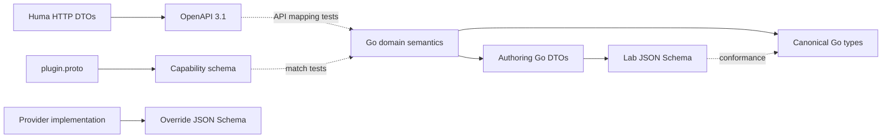

# Template rendering

## Deterministic pipeline

1. Verify bundle manifest/digest and parse limited YAML.
2. Validate `v1alpha1` author schema; apply literal defaults; validate typed inputs.
3. Compile/type-check CEL against a versioned environment (`params`, component args, current iteration key/value, pure helper subset).
4. Expand named components depth-first with recursion rejection and depth/count limits.
5. Expand `forEach` in canonical key order and apply `when`; generate stable qualified names.
6. Resolve typed refs and substitute only explicitly expression-enabled scalar fields.
7. Build typed portable domain objects and infer dependency edges.
8. Detect cycles and validate topology, policy, quotas, and required capabilities.
9. Normalize durations/CIDRs/IPs/enums/units, emit JCS-compatible canonical JSON, and calculate digest.
10. Persist canonical bytes, renderer/environment versions, graph, warnings, and provenance before provider validation.

Limits are server policy and included in validation output: bundle bytes/files, YAML depth/nodes/aliases, CEL AST/cost, component depth, expansion count, resource count, string length, and canonical bytes. Hitting a limit is `invalid_declaration`, never a partial render.

## Schema ownership



No schema is generated blindly from another: semantic mapping/conformance tests prove alignment. HTTP DTOs include server resources and may differ from author YAML. Canonical types contain no author-only syntax. Plugin capability messages use typed extensible parameters. Override schemas are plugin-owned and content-digested.

## Example canonical fragment

```json
{"apiVersion":"canonical.labcentral.io/v1alpha1","resources":[{"id":"network.app","kind":"Network","spec":{"egress":{"mode":"deny"},"ipam":{"mode":"providerManaged"},"kind":"isolated"}}]}
```

Canonical resources and map-like lists sort by stable IDs; ordered NICs remain ordered. Numbers outside the typed domain’s permitted IEEE-754/I-JSON range are rejected before canonicalization rather than rounded. JCS preserves Unicode code points and sorts object property names by UTF-16 code units; it does not normalize ordinary string values. Bundle paths are separately NFC-normalized by the bundle contract.

The executable golden catalog is [`schemas/fixtures/canonical/vectors.yaml`](../../schemas/fixtures/canonical/vectors.yaml). It covers object order, YAML anchors/aliases, equivalent number forms/negative zero, and Unicode. [`tools/jcs.mjs`](../../tools/jcs.mjs) is a design-contract oracle used only to verify those vectors; the Go implementation must reproduce the bytes/digests independently and pass the same fixtures.
