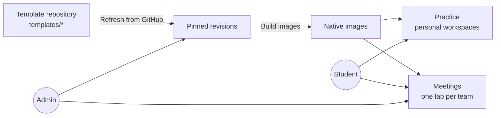

# Running the hosted service

`labcentral-server` turns LabCentral into a web application for a team or class:
students practice in their own cloud workspaces, and instructors run team meetings
with in-browser desktops, breaks, checks and a scoreboard. Hosted provisioning
supports independent AWS and Proxmox installations.

- [What it does](#what-it-does)
- [The template repository](#the-template-repository)
- [Requirements](#requirements)
- [Configuration](#configuration)
- [Running on Proxmox](#running-on-proxmox)
- [Limits](#limits)
- [Operations](#operations)

## What it does



- **Template library.** Imports templates from a Git repository, pins each commit and
  builds images once. Students browse by category, difficulty, tags and duration.
- **Guided practice.** Each attempt snapshots a revision's stages. A stage is completed
  by an answer, by a guest check that verifies the student's actual repair, or by an
  instructor. Authors can attach solutions that students reveal deliberately.
- **Randomized scenarios.** Authors certify compatible combinations of breaks; each
  attempt applies one at random and checks the matching recovery stages.
- **Personal workspaces** with a weekly cloud allowance per student (three hours by
  default), or a download to run the lab on your own infrastructure with the CLI.
- **Team meetings.** Admins start a meeting from a built template, then prepare one lab
  per team. Students join a team and open desktops (one holder per AWS Windows or Proxmox console, individual
  DCV sessions on AWS Linux); instructors apply breaks,
  run scheduled service checks with a scoreboard, and open an SSH terminal to any team
  machine in the browser.
- **Meeting instructor notes.** In **Admin → Meeting → Instructor notes**, read
  the coaching guide from that meeting's pinned template revision. Switching
  between notes and Exercises keeps the current team selection. The notes are
  visible to administrators only and opening them does not run guest actions.
- **Image cleanup.** Admin → Templates shows image counts, and "Remove unused images"
  removes images that no current template, meeting or workspace needs.

Sign-in uses OpenID Connect. Users in the configured member group can practice and join
teams; users in the admin group manage templates and meetings. Group membership is
rechecked every few minutes. If the identity provider is slow or down, signed-in users
stay signed in for up to 15 minutes; after that pages ask them to try again, and a
revoked account is signed out as soon as the provider answers.

## Disabling practice for a meeting

In **Admin → Meeting → Practice labs**, choose **Disable practice…**. Review the
confirmation list, then choose **Disable practice and delete labs**. The list includes
queued, preparing, ready and failed personal runs, plus runs already awaiting cleanup.
Machines and workspace files in those runs will be deleted. Team meeting labs are
unaffected.

The setting applies to everyone, including administrators' personal practice. It
blocks practice browsing, downloads, attempt creation, answers, checks, provisioning
and desktop access, including direct API requests. Admin template management and
meeting controls remain available. Use **Admin → Templates → Explore** to read
instructor notes while practice is disabled. Existing practice desktops lose authorization;
transport revalidation closes them within 20 seconds. Cleanup jobs retain each exact
allocation identity until the provider confirms deletion. Inspect live activity and
retry failed cleanup; disabled practice does not itself mean cleanup has finished.

If allocations change after the confirmation opens, the server refuses the change.
Choose **Review current list** and confirm again. Cancel leaves settings and labs
untouched. Practice starts enabled on installations without a saved setting. The
setting survives restarts. **Enable practice…** restores access without restarting
old labs or cancelling cleanup. Learning progress and pinned revisions are retained.

## The template repository

After a complete successful refresh, template names removed from Git leave the
browsable catalog, including when the last template and its directory are removed.
Their pinned revisions remain available to existing meetings and
attempts and through exact revision URLs. A refresh with invalid template directories
preserves previous names until a complete snapshot can be imported.

The server imports the `templates/` directory from the `main` branch of a Git
repository you configure. Each template is a directory containing:

| Path | Purpose |
| --- | --- |
| `lab.yaml`, image playbooks or scripts | Portable lab source |
| `README.md` | Student handover shown in the library |
| `instructor.yaml` | Private teaching material: stages, checks, breaks, scenarios and catalog details |
| `instructor/` | Private programs for checks, breaks and resets |

Private material is removed before images are built and never reaches students.
`labcentral validate --template DIR` checks a template exactly as the importer will.
Each template is imported on its own: a broken one is reported to admins with the
failing field and does not block the others. See
[Writing lab templates](templates.md) and the
[starter template](../examples/starter-template/).

To publish a change: push to `main`, then **Admin → Templates → Refresh from GitHub**,
then **Build images** on the new revisions. Meetings and attempts keep the revision they
started with.

If an image build fails, choose **Retry build** in **Admin → Templates**. The server
reconciles the previous attempt and, after confirmed cleanup, builds the missing image;
already-built images are kept. **Build images** also handles pending failed attempts.
If cleanup cannot be confirmed, the job stays retryable: ask the operator to resolve
the native build resources, then retry. Removing all of the revision's images is not
needed for a failed build retry.

## Requirements

On one Linux host:

- the `labcentral-server` and `labcentral-provider` binaries and the Packer toolchain;
- the built web UI (`npm --prefix web ci && npm --prefix web run build`, then point
  `webRoot` at `web/build`);
- for AWS desktops, the Amazon DCV Web Client SDK (`dcvjs-esm` directory);
  Proxmox uses bundled noVNC and does not need `sdkRoot`;
- an AWS or Proxmox environment file, as for the CLI (see [Running labs with the CLI](operators.md));
- an OIDC client with redirect URL `https://APP_ORIGIN/auth/callback`;
- a read-only SSH deploy key for the template repository (a GitHub SSH URL such as
  `git@github.com:example/lab-templates.git`) and a `known_hosts` file;
- a TLS-terminating reverse proxy serving two origins, the application and a separate
  desktop origin, to the server's `--listen` address.

## Configuration

Create a configuration file readable only by the service:

```json
{
  "root": "/var/lib/labcentral/state",
  "origin": "https://labs.example.org",
  "desktopOrigin": "https://desktop.labs.example.org",
  "issuer": "https://id.example.org",
  "clientID": "labcentral",
  "clientSecret": "…",
  "memberGroup": "labcentral-users",
  "adminGroup": "labcentral-admins",
  "repository": "git@github.com:example/lab-templates.git",
  "deployKey": "/var/lib/labcentral/config/deploy_key",
  "knownHosts": "/var/lib/labcentral/config/known_hosts",
  "environment": "/var/lib/labcentral/config/aws.yaml",
  "webRoot": "/opt/labcentral/web",
  "sdkRoot": "/opt/labcentral/dcv"
}
```

`backchannelOrigin` can send token and discovery requests to a different HTTPS origin
when the public identity-provider hostname isn't reachable from the server; issuer and
audience are still verified against `issuer`.

```sh
labcentral-server --config /path/to/service.json --check-config   # validate, print limits
labcentral-server --config /path/to/service.json --listen 127.0.0.1:8080
```

## Running on Proxmox

Use a **new Ubuntu 24.04 amd64 VM on the management LAN**, with its own state,
OIDC client and app/desktop DNS names. It has no connection to an AWS installation.
The VM must reach the Proxmox API, gateway management addresses and build guests;
a VPN reaching only the API is insufficient. Allow outbound HTTPS for packages,
Packer and GitHub SSH for template imports. Give the server disk room for build
sources, journals and backups. Keep host names, tokens and deploy keys outside source.

1. **Build the bundle** on a Linux development machine with Go 1.27.1 and Node 22.12+
   (`./tools/package-server.sh`), or download the server archive from a release.
   Copy it to the new VM. Install dependencies and unpack:

   ```sh
   sudo apt-get update
   sudo apt-get install -y git curl ca-certificates unzip xorriso caddy
   sudo useradd --system --create-home --home-dir /var/lib/labcentral --shell /bin/bash labcentral
   sudo install -d /opt/labcentral
   sudo tar -xzf labcentral-server-linux-amd64.tar.gz -C /opt/labcentral
   sudo install -d -m 0750 -o labcentral -g labcentral /etc/labcentral
   ```

2. **Set up the environment** as the service user, following
   [Proxmox setup](operators.md#proxmox) and [Build toolchain](operators.md#build-toolchain).
   Use `/etc/labcentral/proxmox.yaml`; install Packer in `/usr/local/bin` and its pinned
   plugins under `/var/lib/labcentral/packer-plugins`. Export `PACKER_PLUGIN_PATH` to
   that directory during setup. Run `sudo -u labcentral -H bash` for these steps.
   Keep setup receipts and the token beside the environment. Check the environment
   from this VM. The admin token is needed only for setup/teardown; never put it in
   the service configuration.

3. **Configure** `/etc/labcentral/service.json` using the example above, with
   `environment: /etc/labcentral/proxmox.yaml`, `webRoot: /opt/labcentral/web`,
   `root: /var/lib/labcentral/state`, the two installation origins and your OIDC
   client. Omit `sdkRoot`. Set a ceiling, for example:
   `"capacity": {"vCPU": 12, "memoryMiB": 24576}`. Reserve host resources separately
   for the server VM, Proxmox and other workloads. Copy the read-only deploy key
   and verified GitHub host keys to the configured paths. Protect configuration,
   environment, deploy key and `known_hosts` with service ownership and mode 0600.
   Create root-owned `/etc/labcentral/provider.env` (0600), containing:

   ```ini
   LABCENTRAL_PROXMOX_TOKEN=the-runtime-token-secret
   PACKER_PLUGIN_PATH=/var/lib/labcentral/packer-plugins
   ```

   Use the token variable named in the environment's `proxmox.tokenEnv`. Do not
   enable request-body/access logging on the desktop origin: launch POSTs are secrets.

4. **TLS and startup.** Point both names at this VM in local DNS. Copy
   `deploy/Caddyfile` to `/etc/caddy/Caddyfile` and replace its example names.
   For a closed LAN, `tls internal` uses [Caddy's internal CA](https://caddyserver.com/docs/caddyfile/directives/tls).
   Distribute only its root certificate from
   `/var/lib/caddy/.local/share/caddy/pki/authorities/local/root.crt` to clients
   (including browser trust stores). Keep its private key on the VM.
   For public certificates on private addresses, use a Caddy build with your
   [DNS provider module](https://caddyserver.com/docs/automatic-https#dns-challenge)
   and replace `tls internal` with `tls { dns PROVIDER ... }`; keep the provider's
   narrowly scoped DNS credential in a protected Caddy systemd environment file.
   DNS challenge needs public authoritative DNS and outbound ACME access, but no
   inbound public port forwarding. Use split DNS to resolve the app locally.

   ```sh
   sudo install -m 0644 /opt/labcentral/deploy/labcentral-server.service /etc/systemd/system/
   sudo caddy validate --config /etc/caddy/Caddyfile
   sudo systemctl daemon-reload
   sudo systemctl enable --now labcentral-server
   sudo systemctl restart caddy
   sudo systemctl status labcentral-server --no-pager
   ```

   Register `https://labs.example.org/auth/callback` with OIDC. If OIDC uses a
   private CA, install that CA into the VM's system trust store too. Then sign in,
   refresh the template repository, build a revision and try practice before a meeting.

**Console desktops.** Every Proxmox VM has one shared screen. The normal holder,
conflict, **Take over** and **Take back** controls apply to students and coaches.
Use **Console login** in the desktop toolbar to see the temporary guest username and
password, then sign in at the guest greeter. These are guest credentials; the native
VNC ticket and API token stay on the server. Closing or revoking access terminates the
guest session and locks the account; saved files remain until the lab is destroyed. Reopen
from the app for a fresh authenticated connection. Full screen and viewport resizing
are available; clipboard text depends on the guest supporting QEMU's clipboard channel
and may be unavailable on standard console images. The lesson panel works beside the
console during practice. AWS Linux keeps its per-user DCV sessions.

## Windows templates

Templates can include Windows Server 2022 machines (AWS only). Add to the service's
environment file:

- a Windows base, such as `bases.windows-2022`, with `os: windows`,
  `user: Administrator`, `diskGiB: 30` and the same AMI ID in `id` and `identity`.
  Resolve `/aws/service/ami-windows-latest/Windows_Server-2022-English-Full-Base` once
  and bind the ID, never the parameter path;
- the DCV installer pins `build.windowsDCVURL` and `build.windowsDCVSHA256` (see
  [Windows guests](operators.md#windows-guests)); the build network needs Windows Update
  access to install OpenSSH;
- an instance type with at least 4 GiB in `aws.types`, such as
  `{name: t3.medium, cpu: 2, memoryMiB: 4096}`, selected for builds with
  `build.instanceType` or the image's `platform.aws.buildInstanceType`.

The service's AWS role must be allowed to launch that AMI and instance type. A template
the environment can't support shows the reason in **Admin → Templates** and can't be
built; Linux templates are unaffected.

**One screen per Windows machine.** A Windows machine has a single console, so in a
meeting one person uses a team's Windows desktop at a time. Teammates see who has it
and can **Take over**, which disconnects that person first; saved files stay, but open
programs close. Coaches can open or take over any team's desktop from **Admin →
Meeting → Coach machine access**. Practice attempts belong to one person, so this
doesn't apply there.

**Coach terminal.** Opens PowerShell as `Administrator`. The terminal keeps its initial
size on Windows. Breaks, resets and checks can run while the terminal stays open.

**Time and cost.** Expect about an hour for a first Windows image build and several
minutes for a Windows desktop to start (the opening and preparation limits below are
longer for Windows). Windows instances cost more than Linux ones, and closing a desktop
doesn't stop the lab's machines.

## Limits

`capacity` is an optional site ceiling: set **both** `vCPU` and `memoryMiB`, or omit
both to disable it. Admissions count every team's allocation (including waiting
meetings), queued/active/failed/ending practice, retained engine allocations and each
lab's gateway. They stay reserved until cleanup is confirmed. Creation/preparation
and practice refuse before provisioning with the required and available capacity.
Builds also reserve temporary capacity: on Proxmox, 3 vCPU / 4864 MiB per parallel
image for its builder or qualifier plus gateway. Failed builds retain this reservation
until retry succeeds or image cleanup confirms absence. Allow headroom or lower
`engine.maxImageBuildConcurrency`. This is a reservation policy, not native free-RAM
measurement; installations must use an exclusive allocation namespace. Weekly student
minutes apply independently on both platforms. On AWS, include the gateway instance
type in `aws.types` when enabling a capacity ceiling.

Other limits are optional; omitted or zero values use the defaults.

| Setting | Default | Meaning |
| --- | ---: | --- |
| `weeklyCloudMinutes` | 180 | Each student's weekly personal cloud allowance (resets Monday, UTC) |
| `worker.maxProvisioningConcurrency` | 3 | Simultaneous team and personal lab preparations |
| `worker.maxBulkJobs` | 3 | Builds, preparations, template refreshes and image removals |
| `worker.maxGuestJobs` | 12 | Guest checks and breaks, separate from bulk work |
| `worker.maxImageBuildJobs` | 2 | Image builds within the bulk budget |
| `worker.prepareTimeoutMinutes` | 30 | Per Linux allocation preparation (1–1440 minutes) |
| `worker.windowsPrepareTimeoutMinutes` | 45 | Per Windows or mixed allocation preparation (1–1440 minutes) |
| `desktop.openSeconds` | 90 | Hosted Linux desktop opening (1–3600 seconds) |
| `desktop.windowsOpenSeconds` | 600 | Hosted Windows desktop opening (1–3600 seconds; provider ceiling 600) |
| `worker.jobTimeoutMinutes` | 120 | Maximum job duration (1–1440) |
| `engine.maxImageBuildConcurrency` | 3 | Parallel images within one build |
| `engine.maxMachineConcurrency` | 4 | Parallel machine creates within one deployment |
| `engine.maxCleanupConcurrency` | 4 | Parallel machine deletions within one cleanup |
| `aggregate.maxNativeOperations` | 8 | Machine creates and deletes across all jobs |
| `aggregate.maxSSHSessions` | 24 | Guest SSH steps, coach terminals and desktop operations across all jobs |

Worker concurrency and engine values accept 1–32 and aggregate budgets 1–64. Raising them does not
raise your cloud provider's quotas. A meeting of 6 teams × 6 students with 36
concurrent desktops has been verified with the defaults: desktops opened at once took
6–41 seconds, because desktop operations share `aggregate.maxSSHSessions`.

## Operations

- **Desktop cleanup.** Busy desktop operations are retried automatically by the
  periodic cleanup sweep (every 20 seconds), without a failed Admin job. Unconfirmed
  native cleanup still appears as a failed job and retains its cleanup intent.
- **Backups.** Back up the state root, including its WAL files and provider journals,
  while the server is stopped.
- **One server per state root.** Never run two servers against the same state.
- **Deploying updates.** Deploy when nothing is running (no open meeting, no active
  workspaces or jobs), after a backup.
- **Release checks.** Before trusting a release, sign in with a real identity, open a
  real desktop session and confirm cleanup; local tests cannot substitute for that.
