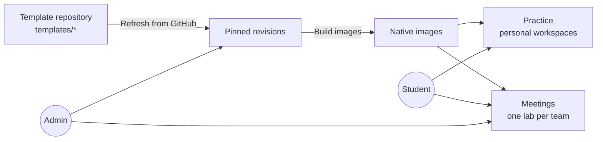

# Running the hosted service

`labcentral-server` turns LabCentral into a web application for a team or class:
students practice in their own cloud workspaces, and instructors run team meetings
with in-browser desktops, breaks, checks and a scoreboard. Hosted provisioning
currently requires AWS.

- [What it does](#what-it-does)
- [The template repository](#the-template-repository)
- [Requirements](#requirements)
- [Configuration](#configuration)
- [Limits](#limits)
- [Operations](#operations)

## What it does



- **Template library.** Imports templates from a Git repository, pins each commit and
  builds images once. Students browse by category, difficulty, tags and duration.
- **Guided practice.** Each attempt snapshots a revision's stages. A stage is completed
  by an answer, by a guest check that verifies the student's actual repair, or by an
  instructor. Authors can attach solutions that students reveal deliberately.
- **Randomized scenarios.** Authors certify compatible combinations of breaks; each
  attempt applies one at random and checks the matching recovery stages.
- **Personal workspaces** with a weekly cloud allowance per student (three hours by
  default), or a download to run the lab on your own infrastructure with the CLI.
- **Team meetings.** Admins start a meeting from a built template, then prepare one lab
  per team. Students join a team and open desktops (one holder per Windows machine, individual
  sessions on Linux); instructors apply breaks,
  run scheduled service checks with a scoreboard, and open an SSH terminal to any team
  machine in the browser.
- **Image cleanup.** Admin → Templates shows image counts, and "Remove unused images"
  removes images that no current template, meeting or workspace needs.

Sign-in uses OpenID Connect. Users in the configured member group can practice and join
teams; users in the admin group manage templates and meetings.

## The template repository

The server imports the `templates/` directory from the `main` branch of a Git
repository you configure. Each template is a directory containing:

| Path | Purpose |
| --- | --- |
| `lab.yaml`, image playbooks or scripts | Portable lab source |
| `README.md` | Student handover shown in the library |
| `instructor.yaml` | Private teaching material: stages, checks, breaks, scenarios and catalog details |
| `instructor/` | Private programs for checks, breaks and resets |

Private material is removed before images are built and never reaches students.
`labcentral validate --template DIR` checks a template exactly as the importer will.
Each template is imported on its own: a broken one is reported to admins with the
failing field and does not block the others. See
[Writing lab templates](templates.md) and the
[starter template](../examples/starter-template/).

To publish a change: push to `main`, then **Admin → Templates → Refresh from GitHub**,
then **Build images** on the new revisions. Meetings and attempts keep the revision they
started with.

## Requirements

On one Linux host:

- the `labcentral-server` and `labcentral-provider` binaries and the Packer toolchain;
- the built web UI (`npm --prefix web ci && npm --prefix web run build`, then point
  `webRoot` at `web/build`);
- the Amazon DCV Web Client SDK (`dcvjs-esm` directory) for browser desktops;
- an AWS environment file, as for the CLI (see [Running labs with the CLI](operators.md));
- an OIDC client with redirect URL `https://APP_ORIGIN/auth/callback`;
- a read-only SSH deploy key for the template repository (a GitHub SSH URL such as
  `git@github.com:example/lab-templates.git`) and a `known_hosts` file;
- a TLS-terminating reverse proxy serving two origins, the application and a separate
  desktop origin, to the server's `--listen` address.

## Configuration

Create a configuration file readable only by the service:

```json
{
  "root": "/var/lib/labcentral/state",
  "origin": "https://labs.example.org",
  "desktopOrigin": "https://desktop.labs.example.org",
  "issuer": "https://id.example.org",
  "clientID": "labcentral",
  "clientSecret": "…",
  "memberGroup": "labcentral-users",
  "adminGroup": "labcentral-admins",
  "repository": "git@github.com:example/lab-templates.git",
  "deployKey": "/var/lib/labcentral/config/deploy_key",
  "knownHosts": "/var/lib/labcentral/config/known_hosts",
  "environment": "/var/lib/labcentral/config/aws.yaml",
  "webRoot": "/opt/labcentral/web",
  "sdkRoot": "/opt/labcentral/dcv"
}
```

`backchannelOrigin` can send token and discovery requests to a different HTTPS origin
when the public identity-provider hostname isn't reachable from the server; issuer and
audience are still verified against `issuer`.

```sh
labcentral-server --config /path/to/service.json --check-config   # validate, print limits
labcentral-server --config /path/to/service.json --listen 127.0.0.1:8080
```

## Windows templates

Hosted Windows uses the same AWS Server 2022 image and guest lifecycle as the CLI.
Local authorization, persistence, race and fake SSH tests cover the hosted paths;
real OIDC, Windows desktop input, shared-console handoffs and release acceptance
remain pending. Do not treat those tests as live platform qualification.

Before refreshing a Windows template, configure the service's **environment file**:

- Bind the author's base name, for example `bases.windows-2022`, with `os: windows`,
  `user: Administrator`, `diskGiB: 30`, and the same pinned AMI in `id` and `identity`.
  Resolve `/aws/service/ami-windows-latest/Windows_Server-2022-English-Full-Base` once
  in the deployment region; never bind the mutable parameter path.
- Set `build.windowsDCVURL` and `build.windowsDCVSHA256` to the pinned MSI values in
  [Windows guests](operators.md#windows-guests). The build network needs Windows
  Update access for OpenSSH. Both pins must be supplied together.
- Include a Windows-capable type in `aws.types`, such as
  `{name: t3.medium, cpu: 2, memoryMiB: 4096}`, and select it with
  `build.instanceType` or the Windows image's `platform.aws.buildInstanceType`.
  Keep the Linux base, Linux DCV pins and existing license-only desktop profile.
- Allow the provider role to launch the pinned Windows base AMI and the selected
  instance types. Windows needs no password-decryption, WinRM or guest SSM access;
  it uses pinned OpenSSH through the existing lab gateway. Parameter resolution is
  an operator action, separate from the service's runtime permissions.

A Linux-only service remains valid. Missing Windows bases, mismatched OS bindings,
installer pins and insufficient instance capacity appear in the existing **Admin →
Templates** problem panel before a build can be queued. Current revision views also
expose `problem` if configuration changes after import. Cleanup continues to use saved
image keys; an incompatible environment never licenses guessing which images to remove.

Coaches (users in `adminGroup`) can create their own explore/baseline/scenario attempts
from coach-only templates. These attempts stay private to their owner; losing coach
privileges blocks access and guest work, while Stop and cleanup remain available.
The UI controls for starting coach-only attempts still need to be enabled.

A team's Windows machine has one console, owned by local `lab`, and one hosted holder.
An ordinary open returns HTTP 409 with `code: desktop_held` and `holderName` when a
teammate holds it. Explicit take-over revokes the old grant, waits for provider
confirmation, then opens the new one. Saved profile files are shared and preserved;
logoff ends applications, so save work before handing over. Unknown revocation returns
503 with `code: desktop_outcome_unknown` and `Retry-After`; the old holder stays in
persistent state and no replacement grant is created until cleanup is confirmed.
Concurrent take-overs serialize on that allocation and machine. Restart reconciles
old access before another grant; it does not replay an interrupted requester's login.

The API contract for the remaining UI work is:

| Action | Teammate | Coach/admin targeting the current meeting |
| --- | --- | --- |
| Open | `POST /api/access` | `POST /api/admin/teams/{id}/desktop` |
| Explicit take-over | `POST /api/access/takeover` | `POST /api/admin/teams/{id}/desktop/takeover` |
| Status | `GET /api/access/status` | `GET /api/admin/teams/{id}/desktop/status` |

Writes use the existing Origin and CSRF checks. Team IDs on admin routes must belong
to a ready team in the current meeting; normal members can only target their own
current seat. Holder names are available only after these checks. `LabView.desktopState`
also carries the current state on `/api/me`. Status reports `available`, `held`, `owned`,
`desktop_taken_over` (with `takenOverBy`), or `desktop_outcome_unknown`; `canTakeOver`
indicates another holder. The displaced desktop cookie can poll `/status` on the
desktop origin, and a reconnect reports a typed taken-over response. Status and old
cookies stop disclosing names after seat change, sign-out, expiry or role revocation.
UI take-over controls, status polling and presentation are pending.

Personal practice has one owner and needs no take-over. Closing and reopening a
desktop on a live allocation preserves saved files; **Stop** destroys the allocation
and retains learning progress only. Linux desktops retain individual guest sessions.
Windows desktop authentication uses account `lab` and session ID `console`.
The desktop lesson panel supports personal attempts on both operating systems;
meeting learning remains in the application.

The coach terminal connects as `Administrator` through Windows OpenSSH's PowerShell
default shell. It retains pinned host keys, meeting authorization, cancellation and
the ten-minute shell limit. Initial dimensions default to 100 columns × 30 rows;
valid resize messages are accepted but Windows keeps the initial console size.
Linux still receives window-change requests. The `lab` desktop account and the
management `Administrator` account serve separate purposes.

Windows cold boots and logon are slower. Defaults are 15 minutes for Windows guest
readiness (Linux: 5), 5 minutes for the Windows console to become running (Linux: 25
seconds), 10 minutes for hosted Windows desktop open (Linux: 90 seconds), and 2 minutes
for Windows logoff/close (Linux: 20 seconds). The provider's open ceiling is 10 minutes
on Windows and 2 on Linux. Preparation budgets are 45 minutes for mixed/Windows labs
and 30 for Linux, further bounded by allocation expiry and `worker.jobTimeoutMinutes`.
The EC2-running wait is 10 minutes and image qualification is 20 on Windows, 10 on
Linux. Reverse-proxy launch timeouts must allow the configured open budget plus a
possible two-minute revoke; 15 minutes covers the defaults. The current web launch
retry window (two minutes) and terminal-ready wait (30 seconds) still need OS-aware
UI handling. Never retry by creating a new desktop when status is unknown.

Prior CLI qualification observed roughly an hour for a cold Windows image build,
20 minutes for Linux and seven minutes for deployment; hosted timings remain
unverified. Windows licensing and larger instance sizes add cost. Preparation,
retained allocations, failed runs awaiting cleanup and image storage all consume
resources; desktop Close does not stop billing for the lab. Set quotas accordingly
and confirm instance and image cleanup after acceptance.

## Limits

All limits are optional; omitted or zero values use the defaults.

| Setting | Default | Meaning |
| --- | ---: | --- |
| `weeklyCloudMinutes` | 180 | Each student's weekly personal cloud allowance (resets Monday, UTC) |
| `worker.maxProvisioningConcurrency` | 3 | Simultaneous team and personal lab preparations |
| `worker.maxBulkJobs` | 3 | Builds, preparations, template refreshes and image removals |
| `worker.maxGuestJobs` | 12 | Guest checks and breaks, separate from bulk work |
| `worker.maxImageBuildJobs` | 2 | Image builds within the bulk budget |
| `worker.prepareTimeoutMinutes` | 30 | Per Linux allocation preparation (1–1440 minutes) |
| `worker.windowsPrepareTimeoutMinutes` | 45 | Per Windows or mixed allocation preparation (1–1440 minutes) |
| `desktop.openSeconds` | 90 | Hosted Linux desktop opening (1–3600 seconds) |
| `desktop.windowsOpenSeconds` | 600 | Hosted Windows desktop opening (1–3600 seconds; provider ceiling 600) |
| `worker.jobTimeoutMinutes` | 120 | Maximum job duration (1–1440) |
| `engine.maxImageBuildConcurrency` | 3 | Parallel images within one build |
| `engine.maxMachineConcurrency` | 4 | Parallel machine creates within one deployment |
| `engine.maxCleanupConcurrency` | 4 | Parallel machine deletions within one cleanup |
| `aggregate.maxNativeOperations` | 8 | Machine creates and deletes across all jobs |
| `aggregate.maxSSHSessions` | 24 | Guest SSH steps, coach terminals and desktop operations across all jobs |

Worker concurrency and engine values accept 1–32 and aggregate budgets 1–64. Raising them does not
raise your cloud provider's quotas. A meeting of 4 teams × 3 students with 12
concurrent desktops has been verified with the defaults.

## Operations

- **Backups.** Back up the state root, including its WAL files and provider journals,
  while the server is stopped.
- **One server per state root.** Never run two servers against the same state.
- **Deploying updates.** Deploy when nothing is running (no open meeting, no active
  workspaces or jobs), after a backup.
- **Release checks.** Before trusting a release, sign in with a real identity, open a
  real desktop session and confirm cleanup; local tests cannot substitute for that.
