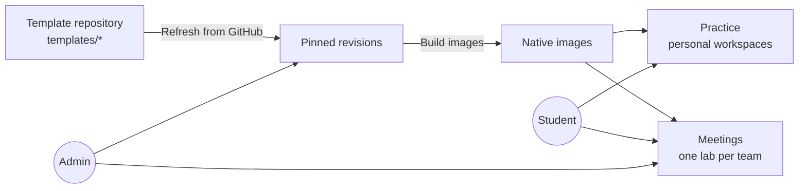

# Running the hosted service

`labcentral-server` turns LabCentral into a web application for a team or class:
students practice in their own cloud workspaces, and instructors run team meetings
with in-browser desktops, breaks, checks and a scoreboard. Hosted provisioning
currently requires AWS.

- [What it does](#what-it-does)
- [The template repository](#the-template-repository)
- [Requirements](#requirements)
- [Configuration](#configuration)
- [Limits](#limits)
- [Operations](#operations)

## What it does



- **Template library.** Imports templates from a Git repository, pins each commit and
  builds images once. Students browse by category, difficulty, tags and duration.
- **Guided practice.** Each attempt snapshots a revision's stages. A stage is completed
  by an answer, by a guest check that verifies the student's actual repair, or by an
  instructor. Authors can attach solutions that students reveal deliberately.
- **Randomized scenarios.** Authors certify compatible combinations of breaks; each
  attempt applies one at random and checks the matching recovery stages.
- **Personal workspaces** with a weekly cloud allowance per student (three hours by
  default), or a download to run the lab on your own infrastructure with the CLI.
- **Team meetings.** Admins start a meeting from a built template, then prepare one lab
  per team. Students join a team and open their own desktops; instructors apply breaks,
  run scheduled service checks with a scoreboard, and open an SSH terminal to any team
  machine in the browser.
- **Image cleanup.** Admin → Templates shows image counts, and "Remove unused images"
  removes images that no current template, meeting or workspace needs.

Sign-in uses OpenID Connect. Users in the configured member group can practice and join
teams; users in the admin group manage templates and meetings.

## The template repository

The server imports the `templates/` directory from the `main` branch of a Git
repository you configure. Each template is a directory containing:

| Path | Purpose |
| --- | --- |
| `lab.yaml`, image playbooks or scripts | Portable lab source |
| `README.md` | Student handover shown in the library |
| `instructor.yaml` | Private teaching material: stages, checks, breaks, scenarios and catalog details |
| `instructor/` | Private programs for checks, breaks and resets |

Private material is removed before images are built and never reaches students.
`labcentral validate --template DIR` checks a template exactly as the importer will.
Each template is imported on its own: a broken one is reported to admins with the
failing field and does not block the others. See
[Writing lab templates](templates.md) and the
[starter template](../examples/starter-template/).

To publish a change: push to `main`, then **Admin → Templates → Refresh from GitHub**,
then **Build images** on the new revisions. Meetings and attempts keep the revision they
started with.

## Requirements

On one Linux host:

- the `labcentral-server` and `labcentral-provider` binaries and the Packer toolchain;
- the built web UI (`npm --prefix web ci && npm --prefix web run build`, then point
  `webRoot` at `web/build`);
- the Amazon DCV Web Client SDK (`dcvjs-esm` directory) for browser desktops;
- an AWS environment file, as for the CLI (see [Running labs with the CLI](operators.md));
- an OIDC client with redirect URL `https://APP_ORIGIN/auth/callback`;
- a read-only SSH deploy key for the template repository (a GitHub SSH URL such as
  `git@github.com:example/lab-templates.git`) and a `known_hosts` file;
- a TLS-terminating reverse proxy serving two origins, the application and a separate
  desktop origin, to the server's `--listen` address.

## Configuration

Create a configuration file readable only by the service:

```json
{
  "root": "/var/lib/labcentral/state",
  "origin": "https://labs.example.org",
  "desktopOrigin": "https://desktop.labs.example.org",
  "issuer": "https://id.example.org",
  "clientID": "labcentral",
  "clientSecret": "…",
  "memberGroup": "labcentral-users",
  "adminGroup": "labcentral-admins",
  "repository": "git@github.com:example/lab-templates.git",
  "deployKey": "/var/lib/labcentral/config/deploy_key",
  "knownHosts": "/var/lib/labcentral/config/known_hosts",
  "environment": "/var/lib/labcentral/config/aws.yaml",
  "webRoot": "/opt/labcentral/web",
  "sdkRoot": "/opt/labcentral/dcv"
}
```

`backchannelOrigin` can send token and discovery requests to a different HTTPS origin
when the public identity-provider hostname isn't reachable from the server; issuer and
audience are still verified against `issuer`.

```sh
labcentral-server --config /path/to/service.json --check-config   # validate, print limits
labcentral-server --config /path/to/service.json --listen 127.0.0.1:8080
```

## Limits

All limits are optional; omitted or zero values use the defaults.

| Setting | Default | Meaning |
| --- | ---: | --- |
| `weeklyCloudMinutes` | 180 | Each student's weekly personal cloud allowance (resets Monday, UTC) |
| `worker.maxProvisioningConcurrency` | 3 | Simultaneous team and personal lab preparations |
| `worker.maxBulkJobs` | 3 | Builds, preparations, template refreshes and image removals |
| `worker.maxGuestJobs` | 12 | Guest checks and breaks, separate from bulk work |
| `worker.maxImageBuildJobs` | 2 | Image builds within the bulk budget |
| `worker.jobTimeoutMinutes` | 120 | Maximum job duration (1–1440) |
| `engine.maxImageBuildConcurrency` | 3 | Parallel images within one build |
| `engine.maxMachineConcurrency` | 4 | Parallel machine creates within one deployment |
| `engine.maxCleanupConcurrency` | 4 | Parallel machine deletions within one cleanup |
| `aggregate.maxNativeOperations` | 8 | Machine creates and deletes across all jobs |
| `aggregate.maxSSHSessions` | 24 | Guest SSH steps, coach terminals and desktop operations across all jobs |

Worker and engine values accept 1–32 and aggregate budgets 1–64. Raising them does not
raise your cloud provider's quotas. A meeting of 4 teams × 3 students with 12
concurrent desktops has been verified with the defaults.

## Operations

- **Backups.** Back up the state root, including its WAL files and provider journals,
  while the server is stopped.
- **One server per state root.** Never run two servers against the same state.
- **Deploying updates.** Deploy when nothing is running (no open meeting, no active
  workspaces or jobs), after a backup.
- **Release checks.** Before trusting a release, sign in with a real identity, open a
  real desktop session and confirm cleanup; local tests cannot substitute for that.
