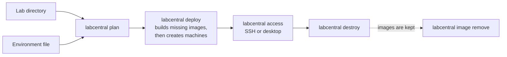

# Running labs with the CLI

This guide is for operators who run labs on their own AWS account or Proxmox cluster
with the `labcentral` command-line tool. To write labs, see
[Writing lab templates](templates.md); to run the web service for a class, see
[Running the hosted service](hosted.md).

- [Install](#install)
- [Configure an environment](#configure-an-environment)
- [AWS](#aws)
- [Proxmox](#proxmox)
- [Run labs](#run-labs)
- [State and recovery](#state-and-recovery)



## Install

You need Go 1.27 (every pinned tool version is in
[tools/toolchain.json](../tools/toolchain.json)) and an AWS account or Proxmox cluster
you control. The operator machine is Linux amd64.

```sh
git clone https://github.com/OutboundSpade/LabCentral.git
cd LabCentral
make build
export PATH="$PWD/bin:$PATH"
```

`make build` produces `labcentral` and `labcentral-provider`. The CLI looks for the
provider next to itself, so keep both binaries together. `labcentral help COMMAND`
shows usage and examples for every command.

## Configure an environment

An environment file describes where labs run: the target, base images, network
policy and the pinned build toolchain. Keep environment files and credentials outside
your lab repositories.

```sh
mkdir -p ~/.config/labcentral && chmod 700 ~/.config/labcentral
labcentral environment init ~/.config/labcentral/aws.yaml aws
# or: labcentral environment init ~/.config/labcentral/proxmox.yaml proxmox
labcentral environment check --environment ~/.config/labcentral/aws.yaml
```

### Base images

`bases` binds the base names that labs use (such as `ubuntu-24.04`) to pinned images:

| Field | AWS | Proxmox |
| --- | --- | --- |
| `id`, `identity` | The AMI ID (both fields) | Template VMID, and its configuration digest |
| `user` | The image's default login user | The image's default login user |
| `diskGiB` | Root disk size | Root disk size |
| `os` | `linux` (default) or `windows` | `linux` |

Guests are Ubuntu 24.04 amd64, plus Windows Server 2022 on AWS.

### Build toolchain

`build` pins the toolchain. Install Packer 1.14.3, verify its published checksum, and
install exactly the pinned plugins into a dedicated directory:

```sh
export PACKER_PLUGIN_PATH="$HOME/.local/share/labcentral/packer-plugins"
packer plugins install github.com/hashicorp/amazon 1.8.1
packer plugins install github.com/hashicorp/proxmox 1.2.3
packer plugins install github.com/hashicorp/ansible 1.1.4
sha256sum "$(command -v packer)"
labcentral environment fingerprint-plugins "$PACKER_PLUGIN_PATH"
```

Then set:

- `build.packer` and `build.pluginDirectory` to absolute paths;
- `build.packerSHA256` and `build.toolchainID` from the commands above;
- `build.ansibleVersion: 2.19.3` and a `build.timeoutSeconds` limit.

`operatorCIDRs` lists the IPv4 ranges (/24 or narrower) allowed to reach labs.

## AWS

Use a dedicated account with short-lived credentials (IAM Identity Center, an assumed
role, or IAM Roles Anywhere). Never put access keys in lab source.

1. Create the build network and the DCV licensing role once with
   [tools/aws-sandbox.yaml](../tools/aws-sandbox.yaml):

   ```sh
   aws cloudformation deploy --stack-name labcentral-build \
     --template-file tools/aws-sandbox.yaml --capabilities CAPABILITY_IAM \
     --parameter-overrides OperatorCIDR=203.0.113.10/32 AvailabilityZone=us-east-1a
   aws cloudformation describe-stacks --stack-name labcentral-build \
     --query 'Stacks[0].Outputs'
   ```

2. Copy the outputs into `build.subnetID`, `build.securityGroupID` and
   `aws.desktopProfile`.
3. Set `aws.account`, `aws.region`, `aws.zone`, `aws.profile` and an instance-type
   allowlist, for example `types: [{name: t3.medium, cpu: 2, memoryMiB: 4096}]`. Add
   `maxNICs` to a type to check multi-NIC machines offline; otherwise the provider asks
   AWS for the type's limit.
4. For Linux desktops, set `build.dcvURL` and `build.dcvSHA256` to the official Amazon
   DCV server archive for Ubuntu 24.04 and its published checksum.

**How labs are laid out.** Each lab gets its own VPC (`10.77.0.0/16` by default) with
one subnet, security group and route table per network. Machines have no public
addresses: a small gateway holds the lab's only public address, and all SSH, desktop
and check traffic is tunneled through it with host keys pinned on both hops. Configure
it with `aws.gateway: {base: ubuntu-24.04, instanceType: t3.micro}` (the defaults).
Set `aws.allowEgress: true` to let labs request Internet access.

**Permissions and costs.** The operator identity needs EC2 lifecycle permissions and
`iam:PassRole` for the DCV licensing role (restricted to `ec2.amazonaws.com`). Lab
machines get no AWS permissions; desktop machines get a license-only instance profile.
Instances, public IPv4 addresses, images and snapshots are billed while they exist.

### Windows guests

1. Resolve the current Windows Server 2022 AMI once and pin it:

   ```sh
   aws ssm get-parameter --name \
     /aws/service/ami-windows-latest/Windows_Server-2022-English-Full-Base \
     --query Parameter.Value --output text
   ```

2. Add a base with that ID as both `id` and `identity`, `os: windows`,
   `user: Administrator` and `diskGiB: 30`. Never store the parameter path itself.
3. Allow an instance type with at least 4 GiB of memory, and select it for builds with
   `build.instanceType` or the image's `platform.aws.buildInstanceType`.
4. For Windows desktops, pin the DCV server installer:

   ```yaml
   build:
     windowsDCVURL: https://d1uj6qtbmh3dt5.cloudfront.net/2025.0/Servers/nice-dcv-server-x64-Release-2025.0-20103.msi
     windowsDCVSHA256: 593e2b78cd41b64fac255f303e48b1e7f73129969279ba2eae067e519f962067
   ```

The build network needs Windows Update access so the built-in OpenSSH Server can be
installed. See [examples/windows-iis](../examples/windows-iis/README.md) for a small
mixed Windows and Linux lab.

## Proxmox

You need a node, storage, a dedicated resource pool, exclusive VMID and VLAN ranges,
and a VLAN-aware bridge for isolated lab networks. Each lab network gets its own VLAN
and a /24 from the configured IPv4 range, and the operator's routing must already reach
those addresses.

- **Base image:** an Ubuntu 24.04 amd64 cloud-init template with a `scsi0` root disk, a
  cloud-init drive and a working QEMU guest agent. LabCentral makes full clones and
  never modifies the template.
- **Builds:** set `build.bridge` to a network with DHCP and package-repository access.
- **API access:** set `proxmox.tokenID` and `proxmox.tokenEnv` (the name of the
  environment variable holding the token secret). Use a trusted certificate or
  `caFile`; `insecureSkipTLSVerify` is for test endpoints only.
- **Isolation:** the cluster firewall must be enabled, and your router must drop
  traffic between lab VLANs so labs connect networks only through their own router
  machines. Verify VLAN separation, operator-only SSH and management isolation
  yourself, then set `verifiedIsolation: true`. LabCentral checks firewall and bridge
  settings but cannot probe your physical network.
- **Options:** `proxmox.cpuTypes` lists CPU models authors may request.
  `proxmox.allowEgress: true` plus a `proxmox.gateway` that provides NAT lets labs
  request Internet access.

Proxmox support is implemented but not yet verified end to end on a real cluster; see
[Qualification status](../ARCHITECTURE.md#qualification-status).

## Run labs

```sh
labcentral plan    DIR --environment ENV.yaml   # preview images, machines and costs
labcentral deploy  DIR --environment ENV.yaml   # build missing images, then deploy
labcentral list
labcentral inspect INSTANCE_ID
labcentral access  INSTANCE_ID MACHINE ssh
labcentral access  INSTANCE_ID MACHINE desktop
labcentral destroy INSTANCE_ID
labcentral image list
labcentral image remove IMAGE_KEY
```

- Commands that create or delete resources ask for confirmation; `--yes` approves them
  for automation, and `--json` prints versioned results and progress events.
- `access … desktop` prints a one-use URL on `127.0.0.1` and temporary guest
  credentials. Keep the command running while you use the desktop; Ctrl-C closes the
  session and removes the temporary account. To use a browser on another computer,
  forward the port over SSH rather than exposing it.
- `labcentral config init` creates `~/.config/labcentral/config.json` (mode 0600) for
  default paths and concurrency limits. Flags override it, and it can never enable
  `--yes`.

## State and recovery

State lives in `~/.local/state/labcentral/v2` (or `--state DIR`): a SQLite journal,
provider journals and per-lab SSH keys. Back them up together. One state root owns each
allocation range; do not point two operators at the same target ranges.

```sh
labcentral recover INSTANCE_ID        # finish an interrupted deploy or destroy
labcentral image builds               # list unfinished image builds
labcentral recover build:IMAGE_KEY
labcentral image abandon IMAGE_KEY    # remove an unpublished build attempt
```

There is no background cleanup: resources keep running, and costing money, until you
destroy them. `destroy` keeps images; `image remove` refuses images that a retained lab
still uses.
