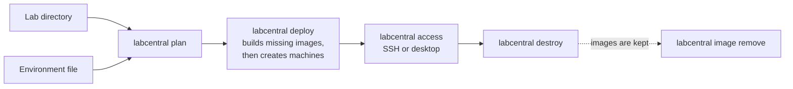
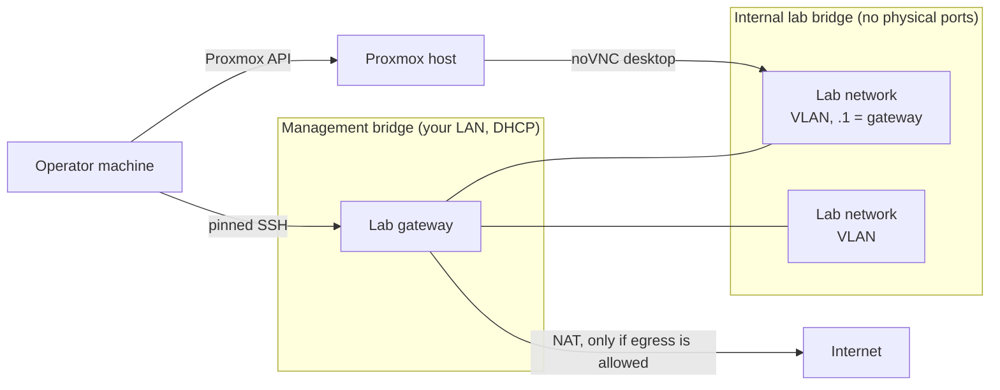

# Running labs with the CLI

This guide is for operators who run labs on their own AWS account or Proxmox cluster
with the `labcentral` command-line tool. To write labs, see
[Writing lab templates](templates.md); to run the web service for a class, see
[Running the hosted service](hosted.md).

- [Install](#install)
- [Configure an environment](#configure-an-environment)
- [AWS](#aws)
- [Proxmox](#proxmox)
- [Run labs](#run-labs)
- [State and recovery](#state-and-recovery)



## Install

Download the latest release from
[Releases](https://github.com/OutboundSpade/LabCentral/releases/latest). The operator
machine is Linux amd64; `labcentral-linux-amd64.tar.gz` holds `labcentral` and
`labcentral-provider`:

```sh
curl -fLO https://github.com/OutboundSpade/LabCentral/releases/latest/download/labcentral-linux-amd64.tar.gz
curl -fLO https://github.com/OutboundSpade/LabCentral/releases/latest/download/SHA256SUMS
sha256sum --check --ignore-missing SHA256SUMS
mkdir -p ~/.local/lib/labcentral && tar -C ~/.local/lib/labcentral -xzf labcentral-linux-amd64.tar.gz
export PATH="$HOME/.local/lib/labcentral:$PATH"
labcentral version
```

The CLI looks for the provider next to itself, so keep both binaries together.
`labcentral help COMMAND` shows usage and examples for every command.

The Windows and macOS downloads (`labcentral-windows-amd64.exe`,
`labcentral-darwin-arm64`, `labcentral-darwin-amd64`) are for validating templates;
running labs needs Linux. On a Mac, clear the download quarantine first with
`xattr -d com.apple.quarantine FILE` and `chmod +x FILE`.
`gh attestation verify FILE --repo OutboundSpade/LabCentral` proves a download was
built by this repository's release workflow.

To build from source instead, you need Go 1.27 (every pinned tool version is in
[tools/toolchain.json](../tools/toolchain.json)):

```sh
git clone https://github.com/OutboundSpade/LabCentral.git
cd LabCentral
make build
export PATH="$PWD/bin:$PATH"
```

## Configure an environment

An environment file describes where labs run: the target, base images, network
policy and the pinned build toolchain. Keep environment files and credentials outside
your lab repositories.

```sh
mkdir -p ~/.config/labcentral && chmod 700 ~/.config/labcentral
labcentral environment init ~/.config/labcentral/aws.yaml aws
# For Proxmox, use the guided setup below.
labcentral environment check --environment ~/.config/labcentral/aws.yaml
```

### Base images

`bases` binds the base names that labs use (such as `ubuntu-24.04`) to pinned images:

| Field | AWS | Proxmox |
| --- | --- | --- |
| `id`, `identity` | The AMI ID (both fields) | Template VMID, and its configuration digest |
| `user` | The image's default login user | The image's default login user |
| `diskGiB` | Root disk size | Root disk size |
| `os` | `linux` (default) or `windows` | `linux` |

Guests are Ubuntu 24.04 amd64, plus Windows Server 2022 on AWS.

### Build toolchain

`build` pins the toolchain. Install Packer 1.14.3, verify its published checksum, and
install exactly the pinned plugins into a dedicated directory:

```sh
export PACKER_PLUGIN_PATH="$HOME/.local/share/labcentral/packer-plugins"
packer plugins install github.com/hashicorp/amazon 1.8.1
packer plugins install github.com/hashicorp/proxmox 1.2.3
packer plugins install github.com/hashicorp/ansible 1.1.4
sha256sum "$(command -v packer)"
labcentral environment fingerprint-plugins "$PACKER_PLUGIN_PATH"
```

Then set:

- `build.packer` and `build.pluginDirectory` to absolute paths;
- `build.packerSHA256` and `build.toolchainID` from the commands above;
- `build.ansibleVersion: 2.19.3` and a `build.timeoutSeconds` limit.

`operatorCIDRs` lists the IPv4 ranges (/24 or narrower) allowed to reach lab gateways.

## AWS

Use a dedicated account with short-lived credentials (IAM Identity Center, an assumed
role, or IAM Roles Anywhere). Never put access keys in lab source.

1. Create the build network and the DCV licensing role once with
   [tools/aws-sandbox.yaml](../tools/aws-sandbox.yaml):

   ```sh
   aws cloudformation deploy --stack-name labcentral-build \
     --template-file tools/aws-sandbox.yaml --capabilities CAPABILITY_IAM \
     --parameter-overrides OperatorCIDR=203.0.113.10/32 AvailabilityZone=us-east-1a
   aws cloudformation describe-stacks --stack-name labcentral-build \
     --query 'Stacks[0].Outputs'
   ```

2. Copy the outputs into `build.subnetID`, `build.securityGroupID` and
   `aws.desktopProfile`.
3. Set `aws.account`, `aws.region`, `aws.zone`, `aws.profile` and an instance-type
   allowlist, for example `types: [{name: t3.medium, cpu: 2, memoryMiB: 4096}]`. Add
   `maxNICs` to a type to check multi-NIC machines offline; otherwise the provider asks
   AWS for the type's limit.
4. For Linux desktops, set `build.dcvURL` and `build.dcvSHA256` to the official Amazon
   DCV server archive for Ubuntu 24.04 and its published checksum.

**How labs are laid out.** Each lab gets its own VPC (`10.77.0.0/16` by default) with
one subnet, security group and route table per network. Machines have no public
addresses: a small gateway holds the lab's only public address, and all SSH, desktop
and check traffic is tunneled through it with host keys pinned on both hops. Configure
it with `aws.gateway: {base: ubuntu-24.04, instanceType: t3.micro}` (the defaults).
Set `aws.allowEgress: true` to let labs request Internet access.

**Permissions and costs.** The operator identity needs EC2 lifecycle permissions and
`iam:PassRole` for the DCV licensing role (restricted to `ec2.amazonaws.com`). Lab
machines get no AWS permissions; desktop machines get a license-only instance profile.
Instances, public IPv4 addresses, images and snapshots are billed while they exist.

### Windows guests

1. Resolve the current Windows Server 2022 AMI once and pin it:

   ```sh
   aws ssm get-parameter --name \
     /aws/service/ami-windows-latest/Windows_Server-2022-English-Full-Base \
     --query Parameter.Value --output text
   ```

2. Add a base with that ID as both `id` and `identity`, `os: windows`,
   `user: Administrator` and `diskGiB: 30`. Never store the parameter path itself.
3. Allow an instance type with at least 4 GiB of memory, and select it for builds with
   `build.instanceType` or the image's `platform.aws.buildInstanceType`.
4. For Windows desktops, pin the DCV server installer:

   ```yaml
   build:
     windowsDCVURL: https://d1uj6qtbmh3dt5.cloudfront.net/2025.0/Servers/nice-dcv-server-x64-Release-2025.0-20103.msi
     windowsDCVSHA256: 593e2b78cd41b64fac255f303e48b1e7f73129969279ba2eae067e519f962067
   ```

The build network needs Windows Update access so the built-in OpenSSH Server can be
installed. See [examples/windows-iis](../examples/windows-iis/README.md) for a small
mixed Windows and Linux lab.

## Proxmox

LabCentral sets up a fresh Proxmox VE 9 host for you with one command. Each lab then
runs on an internal bridge with no physical ports, behind its own small gateway VM, so
you don't need to route lab VLANs, run NAT or change the cluster firewall.



**Before you start**, run the CLI on a Linux amd64 machine that can reach the Proxmox
API *and* addresses on the management bridge (where gateways and build machines get
DHCP addresses). A VPN that only reaches the API is not enough; a small operator VM on
the same network works well. Install the CLI, Packer and the pinned plugins (see
[Build toolchain](#build-toolchain)), plus `xorriso`:

```sh
sudo apt-get install xorriso
```

You need Proxmox VE 9 with directory storage and a trusted API certificate (or pass
`--ca-file`).

1. **Run setup with an administrator token.** The admin token is used once and never
   stored:

   ```sh
   read -rsp 'Admin token secret: ' LABCENTRAL_PROXMOX_ADMIN_TOKEN; echo
   export LABCENTRAL_PROXMOX_ADMIN_TOKEN
   labcentral environment setup proxmox ~/.config/labcentral/proxmox.yaml \
     --url https://pve.example.invalid:8006 --admin-token-id 'admin@pve!setup'
   ```

   Setup shows its plan and asks for confirmation (`--yes` skips it). It:

   - detects the node, directory storage and management bridge;
   - picks free VMID, VLAN and address ranges;
   - creates a pool, a dedicated user with a scoped role and a read-only inventory
     role, and a runtime API token;
   - creates the internal lab bridge, applying only that network change;
   - builds a pinned Ubuntu 24.04 base template, installing the QEMU guest agent inside
     a temporary guest (no host shell access or snippets needed);
   - writes the environment file, the token file (mode 0600) and private ownership
     receipts next to it. Keep them together.

2. **Switch to the runtime token and check:**

   ```sh
   export LABCENTRAL_PROXMOX_TOKEN="$(cat ~/.config/labcentral/proxmox.yaml.token)"
   unset LABCENTRAL_PROXMOX_ADMIN_TOKEN
   labcentral environment check --environment ~/.config/labcentral/proxmox.yaml
   ```

Then deploy labs as usual (see [Run labs](#run-labs)).

**Re-running setup** is safe: it verifies ownership and reuses finished steps. Rerun it
if you install Packer or its plugins later, so their checksums get pinned. Override
detection with `--node`, `--storage`, `--management-bridge`, `--lab-bridge`, `--pool`,
`--vmid-start`, `--vlan-start`, `--cidr` and `--operator-cidr`. Setup refuses to touch
resources it doesn't own, overlapping allocations, or unrelated pending network
changes. `--insecure-skip-tls-verify` is for test endpoints only.

**How labs are laid out:**

- Each lab network gets its own VLAN (tags 2–4094) and /24 on the internal bridge,
  which has no physical ports, host address or uplink; LabCentral checks this.
- Each lab gets a gateway VM (1 CPU, 768 MiB) outside the author's inventory, with a
  DHCP address on the management bridge and `.1` on each lab VLAN. All guest SSH goes
  through it with both host keys pinned.
- The gateway drops forwarding by default and blocks private ranges (including your
  LAN), link-local, CGNAT, operator addresses and itself, so labs cannot reach your
  network.
- With `proxmox.allowEgress: true`, networks that request Internet access get a default
  route and NAT through the gateway; other networks get neither.
- Desktops use the Proxmox console (noVNC) through the API.

**Other settings:**

- `proxmox.cpuTypes` lists CPU models authors may request.
- `proxmox.gatewayBase` defaults to `ubuntu-24.04`.
- For static management addresses instead of DHCP, set
  `proxmox.managementAddresses: {cidr: 192.0.2.0/24, gateway: 192.0.2.1, dns: [1.1.1.1]}`
  and reserve that range for LabCentral.
- `build.bridge` (DHCP and Internet) is where image builds run; your operator machine
  must reach it too.

**To remove everything setup created**, destroy your labs and remove their images, then:

```sh
labcentral environment teardown proxmox ~/.config/labcentral/proxmox.yaml \
  --admin-token-id 'admin@pve!setup'
```

Teardown checks ownership, refuses while guests still use the pool or bridge, and
removes only what setup created (base template, seed and import files, bridge,
permissions, user and token, roles and pool). It restores storage content settings only
if nobody changed them since. An interrupted step stays unknown until its exact resource
is found or its deletion is confirmed; keep the receipts and rerun.

## Run labs

```sh
labcentral plan    DIR --environment ENV.yaml   # preview images, machines and costs
labcentral deploy  DIR --environment ENV.yaml   # build missing images, then deploy
labcentral list
labcentral inspect INSTANCE_ID
labcentral access  INSTANCE_ID MACHINE ssh
labcentral access  INSTANCE_ID MACHINE desktop
labcentral destroy INSTANCE_ID
labcentral image list
labcentral image remove IMAGE_KEY
```

- Commands that create or delete resources ask for confirmation; `--yes` approves them
  for automation, and `--json` prints versioned results and progress events.
- `access … desktop` prints a one-use URL on `127.0.0.1` and temporary guest
  credentials. Keep the command running while you use the desktop; Ctrl-C closes the
  session and removes the temporary account. To use a browser on another computer,
  forward the port over SSH rather than exposing it. If a Windows console opens blank
  or locked, use **Desktop → Send Ctrl+Alt+Del** in the DCV client.
- `labcentral config init` creates `~/.config/labcentral/config.json` (mode 0600) for
  default paths and concurrency limits. Flags override it, and it can never enable
  `--yes`.

## State and recovery

State lives in `~/.local/state/labcentral/v2` (or `--state DIR`): a SQLite journal,
provider journals and per-lab SSH keys. Back them up together. One state root owns each
allocation range; do not point two operators at the same target ranges.

```sh
labcentral recover INSTANCE_ID        # finish an interrupted deploy or destroy
labcentral image builds               # list unfinished image builds
labcentral recover build:IMAGE_KEY
labcentral image abandon IMAGE_KEY    # remove an unpublished build attempt
```

There is no background cleanup: resources keep running, and costing money, until you
destroy them. `destroy` keeps images; `image remove` refuses images that a retained lab
still uses.


A failed command does not mean its native request failed. After a timeout or lost
connection, use the original state directory and `recover`; do not start a replacement
with a new state directory or delete journal files. Recovery discovers the original
owned resource. An explicit authorization/validation rejection, documented EC2 launch quota/capacity
denial, or throttle can be
submitted again; an uncertain create with no authoritative result stays
`recovery_required`, with its allocation and cleanup intent retained.

`ownership_mismatch` means a recorded native object, attached disk/NIC, guest account
or desktop session no longer has the expected owner. Cleanup retains it. Inspect the
exact recorded identity in protected local state and compare its native markings;
restore a marking only when independent evidence establishes that it is still yours.
Never fix this by deleting a same-named object. Confirmed absence completes cleanup;
a running Proxmox task or an AWS object still deleting requires another recovery after
its native operation settles.

`recover INSTANCE_ID` also finishes uncertain desktop grants and revocations. Guest
revocation records a generation tombstone before cleanup, preventing delayed commands
from reopening the retired access. Reopening a provider-expired desktop first confirms
retirement and uses a fresh generation; a saved successful launch alone does not
authorize reuse. Recovery also retires a replacement grant that was saved but never
reached the guest, without revoking a different active generation.
A second client waits behind the instance/image
and provider fences; stop the original controller before restoring state elsewhere.
Image recovery qualifies a captured image on disposable guests, or cleans an incomplete
attempt and asks for `image abandon` before a fresh build. Abandonment cannot release
identifiers while an unknown native create remains unresolved.

Proxmox VM removal can succeed while its native task only warns about a disk free
failure. LabCentral records disk IDs before deletion and checks storage afterwards.
It keeps the VMID allocation if a disk remains. The runtime token intentionally lacks
`Datastore.Allocate`, which Proxmox requires to delete an orphan image volume through
the storage API. An administrator can inspect the exact recorded volume, verify its
native VMID owner and the VM's absence, remove that volume, then rerun recovery. An
unrecorded volume or a changed native owner is retained for investigation; cleanup
never enables “destroy unreferenced disks” or removes a volume just because its name
contains a VMID.
