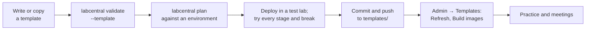

# Writing lab templates

A lab template is a directory that describes a hands-on lab: the machines students
work on, how their images are built, what students read, and the private material
instructors use to break, check and teach. LabCentral validates the directory, builds
its images once, and runs as many copies as a class needs.

This guide covers everything an author needs. The fastest way to start is to copy
[examples/starter-template](../examples/starter-template/) and change it.

- [The format](#the-format)
- [Quick start](#quick-start)
- [Directory layout](#directory-layout)
- [lab.yaml: machines and images](#labyaml-machines-and-images)
- [Image builds](#image-builds)
- [Windows machines](#windows-machines)
- [README.md: the student handover](#readmemd-the-student-handover)
- [instructor.yaml: teaching material](#instructoryaml-teaching-material)
- [Guest programs](#guest-programs)
- [Checks](#checks)
- [Breaks and reset](#breaks-and-reset)
- [Stages](#stages)
- [Scenarios](#scenarios)
- [Coach-only templates](#coach-only-templates)
- [Validate, test and publish](#validate-test-and-publish)
- [Limits](#limits)

## The format

Templates use **format version 3**, declared as `version: 3` at the top of both
`lab.yaml` and `instructor.yaml`. The machine-readable contracts are generated from
the code:

- [schemas/lab-v3.json](../schemas/lab-v3.json) for `lab.yaml`
- [schemas/instructor-v3.json](../schemas/instructor-v3.json) for `instructor.yaml`

Most editors can use these schemas for completion and inline errors. With the YAML
language server (VS Code's YAML extension), add a comment such as
`# yaml-language-server: $schema=../../schemas/lab-v3.json` at the top of the file,
pointing at the schema's path relative to it.

Version 3 is the stable format. New optional fields may be added to it; anything that
would change the meaning of an existing template gets a new version number. Older
versions are not accepted. The parser is strict: unknown or duplicate keys, YAML
anchors and aliases, multiple documents, unsafe paths, symlinks, hidden files and
missing files are errors, each reported with a field path such as
`stages[2].completion.check`.

## Quick start

Validating a template needs only the `labcentral` CLI: download it for Windows, macOS
or Linux from [Releases](https://github.com/OutboundSpade/LabCentral/releases/latest)
(see [Install](operators.md#install)). No cloud account or environment file is needed.

```sh
cp -r examples/starter-template templates/my-lab
$EDITOR templates/my-lab/lab.yaml        # rename the lab, change machines
labcentral validate --template templates/my-lab
labcentral plan --template --environment ~/.config/labcentral/aws.yaml templates/my-lab
```

`validate` checks the files exactly as the hosted importer will. `plan` also checks
the template against a real environment (instance sizes, platform features) without
creating anything. To try it for real, `labcentral deploy` it in a test environment,
then commit it to your template repository and import it from **Admin → Templates**.

## Directory layout

A template is one directory, for example `templates/my-lab/`:

| Path | What it holds | Students see it | Used by image builds |
| --- | --- | --- | --- |
| `lab.yaml` | Machines, networks and image builds | Yes (downloadable) | Yes |
| `images/` | Build playbooks or scripts and the files they install | Yes (downloadable) | Only files listed in `build.files` |
| `README.md` | The student handover, shown on the template's page | Yes | Only if listed in `build.files` |
| `instructor.yaml` | Stages, answers, checks, breaks and scenarios | Never | Never |
| `instructor/` | Programs for checks, breaks and reset | Never | Never |

Any other files you add are portable source, like `images/`. The `images/` and
`instructor/` names are conventions; paths are whatever your files reference.

LabCentral removes `instructor.yaml` and `instructor/` before building images or
giving students anything. Put answers, solutions and break programs only there.

The directory name is the template's identity in the library. Names are shown
humanized: `dns-recovery` appears as "DNS recovery".

## lab.yaml: machines and images

```yaml
version: 3
name: starter-template
description: Keep a small company website online and find out why it stopped.
images:
  web:
    base: ubuntu-24.04
    build: {playbook: images/web.yml, files: [images/web.yml]}
  workstation:
    base: ubuntu-24.04
    build: {playbook: images/workstation.yml, files: [images/workstation.yml]}
machines:
  web:
    image: web
    cpu: 2
    memory: 2Gi
    disk: 20Gi
    access: [ssh]
  workstation:
    image: workstation
    cpu: 2
    memory: 4Gi
    disk: 20Gi
    access: [ssh, desktop]
```

`name` is lowercase letters, digits and hyphens. `description` is the one-line
summary shown on library cards.

### Images

- `base` names a base image. The operator's environment binds it to a pinned AMI or
  Proxmox template, so templates never contain cloud image IDs.
- `build.playbook` (Linux) or `build.script` (Windows, see
  [Windows machines](#windows-machines)) runs inside a temporary build machine; use
  exactly one. Omit `build` to use the base unchanged (fine for SSH-only machines).
  Desktop machines need a build, because LabCentral installs the platform's desktop
  software during it.
- `build.files` lists the source files copied into the build. Only these files affect
  the image's identity, so editing the README or instructor material does not trigger
  a rebuild. Always list them; when omitted, every portable file is used.
- Runtime settings (networks, NICs, platform options) and operator settings that don't
  affect builds never cause a rebuild.

### Machines

- `cpu`, `memory` (`Mi`/`Gi`) and `disk` are minimums. On AWS the planner picks the
  smallest allowed instance type that fits.
- `access` is any of `ssh` and `desktop`. Students open desktops in the browser.
- `hostnamePeers` controls which machines appear in each guest's `/etc/hosts`: `all`
  (the default), a list of names, or `[]` for none. Machine names resolve to their
  private lab addresses.

### Networks and Internet access

Without a `networks` section, a lab has one private network named `lab` and every
machine has one NIC on it. A machine can pin its host address with
`nics: [{network: lab, address: 20}]` (offsets 4–250); the others are numbered from 11
in name order.

Networks are isolated from each other. To connect two, add a machine with a NIC on
each and `forwarding: true`:

```yaml
networks:
  clients: {egress: internet}
  servers: {}
machines:
  router:
    image: ubuntu
    cpu: 2
    memory: 2Gi
    disk: 20Gi
    forwarding: true
    nics: [{network: clients, address: 10}, {network: servers, address: 10}]
    access: [ssh]
```

- A machine's first NIC is its management address for SSH, desktops and checks.
- A peer's hostname resolves to its address on the first network the two machines
  share, or to its first-NIC address if they share none.
- The planner adds static routes through routers, including chains of routers. Two
  routers joining the same pair of networks, or a cycle, is rejected.
- On AWS, a network may set its own private `cidr`; all networks must fit in one /16.
  Proxmox assigns ranges itself and rejects author CIDRs.

Internet access is off by default. `egress: internet` on a network requests it, and the
operator must also allow it (`aws.allowEgress` or `proxmox.allowEgress`). It is general
Internet access with private ranges blocked, not a URL allowlist. Image builds have
their own network and are not affected.

### Inputs

Inputs are typed values passed to image playbooks as Ansible variables:

```yaml
inputs:
  welcome_message: {type: string, default: Welcome!, description: Shown on the home page}
  worker_count: {type: integer, default: 2}
  debug: {type: boolean, required: true}
```

Types are `string`, `integer` and `boolean`. Inputs are recorded in plans and build
records, so never use them for secrets.

### Platform options

Authors can request platform-specific settings. They refine how a platform realizes a
machine but never change its topology or access. Each platform ignores the other's
block, and the operator's environment decides what is allowed.

```yaml
images:
  server:
    base: ubuntu-24.04
    build: {playbook: images/server.yml}
    platform:
      aws: {buildInstanceType: t3.large}
machines:
  server:
    image: server
    cpu: 2
    memory: 4Gi
    disk: 32Gi
    platform:
      aws:
        instanceType: t3.large
        volume: {type: gp3, iops: 4000, throughput: 500}
        cpuCredits: standard
      proxmox: {cpuType: host, nicModel: virtio, memoryBalloon: false}
```

| Option | Allowed values |
| --- | --- |
| `machines.*.platform.aws.instanceType` | A type from `environment.aws.types` that satisfies the CPU and memory request |
| `machines.*.platform.aws.volume` | `type: gp3`; `iops` 3000–16000 (at most 500 × disk GiB); `throughput` 125–1000 MiB/s (at most IOPS ÷ 4) |
| `machines.*.platform.aws.cpuCredits` | `standard` or `unlimited`, burstable types only |
| `images.*.platform.aws.buildInstanceType` | A type from `environment.aws.types`, used for the build and its validation machine |
| `machines.*.platform.proxmox.cpuType` | A CPU model listed in `environment.proxmox.cpuTypes` (`host` enables nested virtualization) |
| `machines.*.platform.proxmox.nicModel` | `virtio`, `e1000`, `e1000e`, `vmxnet3` or `rtl8139` |
| `machines.*.platform.proxmox.memoryBalloon` | `true` or `false` |

`platforms: [aws]` at the top level restricts a lab to the listed platforms.

### Extensions

`extensions` holds your own data on the lab, networks, images, machines and (in
`instructor.yaml`) on checks, breaks and stages. Keys must be namespaced
(`org.example.scoring`) and values can be any JSON, up to 64 KiB per file. LabCentral
stores them unchanged, passes lab and image extensions to image builds as
`labcentral_extensions`, and gives guest programs a copy in `labcentral/context.json`.
It never interprets them, and they are not a place for secrets.

```yaml
extensions:
  org.example.course: {unit: 3, track: blue-team}
```

## Image builds

Linux images are built by ordinary Ansible playbooks that run **inside** the build
machine, never on the operator's computer:

```yaml
- name: Build the company web server
  hosts: localhost
  connection: local
  become: true
  tasks:
    - name: Install the web server
      ansible.builtin.apt:
        name: [nginx, curl]
        state: present
        update_cache: true
```

- Always use `hosts: localhost` and `connection: local`.
- Install everything the lab needs at build time. Running labs have no Internet access
  unless a network requests it.
- Inputs and `labcentral_extensions` are available as variables.
- Training accounts and passwords belong to the lab, not to any real system. Use
  obviously synthetic passwords, say so in the handover, and store only hashes in
  playbooks.
- Keep a pristine copy of anything your reset needs to restore (for example under
  `/usr/local/share/<lab>/`), because breaks and students change the live copy.

## Windows machines

Windows Server 2022 machines run on AWS. Declare the image's OS and build it with a
PowerShell script instead of a playbook:

```yaml
platforms: [aws]
images:
  iis:
    base: windows-2022          # the operator binds this to a Windows AMI
    os: windows
    build: {script: images/iis.ps1, files: [images/iis.ps1]}
machines:
  server:
    image: iis
    cpu: 2
    memory: 4Gi
    disk: 30Gi
    access: [desktop, ssh]
```

- The build script runs inside the temporary Windows build machine, from
  `C:\ProgramData\LabCentral\build\` where the selected files are copied (keeping their
  relative paths). `$env:LABCENTRAL_INPUTS` names a JSON file with the lab's inputs.
  Start scripts with `$ErrorActionPreference = 'Stop'` so any error fails the build.
- Windows machines need at least 4 GiB of memory and a 30 GiB disk, have exactly one
  NIC, cannot be routers (`forwarding`), and have names of at most 15 characters.
- `access: [desktop, ssh]` gives students one desktop console and PowerShell over SSH.
  Only one person can use a Windows desktop at a time. In hosted meetings, teammates
  explicitly take over the console after the current grant is revoked. Saved files
  in the shared `lab` profile remain; running applications end during handoff.
  Checks and reset must tolerate that shared workspace and preserve student files.
- Private programs for Windows machines are PowerShell scripts too; see
  [Guest programs](#guest-programs). A lab can mix Windows and Linux machines.

[examples/windows-iis](../examples/windows-iis/README.md) is a complete small example.

## README.md: the student handover

`README.md` is required for hosted templates. It is shown on the template's page and
in the lab as the "Environment handover". Write it for the student starting the lab:

- the scenario in a few sentences and what "working" looks like;
- machine names, URLs and how to sign in (synthetic credentials only);
- what to record as evidence.

Never include answers, solutions or details of the breaks.

## instructor.yaml: teaching material

```yaml
version: 3
visibility: {audience: students}
practice: {desktopMachine: workstation}
library:
  category: Getting started
  difficulty: beginner
  estimatedMinutes: 20
  tags: [Linux, web, nginx]
notes: |
  Private notes for instructors.
reset:     [...]
checks:    [...]
breaks:    [...]
stages:    [...]
scenarios: [...]
```

| Field | Required | Meaning |
| --- | --- | --- |
| `version` | Yes | `3` |
| `visibility.audience` | Yes | `students`, or `coaches` for instructor-only templates |
| `visibility.hiddenMachines` | No | Coach templates only; see [Coach-only templates](#coach-only-templates) |
| `practice.desktopMachine` | With stages or scenarios | A visible machine with `desktop` access |
| `library` | No | `category` (1–80 bytes), `difficulty` (`beginner`, `intermediate`, `advanced`), `estimatedMinutes` (1–1440), up to 12 `tags` |
| `notes` | No | Private Markdown instructor notes (shown to admins) |
| `reset` | With breaks | Guest steps that restore the baseline |
| `checks` | No | Scored service checks |
| `breaks` | No | Problems instructors and scenarios apply |
| `stages` | No | What students work through |
| `scenarios` | No | Random combinations of breaks for self-paced practice |
| `extensions` | No | Namespaced author data |

IDs for checks, breaks, stages, scenarios and variants are lowercase letters, digits
and hyphens, start with a letter and are at most 48 characters. `reset` and `check` are
reserved.

## Guest programs

Checks, breaks and reset are lists of **steps**. Each step runs one private program
from `instructor/` on one machine: a `playbook` for Linux machines or a `script`
(PowerShell) for Windows machines.

```yaml
steps:
  - machine: web
    playbook: check-service.yml       # a path under instructor/
    files: [lib/common.yml]           # optional: more files from instructor/
    assets: [images/site.conf]        # optional: portable files from the lab source
    guestHosts: [workstation]         # optional: other machines' addresses and SSH host keys
    timeoutSeconds: 120               # optional: 10–600, default 90
  - machine: server                   # a Windows machine
    script: check.ps1                 # a PowerShell script under instructor/
```

How a step runs:

1. LabCentral connects to the machine over its private management path and copies
   the playbook, `files`, `assets` (under `template/`) and generated context (under
   `labcentral/`) into a fresh private temporary directory.
2. It runs the program inside the guest with that directory as the working directory:
   `ansible-playbook` as root on Linux, or the script on Windows with
   `$env:LABCENTRAL_STEP_DIR` pointing at the directory. Only one guest program runs on
   a machine at a time.
3. The step **passes** when the program succeeds and **fails** when a playbook task
   fails or a script exits with a nonzero code.
   Anything else (a playbook syntax error, a timeout, a lost connection) is an
   **unknown** outcome: a check reports it as unavailable, and a break or reset is
   never assumed to have failed. Run `ansible-playbook --syntax-check` on your
   playbooks before importing.
4. The temporary directory is deleted. Output is not shown to students.

Generated files available to a step:

| Path | Contents |
| --- | --- |
| `labcentral/context.json` | `machine`, plus lab, template and owner `extensions` |
| `labcentral/hosts.json` | For `guestHosts`: each machine's `address` and SSH `publicKey` |
| `template/<path>` | Each requested `assets` file |

Paths under `labcentral/` and `template/` are reserved; your own files cannot use them.

Write guest programs so they are **safe to repeat**: a check must not change the
machine, and reset and breaks must give the same result if run twice.

## Checks

```yaml
checks:
  - id: service
    name: Web service running
    points: 50
    steps:
      - {machine: web, playbook: check-service.yml}
```

A check passes when all its steps pass. Checks are used three ways: instructors run
them (or schedule them) during meetings for the scoreboard, stages use them to verify a
student's repair, and scenarios use them to confirm recovery. `points` is 1–100.

Make each check test one observable outcome, and keep checks independent: in the
starter, `homepage` reads the page file, so it still gives the right answer when the
web service is stopped.

## Breaks and reset

```yaml
reset:
  - {machine: web, playbook: reset.yml}
breaks:
  - id: stop-web
    name: Web service stopped
    description: Stops nginx without changing its configuration.
    walkthrough: Run systemctl status nginx, then start nginx and check http://web/.
    steps:
      - {machine: web, playbook: stop-web.yml}
```

- **Reset** restores the healthy baseline. It runs once before breaks are applied. It
  must not delete student files, notes or logs.
- A **break** changes only what it is about and should confirm it took effect (the
  starter's `stop-web.yml` checks that nginx is inactive). It must not reset the lab or
  undo another break, so that breaks can be combined.
- `notes` and break `walkthrough` render as Markdown in the admin-only Instructor notes
  panel and the meeting Exercises panel. Use headings, ordered steps and fenced command blocks; raw HTML is disabled.
  Walkthroughs expand separately. Keep the on-page instructions self-contained: private
  source files are not downloadable from that panel.
- `description` is a short summary for instructors; `walkthrough` is the private fix,
  shown to instructors in the meeting's Exercises panel.

In meetings, instructors choose a break and the teams to apply it to. Personal
scenario attempts apply breaks automatically (see [Scenarios](#scenarios)).

## Stages

Stages are the steps students work through, one at a time:

```yaml
stages:
  - id: find-server
    title: Read the handover
    instructions: Connect to the web server with `ssh student@web`.
    prompt: Which web server software is running on the web machine?
    solution: Run `systemctl status nginx`; the server is nginx.
    completion:
      answer: {accepted: [nginx], caseSensitive: false}
```

Each stage has exactly one `completion`:

| Completion | Kind | Done when |
| --- | --- | --- |
| `answer: {accepted: [...], caseSensitive: false}` | Answer | The student's answer matches one of 1–10 accepted values (leading/trailing spaces ignored) |
| `check: <check id>` | Checked automatically | The named check passes on the student's lab |
| `instructor: true` | Instructor | An instructor marks it done |

- `instructions` is Markdown (up to 6000 bytes). `prompt` is the question shown with
  an answer box.
- `solution` is optional and private; students see it only by choosing to reveal it.
- `break: <break id>` links a recovery stage to the break it fixes. Linked stages appear
  only when that break is applied (in a meeting or a scenario), never in baseline
  practice.

**Baseline practice** is the self-paced path through a template's healthy lab. It
includes every stage that has an answer or check and no `break`. Stages completed by
an instructor are for meetings only.

## Scenarios

A scenario gives students a fresh lab with a random combination of breaks:

```yaml
scenarios:
  - id: website-outage
    title: Website outage
    description: Something is wrong with the company website. Find it and fix it.
    difficulty: beginner
    estimatedMinutes: 20
    variants:
      - {id: stopped, compatible: true, breaks: [stop-web], stages: [restore-service]}
      - {id: defaced, compatible: true, breaks: [deface-homepage], stages: [restore-homepage]}
      - id: both
        compatible: true
        breaks: [stop-web, deface-homepage]
        stages: [restore-service, restore-homepage]
```

- A scenario has 2–32 variants, each with a different set of 1–8 breaks, applied in the
  listed order.
- `stages` lists the recovery stages for exactly those breaks: every selected break
  needs a stage with `break:` set to it and a `check` completion.
- `compatible: true` is your statement that you tested this combination: reset once,
  then every listed break, then each recovery check fails until fixed.
- Scenarios require a `reset`, and run only in a cloud workspace.

Each attempt picks one variant at random. Students see the scenario's title and
description, never which breaks were chosen.

## Coach-only templates

Set `visibility.audience: coaches` for templates only instructors should see (for
example, an incident with a controlled attacker machine). Coach templates can list
`visibility.hiddenMachines`, which are not shown on the template's page.

Coaches can make private personal attempts from coach-only revisions; students cannot
browse or start these attempts. Hosted UI controls for coach-only practice are pending.
Include at least one stage without a `break` for baseline practice (for example, a
healthy-state check), alongside scenario recovery stages.

Hidden machines must not leak into visible ones. Validation requires visible images to
list `build.files` explicitly (excluding `lab.yaml` and hidden machines' playbooks),
visible machines to set explicit `hostnamePeers` that exclude hidden machines, and
`guestHosts` on visible machines to exclude hidden ones. Validation checks structure,
not file contents, so also review what each visible image installs.

## Validate, test and publish



1. **Validate.** `labcentral validate --template DIR` checks both files, every
   referenced path and every cross-reference, with the same rules the hosted importer
   uses.
2. **Plan.** `labcentral plan --template --environment ENV DIR` checks sizes and
   platform features against a real environment without creating anything.
3. **Build and deploy in a test environment.** `labcentral deploy` builds images and
   starts the lab. Open the desktop, follow your handover, and confirm each stage works.
4. **Test every break.** For each break and each scenario variant: run reset, apply the
   breaks, confirm the related checks fail, repair as a student would, confirm they
   pass. Then destroy the test lab and remove its images.
5. **Publish.** Commit the directory under `templates/` in your template repository and
   push. In **Admin → Templates**, choose **Refresh from GitHub**, then **Build images**
   on the new revision. Each import pins that commit; meetings and attempts keep the
   revision they started with.

A template with an error is reported in Admin → Templates with its field path and does
not block other templates.

Before publishing, check:

- [ ] `README.md` explains the scenario, machines and synthetic sign-in, with no answers.
- [ ] Every image lists `build.files`, and nothing private is in `lab.yaml` or `images/`.
- [ ] Reset restores everything breaks change, without touching student work.
- [ ] Each break confirms it took effect and leaves other breaks alone.
- [ ] Checks don't change the machine and test one outcome each.
- [ ] Every scenario variant was tested end to end.

## Limits

| Item | Limit |
| --- | --- |
| Checks, breaks, stages | 20 each |
| Scenarios | 12; 2–32 variants each; 1–8 breaks and 1–20 stages per variant |
| Steps per check, break or reset | 1–8 |
| Step timeout | 10–600 seconds (default 90) |
| Files per step | 64 `files`, 20 `assets` (assets up to 1 MiB total) |
| Instructor files | 1 MiB total |
| `points` | 1–100 |
| Stage `instructions` / `solution` / `prompt` | 6000 / 6000 / 1000 bytes |
| Accepted answers | 1–10 values, each up to 1000 bytes |
| Break `description` / `walkthrough` | 6000 / 32000 bytes |
| `notes` | 32000 bytes |
| Scenario `description` | 2000 bytes |
| Library tags | 12, each up to 48 bytes |
| Extensions | 64 KiB per file |
| Network host offsets | 4–250 |
