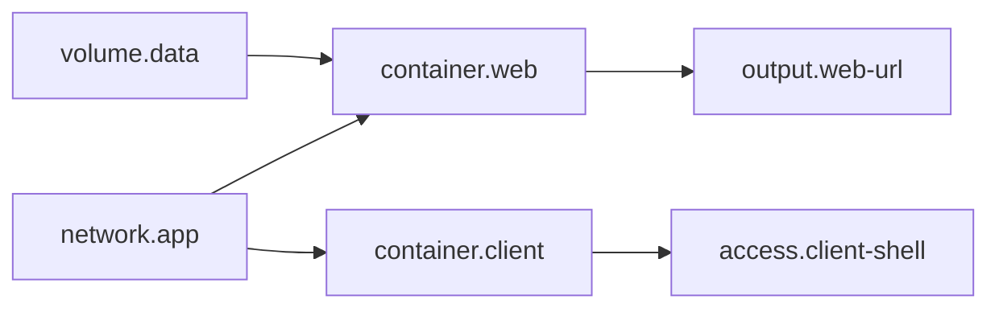

# Example A — Docker laptop lab

This beginner bundle creates a user-defined Docker network, a persistent volume containing SQLite, a digest-pinned Python web container, and a digest-pinned curl client container. Each web request records a visit in SQLite and returns a small JSON response. The web service is published to a provider-selected loopback host port. Local setup is `labd` in no-auth/loopback mode with SQLite/filesystem storage and a Docker Engine target; no production Node.js or external broker is required.

## Bundle layout

```text
bundle.yaml
lab.yaml
README.md
resolved.json
```

## Graph and operation



Required capabilities are native containers, a user-defined isolated segment, persistent volume, host port publication, container exec, IPv4/provider IPAM, create/start/stop/recreate/destroy. Plan sequence: reserve quota → create network and volume in parallel → create/start containers in parallel → resolve port/output → ready. Destroy reverses it, attempts every branch, then network/volume subject to retention policy.

Normal Docker isolation is not safe for arbitrary hostile code. Docker Desktop networking differs from a Linux host bridge. This example combines a loopback-published service with `egress.mode: deny`; the thin provider cannot prove both properties with its portable Engine-only baseline, so it uses a normal user-defined bridge only after an explicit trusted-laptop acknowledgement. The plan, API, and UI keep a persistent warning that denied egress is degraded and not enforced. The Docker socket is host-equivalent privilege and must never be mounted into either container.
