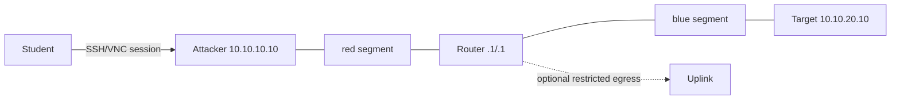

# Example B — routed cybersecurity lab

The attacker and target occupy separate isolated L2 segments; only the router joins both. The target has no external NIC. Optional controlled egress adds a third router NIC and is implemented by guest firewall/NAT provisioning plus provider network policy. User access targets only the attacker.

Inferred graph: networks → attached VMs → access/output; image and provisioning ArtifactRefs are validated prerequisites. With controlled egress false, the `uplink` resource and router NIC are omitted deterministically. Create networks in parallel, create/provision VMs after their networks/images, establish baseline snapshots after readiness, then expose attacker access. Reset restores the compatible baseline snapshot; if provider snapshot mode is unavailable, validation fails because this template requires it.

Proxmox can realize the intended topology when approved bridges/VLAN/SDN, storage snapshots, three NICs, and QEMU templates are discovered. KubeVirt can when Multus/NAD/CNI/CSI snapshot capabilities satisfy L2/static addressing and policy. AWS can approximate routed L3 subnets/ENIs but does **not** satisfy the declared L2 requirement without revising the template. Docker, Fly, and Kubernetes without KubeVirt fail VM isolation.

Example Fly failure: `missing_capability` at `spec.requirements.capabilities[0]` (`workload.vm.native` unsupported), plus `network.semantics.l2` and `network.interface.max>=3`; no provider validation or mutation occurs. Example AWS failure: `network.semantics.l2` unsupported; suggest an explicitly different L3 template revision, never silent degradation.

